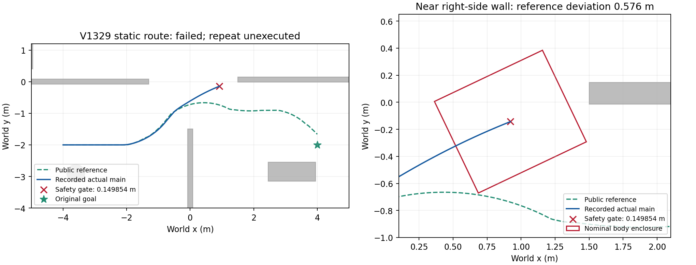

# V1329 完整静态MPPI失败与V1331公共地图资格

V1329 NOT_PASSED，首安全门停止。左右组件已通过不代表8米整路通过；RP-CCR V1281固定动态24/24证据保持，不受本次基线失败改写。

|项目|实际结果|
|---|---|
|原任务|WE(-4,-2,0)→(4,-2)，原19静态、actor OFF、seed10060001|
|控制器|同V1326逐字节参数，V931可执行投影＋V1319持续采样；工程适配MPPI|
|实际积分|12165精确：12164常规状态＋1单独失败状态；failedtime/dt/rootguard/physical count/journal交叉一致|
|模型初始化|规范车辆1次；内部模型构造次数未知|
|私有MuJoCo/训练|0/0；Nav2内部运动学采样另计，不报为MuJoCo积分|
|最低实际净空|0.1498536434419533m，违反原0.15m门|
|接触|0；安全距离失败不等于碰撞|
|剩余目标距离|3.595315765743319m|
|worker墙钟|127.254581s；实际仿真121.65s，未包含未执行的重放，不作实时证明|
|尾段/重放/重复|完整停车未执行；自身重放未执行；static_repeat未执行|

原RESULT的new_actual_native=null/inflight标记保留。V1330不改原结果，通过五个独立保存计数见证补充精确导航12165。有限记录状态/时间/控制幅值与速率/全部接触/源SHA均独核通过；安全失败、无完整尾、无重放照实列为不通过，不将审核当成功。

## 保存态诊断

可复现命令：`python -B experiments/v1330_static_failure_closure/diagnose.py --assert-safe`。约0.9秒稳定返回REPRODUCED_NATIVE_CLEARANCE_FAILURE，无模型积分；省略参数生成完整分账。末点距公共中心参考0.576033m、航向相差约0.446rad；最近公共参考名义整车净空0.413374m。最近障碍为公开静态rectangle3。实际转弯后未及时回到向下参考，不能将这次失败说成参考本身无安全空间。

最后一帧测距端点的名义车框距离0.221979m；同姿态公开完整静态边界距离0.139892m。名义车框比真实当步足迹略保守，所以不要把它与实际0.149854m混为同一数值。该差异支持检查scan-only占据表示；未保存优化器轨迹和累计costmap，不能断言这一个因素唯一导致偏离，也不能排除预测动力学/路径critic作用。

## 已完成的下一步：公共静态地图软件资格

核查当前RP-CCR使用原公开19实体几何，而历史RPP/MPPI local_costmap只由同32线有噪测距建立。V1300/V1329是工程pilot，不支持信息等价的优势比较。V1331从`experiments/v855_renewal_worker/KNOWN_FIELD.json`生成相同公开地图，未使用actor真值、未来轨迹或失败态来修改地图。保守5cm cell与原边界相交即占据，原15cm控制足迹padding和32线实时scan不变；控制器参数全部不变。未来各方法须同公共地图和传感权限。

10529实体边界样本覆盖与PGM/OccupancyGrid上下行方向回读通过；最初浮点边界相切断言失败按1e-12保守包含修正，原错误已登记。真实安装Nav2静态层加载240×240地图；独立读取真实costmap在世界(2,.06623069)障碍单元为100。两个固定软件动作全过：t0有25条合法指令；原近失败保存态7条零指令，FollowPath status6/error104拒绝。0新物理模型/积分；拒绝不等于已经验证实际刹停或整路成功。

下一关是同公开地图的完整静态主及成功重复，另批冻结和有界执行；原V1329首失败封账及原截止不变，不自动重试。静态完整资格后再条件动态基线、统一预算比较、闭环消融；PRIEST仍未实际复现，不能填入已完成主表。论文路线见paper_ras/ROADMAP_20261118.md。

## 来源与存储

V1329 sourcefreeze7103不变、原REVIEW_PENDING字节恢复、执行锁空闲；Stage/实机/训练0。完整失败原件30成员/27710971逻辑字节，分12个≤1MiB压缩块；仅全部GitHub回读SHA、逐成员与恢复核验后按清单清理。备份状态以records/v1329_static_route_20261118/FULL_REMOTE_VERIFIED.json为准；不碰旧V1300未完整核验raw。

7103项是历史广域完整性清单，包含2100项本地旧输出/缓存，不等于全部为当前运行依赖或已全部上传；本轮不清理这些原件，差集见BROAD_FREEZE_LOCAL_ONLY_INVENTORY.json。当前软件20项直接依赖、必要插件二进制/manifest和新源单独纳入Git；全冻结SHA复核通过。原始日志空白原样保留，代码diff检查与日志分开。

源码/报告提交f0bb243bae7d5365163583947be9888642bd9610已push且远端HEAD核对。新Release上传在API标签查询EOF中断，15项仅6个分块上传，未下载验证/未发布/未恢复测试；原始证据和全部传输分块保留，无清理。详见DELIVERY_STATUS.json，不重复upload/push旧操作。
