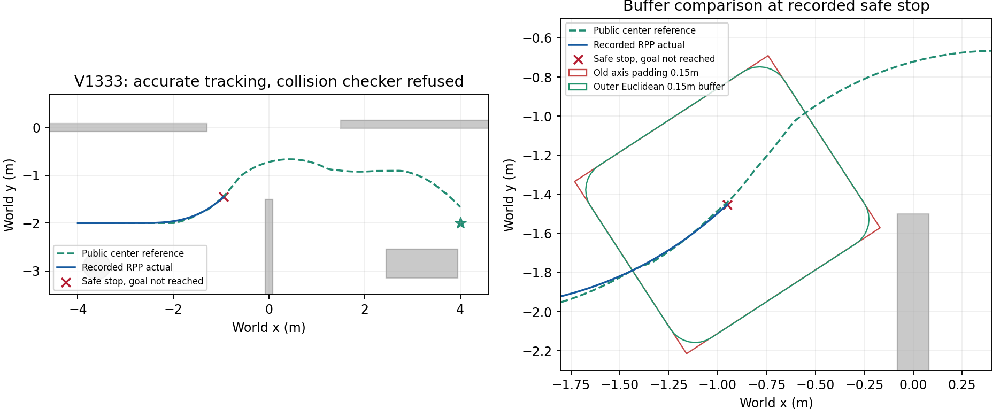

# V1332–V1336 公共地图基线推进

本轮完整静态导航尚未通过。RP-CCR V1281原固定动态24/24保持；当前在补公平的控制器基线，不回退或改写RP-CCR旧成功。

## 实际物理分账

|阶段|结果|导航原生|自身重放|完整证据|
|---|---|---:|---:|---|
|V1332 MPPI主|FollowPath NoValidControl104，原supervisor提前结束native|5495精确|0|终态及初始化保留，完整轨迹缺失，不认证全部物理门|
|V1332 MPPI重复|未执行|NA|NA|不算失败执行样本|
|V1333 RPP主|NoValidControl104后完整停车，目标未达|3460|3460|完整保存，物理/控制/自体/接触/重放门通过|
|V1333 RPP重复|未执行|NA|NA|不自动刷重复|

合计新导航8955精确、完整自身重放3460；规范Vehicle2次、内部模型构造总数未知、私有MuJoCo/训练0。MPPI最低净空/完整接触总量未知，不能拿RPP最小值当整批最小值。MPPI最终tick5495与time54.95一致；冻结代码在FINAL_PACKET后没有新实际积分，终态已停稳，但完整trace/RESULT未落盘，所以仍是证据缺失。

RPP最低实际0.3148995667394884m、badcontact0，目标剩4.98029347863752m，最大参考距离0.03867852483641107m、均值0.008791538471791985m；完整200停车尾、分配记忆/控制和全状态ctrl/mocap/contact自身重放最大误差0，12个物理/来源门全部真，而3个功能到达门假。不能把安全停住当导航成功。

## 操作缺陷已修复并在真实退出中验证

V1332原driver的`any(child.returncode != 0)`在ROS正常功能拒绝退出1时立即杀native，导致停车/保存交接不完整。这是本轮实现错误，原source/COMPLETION保持。V1333新操作源把明确status6/code104且有公共地图receipt的功能拒绝作为drain，允许已有native停车/保存/重放；意外退出、无地图、原生安全异常仍abort。SIGTERM进入原finally保存，控制律不变。提取原生产AST重现误杀，11个生产policy场景通过；V1333真实RPP拒绝后确实保存3460+3460完整记录，修复不止单元检查。

V1333仅接未执行RPP两任务，不重跑MPPI；沿V1332原21:43:12.146555与boot/monotonic截止，不延长。首次RPP功能失败后已闭，未启动新物理候选。当前guard原字节恢复/锁空闲。

## 零模型排除一个假设

V1334取RPP原0–3260每5native一次的653个真实保存后轴位姿/32测距包，以20Hz喂入实际安装Nav2，不加载车辆模型。原设置再次NoValidControl104/7零指令。仅将marking_max_range2.99→2.94（公开3m减原噪声clip.06）仍拒绝；两个实际costmap快照完全相同，未发现publicfree格中的额外lethal格。因此该保存实例不支持“最大量程噪声假障碍是本次拒绝主因”，此设置不投入物理，不把反例隐去。原probe的`known_unsafe_state`检查名是继承标签，仅表示预期拒绝，本RPP实际状态的物理净空是0.3149m，不是实际不安全。

## 找到可验证的额外保守性，并准备下一版

原Nav2矩形各轴padding.15，对角可扩张sqrt(2)*.15≈.2121m；加上5cm保守格，碰撞表示比本项目欧氏15cm合同更保守。公开858参考在原表示的静态格稠密边界检查未发现直接碰撞，不能说参考本身不可行；RPP的前视恒曲率轨迹及跟踪误差仍可能触及额外边界。

V1336只改表示：同名义车框后轴坐标与外切正32边形的Minkowski和，半径.15/cos(pi/32)=.1507257859m、36顶点、scalarpadding0。每条支撑半平面证明其包含完整名义矩形⊕欧氏.15m圆盘；未扩张/缩小1%两个负例均拒绝。因此不降低原生实际15cm门，不改车/地图/控制器参数。角部最多额外0.7258mm，不是降低成0距离或关闭检查。

同653保存观测、同公共静态图和原2.99marking设置下，真实RPP从7零指令/104拒绝变为25合法指令，median w=0.05243037，按测试终止为cancelled；没有任何新实际前进。原V1329实际0.149853643m危险保存姿态＋最后0.05s前测距仍被新边界拒绝，软件负例通过。本轮共8个新ROS软件动作、0额外物理模型/积分；V1333复用4软件资格不另计动作。该对照支持这个保存状态的额外保守性解释，不证明全路线已修好，更不构成新RP-CCR/RAS创新。

Nav2原版本碰撞函数检查当前和前视足迹，可核对[固定1.3.13源码](https://raw.githubusercontent.com/ros-navigation/navigation2/1.3.13/nav2_regulated_pure_pursuit_controller/src/collision_checker.cpp)。本项目采用哪个足迹和真实物理门，以冻结源和geometry proof为准。

下一关应是欧氏边界新候选的原静态整路主及成功重复，使用修复后的退出交接和原全部物理/重放门，再条件补MPPI/动态比较。当前没有自动开启该物理候选，不以软件25指令填成整路成功。PRIEST、闭环消融、未见任务、连续墙钟、实机仍待完成，见论文路线图。

## 归档

物理完整或不完整见证共64成员/26122470逻辑字节，11,715,311字节压缩档拆为12个≤1MiB块。所有新源/协议/错误/表/索引进入Git，原物理成员按Release逐part/整档/解压成员SHA和恢复测试核验后才清理。旧V1329部分上传和原件不动。状态见records/v1332_common_map_20261118/FULL_REMOTE_VERIFIED.json（仅存在且passed后算备份完成）。
