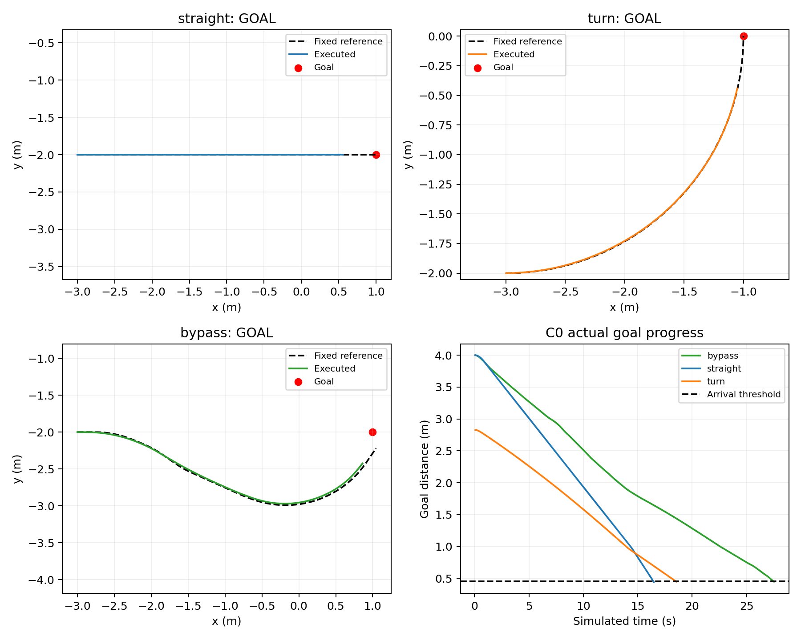

# C0基础控制课程 V687 · 2026-11-01

**无障碍直线、90度圆弧、上一轮已生成的绕行路线，三项均按原0.45m目标距离门槛到达；绕行一次完整同版本重复通过。** 原车能够执行这三类参考路线，本轮没有训练新网络。动态障碍通行仍未验收通过。

## 实际结果

| 固定功能路线 | 公开步/原生步 | 终距目标 | 最近参考点距离中位/最大 | 后备退让 |
|---|---:|---:|---:|---:|
| 4m直线 | 206 / 1648 | 0.442033m | 0.010122 / 0.019932m | 0 |
| 半径2m左转90度圆弧 | 232 / 1856 | 0.445625m | 0.007021 / 0.013627m | 0 |
| V686因果绕行参考 | 344 / 2752 | 0.446529m | 0.020491 / 0.039391m | 0 |
| 同绕行完整重复 | 344 / 2752 | 0.446529m | 0.020491 / 0.039391m | 0 |

四项全部完整原生重放通过，公开完整qpos/qvel和原始命令误差均0；实际命令幅值/速率、首步完整动力学预测/执行、自体覆盖、接触日志摘要和无积分外根状态改写核验通过。无障碍任务的最低场地边界净空1.569440m，完整自体域余量最小0.009022m；不能拿这一净空解释有动态物体时的安全。

绕行重复的模型字节相同，规范初态一致，完整qpos/qvel/ctrl误差0，逐接触事件一致。两原始接触SHA不同，因为日志含各自XML生成目录；先验证XML字节相同，再仅按事前规范化该目录字段，全部物理事件字段精确一致。原始摘要和日志全部保留。

独立零积分模型审计逐项比较车体质量/惯量、关节、执行器、机器人几何尺寸/摩擦/接触参数、支撑地面和求解器/时间步/重力，四项均与V686原车一致。模型中21个环境物体关闭碰撞，无活动actor或mocap。

## 本轮回答了什么

V686已经有检测、运动辨识和19条合格空间路线的证据，却600步未到达。本轮进一步确认，原车在没有动态预测约束、固定参考下，能够执行相应绕行。不能继续把所有失败笼统称为“车不会转弯”或“没有规划出路线”。

但本轮同时固定参考、取消初始观测等待、关闭在线重规划和后备中途切回，属于功能隔离测试，**不是只移除actor的严格单变量对照**。不能唯一归因原失败为预测保守、重规划或后备中的任一项，也不意味着三条路线覆盖所有控制状态。

后续优先验证同固定参考/初始化/后备模式下的因果动态闭环，检查普通候选与完整后备拒绝原因及目标净进展。若需要训练，训练对象应是历史观测条件下的机动提案或选择：转向、前进、制动与退让时机；奖励真实目标净进展和可持续接续，并记录网络动作最终是否执行。纯SAC动作被完全覆盖时，增加原SAC训练量不能据此验证动态收益。

这些是下一阶段设计，当前没有实现新的动态时序策略或更新网络权重。基础课程通过不代替未知动态成功、独立确认、统计优越性或RAS创新充分性。

## 工具失败与原截止

原run_course.py提前创建paired目录，与冻结factory的目录创建冲突，0物理/0私有积分失败。原source/driver/COMPLETION保持不变；唯一实际夹具重试只将预创建对象改为parent，算法/路线/门槛保持。

直线重试206步到达并完整1648步重放/控制审计通过后，附加证书审计因快照目录未含core模块而导入失败。原失败保持；零积分入口补上原冻结core搜索路径，审计代码字节不改，检查通过。接续只执行原尚未执行的圆弧与绕行，未重跑已执行直线或添加第二算法。两个原driver的失败COMPLETION与关闭账目不改，接续账目单列。

原2400s绝对截止1793527065.4886963没有延长；整轮实际仿真与审计在624.803s内结束。全部实际积分只经run_phase.sh、单CPU顺序。实际4次导航（3预注册功能路线+1条件重复），9008导航原生与9008完整重放，5232928私有预测积分分列；原两工具错误新增积分0。训练、动态、独立确认、实机和Stage访问均0。

汇总runs/v687_control_curriculum/FINAL_ANALYSIS.json。全部原始证据及失败保留，当前无活动实验，不自动追加本轮候选或动态任务。

完整证据本地提交f7c5e8f08aa1b5ce194f76af273211c7a4fc3941。186份原始文件/108清单文件完整解压与哈希回读通过，原始runs全部保留。一次10秒推送及随后3秒远端读取均超时124，GitHub当前状态未验证；不重复推送或追加仿真。
