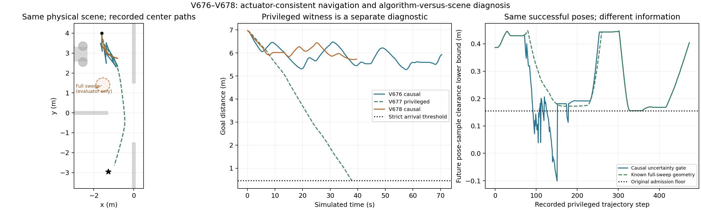

# 动态未知障碍：命令修复与算法/场景分解

**未知动态导航仍未通过。但现在有了明确的场景可执行见证：同一物理场景在已知完整扫掠范围时能安全到达。** 不能再把现有失败简单说成物理路口被堵死；也不能将特权到达算成未知动态算法成功。

本轮原7200秒硬窗从2026-11-01 14:21:21.696+0800登记，绝对截止16:21:21.696，未重开旧轮次。实际2因果候选+1单独特权诊断共3导航，全部完成后提前关闭；0重复/新几何/独立确认/训练/实机/Stage访问，无第三因果候选。全部真实积分仅run_phase.sh隔离入口、单CPU顺序；源/模型冻结。

| 同一95000011开发几何 | V676命令统一 | V677特权场景见证 | V678因果预测引导 |
|---|---:|---:|---:|
| 规划可用信息 | 原测距/已知先验 | **额外完整真实扫掠域** | 原测距/已知先验 |
| 公开步 / 原生步 | 881 / 7048 | 474 / 3792 | 495 / 3960 |
| 结局 | 墙钟停止，未到达 | **严格到达** | 墙钟停止，未到达 |
| 最终目标距m | 5.926373 | 0.442977 | 5.729855 |
| 最低实际原生净空m | 0.252713 | 0.220879 | 0.233187 |
| 障碍接触/穿透/未知 | 0/0/0 | 0/0/0 | 0/0/0 |
| 完整状态+实际ctrl独立审计 | PASS | PASS | PASS |
| 计入因果未知动态到达 | 否 | **否** | 否 |

这三项不是三个独立任务，不能报告混合成功率。特权诊断没有替换物理场景：障碍直径0.20m、幅度0.25m、最高实际速度0.08m/s、真实运动、模型与规范初态完全相同；其完整扫掠圆半径0.35m，距保护路口0.611419m。所有安全门槛、执行器限制与传感噪声/漏检均保持。

左图仅显示机器人中心路径；完整车身安全由逐原生审计核验。右图是成功轨迹的离线位姿采样评价，不是完整原生预测或新导航。

## 已查实并验证修复的命令缺陷

原V674/V675裁剪前命令缓存可超过执行器范围，物理写入被裁剪，但模型内部相同裁剪使qpos/qvel仍一致。旧失败/原审计永不回填。V676在新experiments目录统一命令硬范围与每公开0.10转向/0.70后轮速率投影，普通首步、完整预测序列、320tick后备、缓存与实际执行使用同一映射；last_command记录实际合法输入。执行端遇到非规范命令即报错，每个原生步比较完整实际ctrl，公开末同时比较完整qpos/qvel/ctrl。

前置固定V674首280步和V675首304步控制，锁定272/294真实状态；成功验证4672原生控制重放、12528私有积分（240tick预测/执行逐原生匹配及完整328tick后备）。首次验证因私有MjData克隆漏带上一ctrl而断言停止，2176重放/896私有积分保留；修复只改验证初始化，不改算法或重写失败。10000数学范围/速率检查通过。

V676881公开导航后，7048原生状态/命令与完整控制重放、完整自体、实际净空、329未来时刻有限覆盖、源/模型/规范初态均PASS。与V675前295步实际状态/控制相同，296首次不同；命令管线修复正确，但仍8次进入后备、8次切回、12次采用次优输入后未到达。因此它不是全部停滞的唯一原因。

## 为什么不能再笼统归因于场景无解

V677只把整个真实扫掠圆作为规划和安全检查的已知静态占据，其他控制、评分、原生模型、2.4秒普通预测与3.28秒后备均不变。每条准入和result明确ORACLE_FULL_SWEEP_SCENE_WITNESS、hidden_world_geometry_used=true、causal_algorithm_success=false。实际障碍仍按原正弦移动，不是冻结障碍或换简单地图。

它只规划1次，474公开步严格到达，0后备/0切回，完整3792原生控制重放误差0；原始命令、物理安全、自体、源/模型及全扫掠后备几何重算PASS。这个见证足以证明同一物理场景存在至少一条带额外信息的安全可执行路径。它不足以证明有限有噪观测下必有可获证策略，也不证明原运动类下的最坏情况问题容易。

首次特权启动因依赖目录名笔误在任何窗口/计数/积分前失败，原console和冻结源码保留；仅修正依赖名称后重新冻结。该零积分错误不算导航或成功。原V676因果失败未重试。

## 预测不确定性确实参与了拒绝

将V677已成功轨迹与其实际观测产生的原因果估计离线配对，在每帧取后续最多30个位姿（0.08秒间隔、2.4秒），用原联合未来外覆盖和0.155门槛重算：474帧中49帧被拒，主要在93–151和175–178附近，最低距离下界-0.100860m；同样位姿对已知全扫掠域的最低净空为0.155576m。

这是**外覆盖未能为实际成功位姿样本发证**，不是实际发生碰撞，也不是证明不存在其他可行因果控制。它是评价器使用已保存未来的反事实分析，未把未来轨迹给在线控制；只有公开位姿采样，不能当完整原生2.4秒证书。它说明额外扫掠信息改变了可获证占据，同时空间引导也变了，不能单靠该对照把效应全部归给某一模块。

## 因果静态投影并未解决问题

V678在相同已验证控制栈中，唯一改动是把原估计0..3.28秒的外框用速度上界补足采样间隔，再投影成保守空间提议；栅格启发与密集车身检查同用该提议。普通/后备安全门仍是原联合位置—速度的逐原生时间门，不使用真实扫掠参数。全部881旧包、329未来时刻的联合单元均包含在提议框内；固定初态只得到SAFE_PROGRESS_PREFIX，最低几何净空0.155556m，未得到完整目标路线。

V678495公开后仍未到达。13次规划中0条全局目标路线，整个投影比实际有限运动区域更保守，并且搜索时间较高；没有充分证据支持这种“把未来全部视为静态障碍”的改动。它不是新提出的思想：旧V661在另一未覆盖通过的栈中试过2.4秒投影并失败，本轮是新验证栈的受控机制重验，旧失败保持。

前置首次因冻结几何模块缺导入路径而失败，0积分，原错误/源保留；第二次仅补入仓库现有Phase模块路径后，41.137秒内完成原4000/16000扩展限。在线源/协议冻结后未修改；所有准入、实际ctrl与空间投影因果来源均独立复核。

## 现在怎样判断原因、下一步怎样做

- **实现原因已查实并修复**：命令裁剪/缓存不一致；这不能解释修复后的全部失败。
- **物理场景存在可执行通路已查实**：带全扫掠信息474步严格到达。不能再说该物理场景完全封死，也不能据此推断有限传感问题必然可解。
- **信息和规划的配合仍有问题**：成功轨迹的49帧采样在因果外覆盖下无法获证；简单静态投影又使全局空间路线难以找到。已有控制/后备库、速度/时间耦合和必要信息量各自贡献多少，还没有完全分离。

下一次应先做锁定状态的有界私有机动诊断：在相同因果信息下比较原停车/倒车尾与前进绕行后停车的少量合法序列，保持原3.28秒、末速和净空门槛，验证是否真的存在原库漏掉的可证推进。若有，再以时间、速度、上一实际命令和完整状态构建局部原语搜索；如果没有，则先分析观测可辨识性和终端获证条件。不能直接减小不确定性、安全距离、换容易场景或无限刷同例。完整未执行规格见[DYNAMIC_TEMPORAL_EXECUTION_NEXT.md](DYNAMIC_TEMPORAL_EXECUTION_NEXT.md)。本轮已达2候选限，没有第三候选或自动续窗。

## 文献与论文边界

本轮核对[MuJoCo官方裁剪语义](https://mujoco.readthedocs.io/en/stable/XMLreference.html#actuator-general-ctrllimited)、[SIPP-IP原文](https://arxiv.org/html/2302.00776v1)、[Zhou等在线不确定性学习原文](https://arxiv.org/html/2403.06222v2)、Trautman与gatekeeper等原工作，读取范围和不能移植的假设详见[DYNAMIC_ALGORITHM_VS_SCENE_V676.md](DYNAMIC_ALGORITHM_VS_SCENE_V676.md)。不能从论文标题中的robust推断无条件安全，也不能把图上几何通路当真实动力学可行证明。

这组对照能增强问题定位，但还不能作为RAS论文的性能贡献。需要在因果信息约束下实际通行、同版本复现、预先冻结的新池和公平强基线/消融；当前没有未知动态稳定、递归可行、实时、实机或总体优越性结论。

## 完整分账

因果新导航11008原生，特权诊断3792原生，合计14800；完整控制重放14800。因果导航私有7027272、特权导航私有2203152分开。前置诊断含失败6848控制重放/13424私有积分；投影包含、特权轨迹反事实、数学检查均0机器人积分。0因果到达/0重复/0独立确认，特权1到达单列。

全部三次运行的原始日志、模型/XML、冻结源/协议、错误/修复、独立审计和机器账目在runs及[evidence全轮包](../evidence/dynamic_command_scene_v676_round_20261101/README.md)，原始runs远端核验前不删除。静态V657原结果与冻结资源本轮未改、未重跑。GitHub同步实际状态单独记载，不将本地提交当远端已完成。

归档核验：490份原始文件的归档时字节快照、283份清单文件逐字节/哈希解压回读通过，存储25,029,175字节；原始runs保留。只读准备检查READY，0环境/仿真/训练且Stage不可见，三版本冻结源/协议哈希未变。
