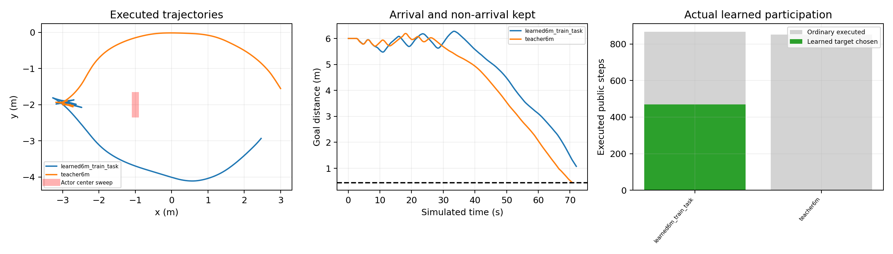

# 6米动态通行与第一版提案学习 V688 · 2026-11-01

**本轮完成了一个6米动态开发任务的参考控制通行，并实际训练了独立提案网络；学习版900步后仍距目标1.074496m，6米学习课程未验收通过，8米未启动。** 训练效果与参考控制成功分列，没有将零接触或训练误差下降当作学习版到达。

## 任务和算法

起点(-3,-2,0)、目标(3,-2)，6米是起终点直线距离，实际绕行路程更长。10×10m空白场地、原车/地面/执行器/物理积分和47束3m传感器，原噪声与漏检保留。直径0.20m单个未知圆柱，锚点(-1,-2)、横向振幅0.25m、最大速度0.08m/s，整个扫掠避开中央口保护区且有全车身绕行参考。真值只用于任务构造/传感器后端/独立评价。

参考控制采用V680原普通动作库、完整动力学准入和保留尾，空间路线改由V678已验证的3.28秒因果未来外覆盖投影引导，提前绕开可能被侵入的区域。执行安全门仍用原联合位置速度集合逐原生时间检查；2.4/3.28s时域、.155预测/.15实际净空、完整自体.002和末速.025均不放宽。32公开步实际安全观测后出发。

这是新的6米空白课程。V686是4米、600步及当前占据引导，V688是6米、900步及未来投影；多项配置不同，不能将跨版本成功唯一归因于投影，更不能替代原墙体场地动态验收。

## 两次实际导航

| 项目 | 6米参考控制teacher | 训练后学习版 |
|---|---:|---:|
| 结果 | **GOAL，单次到达** | **HORIZON，未到达** |
| 公开步 / 原生步 | 884 / 7072 | 900 / 7200 |
| 最终目标距离 | 0.448326m | 1.074496m |
| 原门槛 | <=0.45m | <=0.45m |
| 最低实际原生净空 | 1.110563m | 0.513229m |
| 实际车辆路程 | 9.680337m | 10.546668m |
| 障碍接触/穿透/未知 | 全部0 | 全部0 |
| 完整qpos/qvel/mocap控制重放误差 | 0 | 0 |
| 保留后备实际执行 | 0步 | 0步 |
| 普通倒车步 / 对目标净进展 | 146 / -1.012786m | 201 / -1.751297m |
| 网络提案实际普通执行 | 不适用 | 470 / 868步，约54.1% |

模型文件字节和规范完整初态相同，首次完整控制/状态差异在第32步，与第一条实际网络提案一致。学习版比参考控制多55步普通倒车、多约0.866m实际路程，经历不同重规划后改从下方绕行。不能归咎于后备接管，因为两者都没有执行后备。

二者均完整物理/原始命令/状态/源模型/自体/接触摘要审计通过；原因果集合每决策329未来点覆盖通过，记录的空间投影也重新核验包含原联合外覆盖。所有已存有限尾/交接几何与命令检查通过，实际执行有限尾0。安全前缀通过不使学习版的HORIZON转为到达。

## 已真实进行的训练

使用参考控制实际执行的852个普通控制样本（不含32步观测），训练MLP12→32→32→4的执行器目标提案器。输入仅机器人速度、上一合法命令和局部路线/目标steer与speed，标签为参考控制已选择的合法执行器目标，无actor真值/未来输入。

固定seed688、float64、Adam0.001、batch128，严格512次监督梯度更新，**SAC梯度更新0**。训练均方误差0.123443→0.016182；JSON推理与Torch最大差5.33e-15，独立重算训练误差、模型SHA、852样本SHA和冻结训练源码全部一致。

模型SHA256：c77b5f833fe77d3cadbab9fb41835426a058249728eee94a0cf8e92aa88796c0。checkpoint与训练账目位于runs/v688_dynamic_distance_curriculum/training_6m。学习版导航全程冻结权重，868次普通决策各添加一个网络目标，所有目标仍受原物理/限幅限速/完整后备门约束；在安全候选评分上加事前固定.025奖励，实际470步采用网络提案，原始推理重算误差0。

这一结果证明训练和实际参与已发生，**没有证明训练改善通行**。增加候选数量、固定排序偏好与学习权重的贡献未被分别消融。同训练任务就未到达，事前注册的相位pi/2开发变体、完整重复，以及整个8米teacher/微调/评估阶段均未执行。

## 可定位的训练问题与尚未证明的解释

监督标签含有参考控制本身的往返，当前12维特征未含运动外集、观测年龄和重规划历史，也没有长期到达时间目标。动作拟合误差下降后，闭环路径和前后切换仍可能变差；本轮观察到了这种差异，尚未唯一辨识哪个因素导致失败。

两次数据的各维特征均未超过teacher归一化5倍标准差，这不等于联合状态分布已覆盖，也不能只凭两条轨迹就宣布已证明分布偏移。参考[DAgger原文](https://proceedings.mlr.press/v15/ross11a.html)和[SafeDAgger原文](https://arxiv.org/abs/1605.06450)，下一方向是对学习策略实际访问的状态进行因果参考查询与数据聚合，并让真实目标净进展、路线侧别稳定和可持续接续参与训练/评估；文献保证不直接属于本项目。

同时没有直接禁倒车。停止后零积分复核原32/103/132三个投影输入，去掉反向边的局部搜索在原4000/16000预算内均未获得有意义全局进展；这只是几何搜索负例，不是物理无解证明，也不支持直接宣布全前进策略有效。详细未执行设计见[DYNAMIC_TRAINING_NEXT_DESIGN.md](DYNAMIC_TRAINING_NEXT_DESIGN.md)。

## 原失败与账目

原teacher通行与物理审计完成后，附加审计将numpy.bool_直接写JSON失败，原driver状态STOPPED_EXCEPTION与原源/COMPLETION/关闭ROUND_WINDOW保留。新V649审计只把检查值转换为原生bool写出，计算/断言/输入/安全条件不改；零积分补审通过，没有重跑teacher。接续严格沿用原唯一绝对截止1793535043.6592069，未延期或增加候选。

本轮实际2导航，14272原生导航+14272完整重放，8253760私有预测；1次512监督更新，原序列化失败新增积分0。学习版未到达后，按注册依赖停止本轮：6米门false，8米未启动，剩余监督更新512未使用。无相位评估/完整重复/独立新池确认，训练/开发/评价不混入成功率；Stage/实机0，Phase20/Phase6/current/runtime不改。

原始runs、训练数据/模型/全部失败、源协议与完整证据保留。汇总runs/v688_dynamic_distance_curriculum/FINAL_ANALYSIS.json；当前无活动仿真，不自动延长步数、降低门槛或进入更长距离。后续优先修正6米学习闭环，原墙体场地和动态稳定验收仍未完成。

本轮完整证据本地提交ce8eb1dbdc51d4aee6cc043919d0b2ff4c84e1df，300原始文件/176清单完整解压哈希回读通过。一次10秒push超时124，随后3秒只读远端核验成功exit0，GitHub main仍为旧227c267628b85cca4a66dce84a2e7f42a149dc3d，新证据尚未同步。全部原始runs保留，不重复推送。
