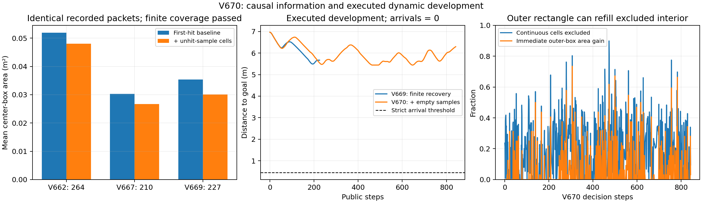

# V670：未命中约束改进估计，但动态通行仍未成功

2026-11-01，本次用户“继续”后独立有界开发。静态V657原结果不变；动态尚未通过。完整源码在experiments/v670_dynamic_empty_samples/，证据入口为evidence/dynamic_empty_samples_v670_20261101/。

## 实际结果

| 项目 | 结果 |
|---|---|
| 开发导航 | 原95000011一次，843公开/6744原生步，0严格到达 |
| 停止 | 原900秒墙钟硬限，私有预测rollout中TimeoutError；不延时、不重试导航 |
| 目标距离 | 最好5.441639m，最后6.294908m，未持续接近目标 |
| 实际行驶长度 | 8.389454m，明显往返，不能将运行更长当作进展成功 |
| 接触 | 障碍/穿透/未知均0；原始74981条接触仅地面支撑及已分类自体接触 |
| 原生最小净空 | 0.338080134m |
| 原控制日志重放 | 6744原生步，843个完整公开qpos/qvel/mocap误差0，自体域最小余量0.009193053m |
| 预测覆盖 | 844决策帧×165未来时刻（3.28秒）中心/速度有限覆盖通过；不是连续时间定理 |
| 保留恢复尾 | 3条完整反向制动尾，共120公开步，原完整状态/命令证书核验通过；仍未接续到达 |
| 条件重复、新几何、独立确认 | 均0；训练/实机/Stage访问0 |

原driver保持STOPPED_EVIDENCE_ANOMALY：完整result.json未生成，Window按规则不启动完整验收。根因是墙钟中断，不是已发现真实物理接触或漏覆盖。原COMPLETION、interrupted、错误堆栈和全部失败永久保留。INDEPENDENT_DYNAMIC_AUDIT.json仍FAIL，不能改写为动态通过；补充INTERRUPTED_PREFIX_EVIDENCE_AUDIT.json仅核验全部已执行前缀。

## 唯一算法变化及机制证据

只在V669首次命中/运动外区间上加入当前同一测距包的未命中样本约束。只用非丢失、非最大量程返回；不把丢包当空闲，不把0.08m离散采样点之间当连续空闲射线。位置矩形分32×32连续闭单元，只删除完全落在某已确认未命中点的不可能圆心圆盘中的单元，模糊单元全保留，再取外接矩形。控制器、搜索、运动类/噪声界、动态0.20m直径、0.25m幅度/0.08m/s真实最高速度、不堵口合格证和0.15/0.155m阈值均未调整。

导航前5000有效首次命中几何及701帧固定旧测距包全部通过。旧三数据集同包平均位置面积分别缩小7.64%、11.86%、15.00%，没有有限真值漏覆盖。第一次离线清单误列一个V666从未保存的765包文件，验证在该处停止；原失败源/日志保留，修正为真实701包后重新验证，0机器人积分，原2400秒截止不变。

本次实际844包的估计器同输入消融：基线平均面积0.03021355m²，新估计0.02171542m²，缩小28.13%；重新运行估计器与在线记录全部位置/速度界误差0，两个估计器有限中心/速度覆盖均通过。这是感知机制证据，不是导航控制反事实或独立样本。

## 失败原因与下一步问题

638帧删除了连续单元，其中400帧（62.70%）取外接矩形后没有留下任何当帧面积改善；平均删除18.22%的单元，而当帧外接矩形平均只缩小5.03%。这量化了非凸排除信息的表示损失，不能证明保留单元并集就必然解决导航。

92帧没有可确定为未知物体的返回，最长年龄1.84秒；但终端位置面积已较小（0.0154612m²），仍无持续目标进展。因此“只是末端集合太大”不足以解释全部失败。还需区分：被外接矩形填回的区域、位置—速度相关性损失、后备/重规划状态机的往返和未来执行准入。不能仅凭面积更小就断言可通行。

下一项应先在锁定记录上比较保留连续单元并集及位置—速度关联后的可行性，再研究能接续有效观测的恢复终端；需要新的明确有界协议后才可实跑。不能读真实轴/相位/未来，不能为取得成功降低安全/运动/噪声门槛。若只是增加代价或组合现有部件而无公平增量，不足以主张强创新。

## 预算、论文与证据边界

本轮2400秒硬截止未重置，单候选上限已用；原导航900秒停止。导航6744及审计重放6744原生积分单列。最后已持久化私有预测计数6563800是下界：末次rollout在返回/计数持久化前被中断，精确总私有积分不可恢复，不能伪填为完整计数。实际900秒仿真67.44秒，墙钟约13.35倍，不支持实时性主张。

[方法草稿](PHASE_DYNAMIC_METHOD_DRAFT.md)补充连续排除外包络的条件推导；[相关工作核对](DYNAMIC_LITERATURE_DESIGN.md)明确负观测/区间估计已有先例；[公平验证设计](DYNAMIC_EVALUATION_DESIGN.md)列出强基线、消融、新池和计算预算。当前仍不足以主张RAS投稿证据成熟，没有录用或强优越性保证。

全部原始runs、失败输入修正及源码均保留。上一次GitHub600秒有界推送已SSL连接超时，未验证新证据已在远端；未经远端核验前不删除原始证据。当前无活动导航，无新增自动任务。
