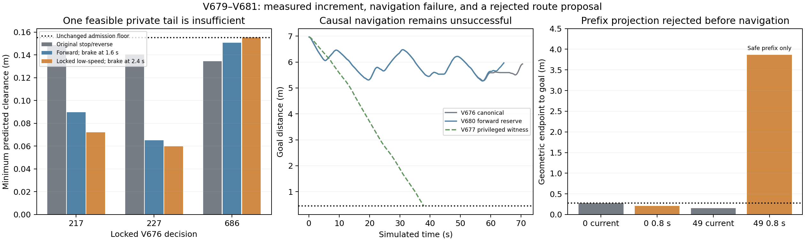

# 动态未知障碍：前进后备与空间引导检查 · V679–V681

2026-11-01。结论：**动态仍未通过；本轮按事前停止条件结束。** 原静态V657有限工程验收保持不变。本轮一个原任务导航、零到达；第二设计在零积分前置检查失败，未盲跑。未增加种子、放宽门槛、重置旧截止或将特权见证混为因果成功。

## 实际完成及未执行

| 项目 | 实际结果 | 能说明什么 |
|---|---|---|
| V679原3锁定点、15前进160步制动尾 | 217/227/686全部不获证 | 原测试库没有增量；不是全控制空间无解 |
| 锁定低速目标延后到240步制动 | 仅686获证，最低预测0.155334441m、末速0.001679356m/s、前进0.388695m | 新库确有一个旧库漏掉的有限后备 |
| V680实际5目标库完整验证 | 686首8+320步完整私有执行匹配 | 验证实现与有限证书；不是导航 |
| V680未知动态导航 | 804公开/6432原生步，BOUNDED_WALL_STOP，未到达 | 加入该后备不足以完成任务 |
| V680独立核验 | 全状态控制重放误差0、逐原生命令、安全、模型/源码/有限预测覆盖PASS | 已执行前缀证据可信，不能替代到达 |
| V681因果0.8秒空间提案检查 | 第0步全局路径；第49步只有安全前缀 | 前置要求失败，导航未执行 |
| 同版本重复、全新独立确认、新几何、训练、实机 | 全部0 | 不报告动态稳定成功率 |

V680原生实际最低净空0.252712875m，障碍接触/穿透/未知0，完整自体覆盖、静态几何未动、积分外根状态改写0。模型、初态和小动态物体直径0.20m/幅度0.25m/实际最高0.08m/s保持原样；原不堵口条件不变。未访问Stage。

## 为什么这次小修没有解决问题

V680行驶约8.3706m，最终距目标5.9673m，最佳也只到5.2685m。17次规划中15次给出几何目标路径；504步正档普通控制、220步负档普通控制和80步保留后备，5次可证切回，仍反复退回。因此“有几何目标路径”“有新的可证有限尾”“实际在运动”均不能推导持续到达。

新增前进尾仅在686允许一个原本无后备的普通首输入，**0步实际前进尾接管**。不能将其描述为执行了0.3887m的前进救援；0.3887m来自私有验证。其余全部10份实际保存的后备/交接证书重新检查完整328位姿、方向、制动时序和合法控制均通过。

V681保持原普通240步、80步后制动，以及328步复合后备全部门槛，只把前向驾驶的0.8秒因果外盒用于空间提案，试图区别于V678的3.28秒全时域静态投影。全804旧估计、每帧81未来原生时刻投影包含联合位置速度单元；这项覆盖检查通过。固定第0步找到几何路径最低0.182769m；固定第49步原当前占据规划在4000+13763扩展找到全局路径，而0.8秒投影在4000+16000扩展仅得到距目标3.86275m的安全前缀。**这是固定算法预算内未找到完整路径，不证明物理路口被堵或因果通行无解。** 按已冻结条件停止，无时域调参或第三候选。

已有V677同物理场景的全扫掠特权信息见证能到达，仍只支持“额外信息下存在安全执行”。当前证据更支持空间提案、时序可执行性与长期进展没有统一，而非单纯障碍太大；没有证明它是唯一原因，也未证明同信息条件下必然有解。

## 完整预算与边界

本轮原7200秒绝对截止见ROUND_WINDOW，未延长。准备两个设计，启动导航候选一个、另一个前置失败；新导航6432原生、其控制重放6432、导航私有预测4492352。固定诊断另计16488旧控制重放、58656私有积分，低于原60000上限。V681路线及最终独立几何检查均0机器人积分，不能混入导航分母。777.73秒实际计算推进64.32秒仿真，约12.09倍，尚非实时方案。

所有实际积分通过run_phase.sh单CPU顺序。原V680冻结源/协议/原COMPLETION、V681失败输出和所有既往失败均保留。0重复、0独立确认、0训练、0实机；原始runs未删除。

## 下一次应验证的结构

下一步应直接检验带时间、速度、上一合法命令和可重放完整状态的有限运动原语搜索，使用同一绝对时间下的因果占据和可保留尾段；具体接口与失败条件见[DYNAMIC_TEMPORAL_KERNEL_DESIGN.md](DYNAMIC_TEMPORAL_KERNEL_DESIGN.md)。该规格未执行，不能作为第三候选、算法完成或RAS创新证据。

本轮只证明一项有限后备库增量，未证明未知动态导航改进、泛化、统计优势、无限安全或递归可行。RAS论文还缺同信息/同计算预算的强对照、结构消融、新池确认和运行时证据；目前不能宣称动态问题已解决或创新说服力已充分。

全分母分账：runs/v679_dynamic_forward_reserve/FINAL_ANALYSIS.json。完整原始证据归档入口：evidence/dynamic_forward_reserve_v679_round_20261101/README.md。远端同步未验证前不删除原始日志。
