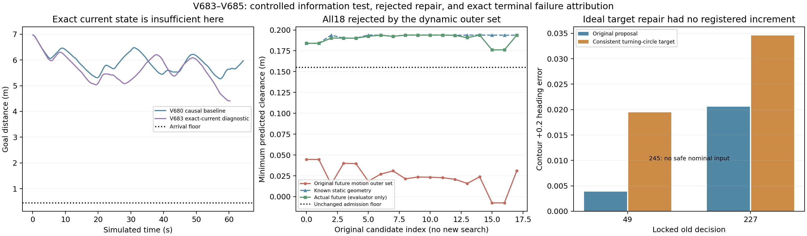

# 当前信息、转向候选与最后拒绝的验证 · V683–V685

2026-11-01。用户授权开始验证并解决动态。本轮已完成一次受控当前信息诊断、一项因果修订固定状态前置，以及原18条末端预测复算。**未知动态仍未通过，因果修订未获准导航。** 本轮没有缩小原速度/加速度类、降低安全门槛、改变场景或将特权结果计为算法成功。静态V657保持原通过。

## 受控当前信息诊断：仅当前准确状态不足以通行

V683由V680出发，只将每决策时刻的障碍当前位置/速度替换成独立评价器的4个准确标量。未来仍使用原每坐标速度0.12m/s、加速度0.04m/s²及原普通2.4秒/复合后备3.28秒；场景、模型、规范初态、空间搜索、评分、候选/后备、执行器限速、因果传感原包均保留。真实锚点/轴/振幅/周期/相位/未来轨迹不进入控制载荷。

该分支明确标ORACLE_CURRENT_STATE_ONLY，原因果Tracker同时旁路记录。源冻结及独立载荷审计确认全部754个决策的准确当前状态、JSON边界及未来模型/控制依赖不变。算法获得特权当前信息，不能算未知动态导航。

| 项目 | V683实际结果 |
|---|---|
| 结果 | 753公开/6024原生，NO_RESERVED_RECOVERY_COMMAND，未到达 |
| 最终目标距离 | 4.412587m |
| 最低实际原生净空 | 0.213391471m |
| 障碍接触/穿透/未知 | 全部0 |
| 完整公开qpos/qvel/mocap重放 | 6024原生，误差0 |
| 原生命令、模型/源、自体、安全审计 | 全部PASS |
| 后备/完整切回 | 84公开步后备，4次可证切回 |
| 保存9份完整后备/交接几何与方向制动审计 | PASS，其中1前进后备 |
| 实际计算/仿真时间 | 593.332秒/60.24秒 |
| 同版本重复/新场景/独立确认 | 全部0 |

相较V680的行为，准确当前信息改变了轨迹并推进得更近，但一次特权未到达不能建立感知的唯一因果贡献或整体导航改进率。它证明：**仅消除当前估计误差，在原广义未来运动界和该控制栈下，此例仍未完成通行。**

## 最后753号决策的具体拒绝来源

V683最后一条观测决策未执行物理步。当时当前包络净空0.193853m，没有旧保留后备，18个普通候选全部被TIME_CLEARANCE拒绝；最好的预测最小净空0.044654805m，均在第240原生时刻取得最差值。没有自体域或末速拒绝。

由于TIME_CLEARANCE同时包含静态和动态几何，V685按原753个已执行控制精确重放，再仅复算原记录的18个目标，原240步/80后制动不变，没有搜索新控制。全部18条的最小净空、最差时刻、末速和自体余量与原日志重现误差0，才进行分量解释。

| 同一组原18条预测 | 最小净空范围 |
|---|---:|
| 仅已知静态几何 | 0.183965—0.193884m |
| 按实际正弦未来后见评估 | 0.176126—0.193884m |
| 原广义未来运动外覆盖 | -0.007466—0.044655m |
| 原准入门槛 | 0.155m |

**18条全部仅由动态外覆盖拒绝，已知墙体不是这次末端拒绝的原因。** 实际未来的值只用于停止后评价，不能当作当时算法已知未来、已执行安全救援或完整328步后备已获证。更宽运动类下的拒绝有其依据，不能叫预测算错。

这些原预测在2.4秒内沿通行y方向最多推进0.183853m，仍停在物体侧方。最佳外覆盖净空候选的终点y1.405333m，根状态y1.408105m，前进不到3毫米，主要完成转向。其前轮合法目标从上一命令切换至少需要0.88/0.72秒，而原语只有0.8秒驾驶阶段，随后长制动。这是命令速率给出的目标到位时间下界，不等于实际关节整定时间，也不单独证明多阶段原语一定能通过。

因此当前最直接、可检验的缺口是：**单目标短驾驶—停车原语没有在宽泛未来运动集合下将机器人带离受侵入区域；准确当前信息并不能自动补上这种时序与终端接续能力。** 其他未搜索机动仍可能存在，不能据18候选证明全控制空间/全场景无解。

## 控制候选一致性修订：未达到导航前条件

旧普通转向目标中存在前轮理想转弯圆与后轮目标差速圆相差8倍的例子，以及大量期望目标越过硬幅值。旧实际命令仍经过规范限幅/速率映射且完整预测/重放一致，不能据此撤销原实际命令审计。

V684只将普通候选目标改为与原规划器同一理想转弯圆，中央转角限制在原规划几何界、后轮同向差速，全部真实模型/因果输入/安全门保持不变。5005个数学目标检查通过，但理想几何一致不是动力学有效性的保证。

原V680锁定49/227/245三个完整状态的实际检查：

| 状态 | 完整可追加后备 | 新预测目标进展 | 跟踪端点误差：旧→新 | 注册增量 |
|---|---|---:|---:|---|
| 49 | 有，首8+320私有执行完整匹配 | +0.214320m | 0.003885→0.019463 | 未满足 |
| 227 | 无 | +0.173826m | 0.020548→0.034572 | 未满足 |
| 245 | 无安全普通输入 | 无 | 无 | 未满足 |

误差为相同参考的轮廓误差+0.2倍航向误差。原动态继承控制参数会变化，补充零积分目标集合审计逐一从旧记录恢复虚拟中央角及直行轮速，新数学目标集合与前置实际使用集合差为0，排除了这项夹具上下文差异。

3状态均未达到事前定义的完整接续/正目标进展/跟踪增量组合条件，因此没有启动新的因果导航，没有改变门槛或追加第三设计。不能说“修正转向已经改进导航”；它也不证明从起点执行该修订必失败。

## 原失败与实现修复全部保留

1. V683原信息审计要求决策数等于执行数，误将最后一条未执行拒绝决策判为异常，原driver COMPLETION为STOPPED_EVIDENCE_ANOMALY。原失败/冻结审计/source/原COMPLETION保持不变。V2独立零积分审计只允许有对应rejected_control的这类末决策，多出的一条仍完整检查，全部754当前载荷PASS；物理、模型和状态检查没有放宽。剩余额度接力保持原截止，不重开失败驱动。
2. V684验证夹具首次漏执行器编号，392旧控制重放/0私有后退出；补齐原CommandMap编号后重验原3点，原失败保留。累计2360诊断重放。
3. V685分量审计首次读取了不存在的范围聚合字段，在6024重放/0私有后停止；仅用原lower/upper拼成同一范围后重验原18条，原失败保留。累计12048末端审计重放。

这些是验证工具问题，不能当算法有效或无效的科学证据；重复计算全部计账，没有删除失败来凑成功。

## 累计预算与论文边界

原V683唯一7200秒绝对截止1793527512.016538未延长，已提前结束实际工作。1特权导航、0因果导航、1因果设计前置未通过、0重复/新几何/独立确认/训练/实机/Stage。全部积分仅run_phase.sh、单CPU顺序，current/runtime/Phase20/Phase6未改。

- 新导航原生：6024（特权诊断）。
- 导航完整控制重放：6024。
- 因果候选固定诊断重放：2360（含初始化失败392）。
- 原18条末端分量审计重放：12048（含字段失败6024）。
- 导航私有预测：3690624。
- 全部固定诊断私有：24664（20344+4320，失败私有均0），低于原40000上限。

原始runs与完整证据保留。没有未知动态成功、新算法确认率、实时性或RAS充分创新结论。可复核总账为runs/v683_dynamic_current_state_diagnosis/FINAL_ANALYSIS.json。

下一实现应检验同一2.4/3.28秒时域内的多阶段转向/速度序列及完整可续接尾，目标是在原运动类下离开受侵入区域，不能先用实际正弦未来取消安全拒绝。若需要利用公开活动区，应单列改变信息假设的对照。详细未执行规格见DYNAMIC_TEMPORAL_KERNEL_DESIGN.md，当前仍未实现新的时序导航器。
