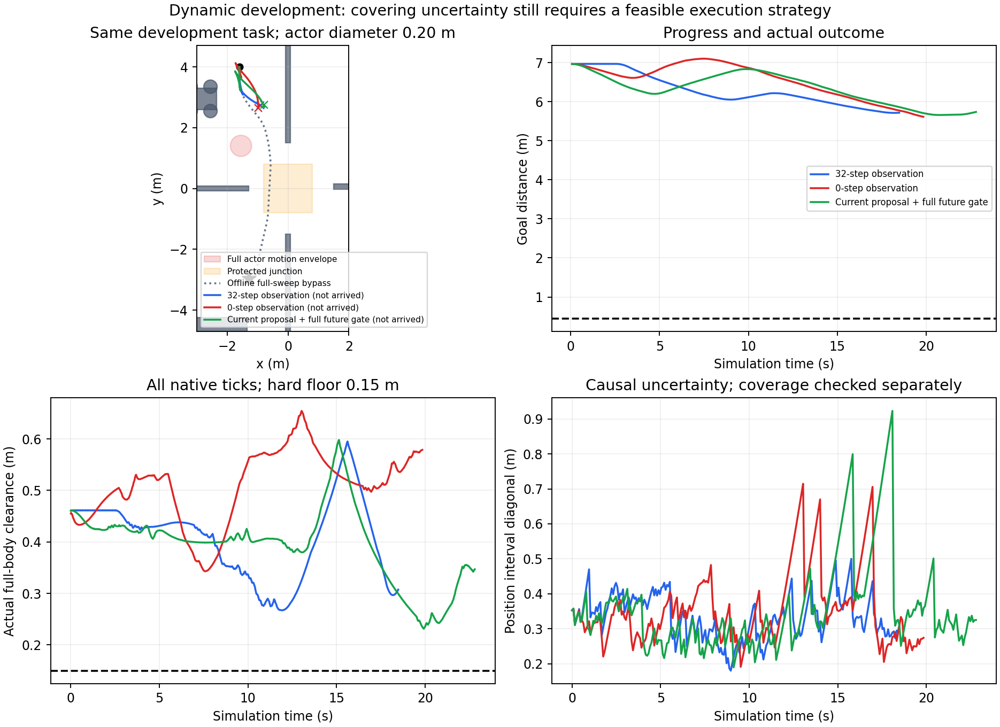

# 动态测距集合与规划诊断 · 2026-11-01

V662–V663已完成并独立审计：旧控制精确回放取得实际测距包，新的因果位置/速度集合在本开发轨迹的有限检查中覆盖真实运动，但同源码32/0步起点观测均未到达。V664按用户再次“继续推进”的指令单列一次有界开发，也未到达；V665密集边段修复仅完成零积分核验，尚未实跑。不能把物理证据PASS称作动态稳定通过。静态V657原23/24工程验收及旧动态失败保持不变。

## 估计修复与对照

旧点均值/CV经验管有约0.0489m有限预测漏覆盖。V662完全使用原V659的264条控制进行实际物理回放，与原完整状态误差0，取得264帧原始测距；2112原生步及2112重放全通过。这是旧轨迹诊断，不是新导航任务。

V663将0.08m射线采样、LiDAR±0.06m/深度±0.09m噪声、单物体半径0.10m、每坐标速度≤0.12m/s及加速度≤0.04m/s²结合。早于任何兼容已知地图返回的非丢失测距产生线段膨胀圆盘，16方向外半平面限制位置；传播并相交历史位置/速度外区间。无观测时继续传播，不清空物体，不读取真实中心、轴、相位、运动幅度或未来。264帧离线回放及300组独立矩形距离核验先通过才冻结实跑。

| 同源码开发分支 | 公开/原生步 | 到达 | 终距(m) | 最小实际净空(m) | 结果 |
|---|---:|---|---:|---:|---|
| V663 起点观测32步 | 231 / 1848 | 否 | 5.716857 | 0.267088 | NO_SAFE_PROGRESS_PATH |
| V663 起点观测0步 | 248 / 1984 | 否 | 5.612681 | 0.343072 | NO_SAFE_PROGRESS_PATH |

两者同模型、规范初态、噪声初态和算法，仅改变起点观测步数。起点观测也实际推进机器人/物体物理并检查制动尾，没有冻结根状态；因此它是有成本的动作。当前结果不支持“多等2.56秒即可恢复通行”。原生导航共3832步，完整重放3832步；零障碍接触/穿透/未知接触、自体覆盖、完整状态、无积分外根改写和原始接触SHA全部通过。均未到达，条件重复0，独立动态确认0。

独立重算32步分支232帧、0步分支249帧，每帧121个0..2.4秒未来时刻，真实圆心均在位置外区间内，当前真实速度也在速度区间内；最接近外边界仍内含约0.003445m/0.001742m。它说明这些有限样本未漏覆盖，不能扩展为任意场景、连续时间或校准概率保证。估计区间中心并不等于精确真实中心。

32步分支最高丢观测年龄0.8秒，位置区间对角线最大0.500m；0步分支分别1.6秒/0.715m。观测初始化确实影响不确定性，但没有变成到达收益，不能以区间变小代替任务完成。

## 新定位：未来管空间投影过度限制路线

两个分支搜索将整个未来2.4秒的位置可达集合永久占据，路线还未走到交互区就可能被拒绝。针对0步分支最后保存的同一因果输入，零积分、同4000/16000固定工作量对比：

| 路线构造 | 结果 | 扩展数 | 几何密集最小净空 |
|---|---|---:|---:|
| 全2.4秒管永久投影 | 无有意义进展路径 | 16000（优先搜索4000亦失败） | 无路径 |
| 当前占据提出路线 | GLOBAL_GOAL_PATH | 75 | 0.187360m |

这是规划提议层的归因证据，不证明新路径能通过完整未来控制准入。仅减少空间投影而同时取消未来安全检查会掩盖问题；V664保留原完整2.4秒时间准入、执行器迟滞和限幅制动尾，仅改变空间提议及重验。它尚不是完整时空规划，也没有无限等待安全保证。

## 任务与论文主张边界

物体仍为直径0.20m、幅度±0.25m、最大速度0.08m/s，比静态0.50/0.32m小。脚本mocap运动，整个扫掠避开中央路口保护区0.611419m，完整扫掠永久占据时仍有车身参考路径（密集净空0.172075m、姿态插值下界0.166406m）。真值参考仅离线核验场景，不进入规划。没有以缩小障碍、扩大空间或放宽0.15m门槛来救回。

当前仅一个已知静态几何中的开发任务，准确定位、已知静态地图、已知物体尺寸与有界噪声/运动类，未验证遮挡突现、多物体、不同几何/相位/速度、统计优势或实机。恢复器接管轮控，SAC作用未隔离；计算仍慢于仿真时间。新的集合表示与规划分层是机制开发，不能直接据此宣称强论文创新。RAS阶段判断见[RAS创新评估](RAS_READINESS_ASSESSMENT.md)。

## 预算和全证据

V662窗口10:07:11.772898至11:07:11.772694+0800；V663两分支完成于收费946.932秒后，原账目关闭，未执行修订02。用户随后再次继续，V664另列一次新导航及成功条件重复，仍保留同一11:07:11绝对上限，不延后旧截止或改写旧分母。所有实际积分仅run_phase.sh，单CPU顺序、模型/current/runtime不改，SAC训练0、实机0、Stage访问0。

- [V662诊断全证据](../evidence/dynamic_sensor_diagnosis_v662_20261101/README.md)：63清单文件、31来源引用、原264控制及测距包、完整原生/接触/重放。
- [V663两失败全证据](../evidence/dynamic_interval_tracking_v663_20261101/README.md)：112清单文件、64来源引用、全部原始接触与预测检查、两条完整状态轨迹及冻结版本。

两包均逐清单与原始接触摘要核验PASS；只表示证据一致，不表示到达。新原始runs全部保留，未经远端验证不清理。V664最终证据另包，不把其结果混入上述已冻结清单。

## V664实际结果与V665零积分修复

V664同任务一次新导航285公开/2280原生步，NO_SAFE_PROGRESS_PATH，终距5.736569m，最低实际净空0.231374519m。完整重放2280步、全部自体与接触检查通过；286帧各121个未来时刻覆盖独立重算通过，最接近外区间边界仍内含0.004780m。没有严格到达，成功条件重复未执行；203.088秒关闭，没有追加导航、种子或动态确认。

末次失败更精确的原因是：搜索按0.04m点间隔接受候选边，但返回前0.008m密集证书得到0.154796688m，低于原规划阈值0.155m，导致整条候选被拒绝。不能把所有拒绝都归为预测集合过大；必须区分V663未来投影造成的无路径与V664最终密集核验失败。原生执行没有违规，也没有为了0.000203m证书差而降低阈值。

V665仅保存输入的零积分开发，把与最终证书相同的密集子步检查前移到每条搜索边，仍使用4000/16000扩展与原阈值。两输入（V664最后失败、V664起点）在执行前锁定，依次旧/新共4次搜索：

| 保存输入 | 旧稀疏边段 | 新密集边段 | 结论边界 |
|---|---|---|---|
| V664最后失败 | 最终密集证书拒绝，0.154797m | 有效进展前缀，密集净空0.157886m、前缀终距3.876581m | 仅修复该输入的无效候选选择；尚无完整目标路径 |
| V664起点 | GLOBAL_GOAL_PATH，0.185262m | GLOBAL_GOAL_PATH，0.185262m | 起点回归通过 |

V665全核验60.350秒<240秒，环境实例与所有积分均0；失败输入搜索44.925秒对旧14.736秒，约3.05倍，不能说性能优化或实时。尚未将此修复放入导航实验，不能以离线前缀救回称动态到达。后续实际候选必须事前冻结完整算法、保留完整未来制动准入并另立有界协议，开发成功后才做独立确认。

本次V663+V664共3分支、一个开发任务、0到达：6112导航原生步；另V662旧控制诊断2112步。8224实际积分均有8224控制日志重放匹配；机器人私有预测积分3218400单列，不计导航样本。新导航767帧各121未来时刻的有限覆盖通过。累计账目见evidence/dynamic_interval_round_account_20261101/CUMULATIVE_LEDGER.json。

[完整V664失败证据](../evidence/dynamic_causal_proposal_v664_20261101/README.md)78清单文件/32来源引用；[V665零积分候选证据](../evidence/dynamic_dense_edge_diagnosis_v665_20261101/README.md)13清单文件/3来源引用。连同V662/V663四包共266清单文件/130来源引用，另累计账目单文件，均核验通过。当前没有活动仿真或自动追加作业；原始数据全部保留，GitHub同步另以SYNC_STATUS.json为准。

本次完整证据及源码已本地提交`86b6aa8`。30秒有界git push与12秒远端读取均超时，未确认GitHub同步；全部原始运行保留。
