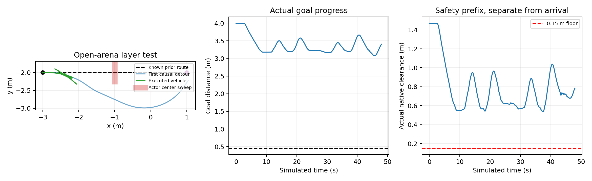

# 空白场地能力验证 V686 · 2026-11-01

按用户建议，把动态问题拆为检测、规划、执行，已实际完成一个新的空白场地开发任务。**本例能发现并辨识障碍运动，能生成合格的因果空间绕行路线，但600步没有通过。** 因而原场地困难不是唯一解释；当前必须解决执行决策、目标进展和时间安全接续，单纯扩大SAC训练量尚无依据。本轮是能力评测，梯度更新0。

## 任务与对照边界

10×10m空白区域，初态(-3,-2,0)、目标(1,-2)，直线距离4m。原20个已知静态物体只在场景构造期移走并关闭碰撞，导航后不修改根状态。原车、地面、质量/惯量/关节/执行器与数值积分参数逐项对原V680模型核验相同；这是明确的新场景，不能冒称原场地同任务配对。

单未知圆柱直径0.20m，锚点(-1,-2)，y方向振幅0.25m、速度上限0.08m/s。完整扫掠有原全自体绕行参考且不堵原中央口保护区。传感器仍47束、3m范围、原噪声/漏检；在线只接收因果测距，不接收真实当前位置/未来/锚点或扫掠。先实际32步安全观测，再导航。原2.4/3.28s时域、0.155m准入/0.15m实际净空、完整自体与合法命令约束均不变。

## 三层实际结果

| 能力 | 结果 | 证据与限制 |
|---|---|---|
| 发现未知障碍 | 此例有证据 | 574/600帧有效未知回波，共1161条；第0步发现，位置中心最大误差0.079292m |
| 辨识发生运动 | 此例有证据 | 部分速度外区间排除0；不同时刻位置区间存在互斥。不是精确速度估计或复杂动态识别 |
| 因果预测集合覆盖 | 有限检查通过 | 600决策×329未来时刻，原联合位置速度外覆盖通过；非连续时间或概率校准保证 |
| 规划新路线 | 此例空间路线通过 | 19次均GLOBAL_GOAL_PATH；旧直行参考在各次当前因果占据下不可用。独立密集复核的路线最低净空0.181395m，首路线横向绕行0.990222m |
| 沿路线完成通行 | **未通过** | 600公开/4800原生，HORIZON；终距目标3.401734m，最近3.075574m，未到达0.45m范围 |
| 实际前缀安全与完整重放 | 通过补充核验 | 最低原生净空0.540338m，障碍接触/穿透/未知0；4800重放完整qpos/qvel/mocap误差0，原始ctrl/速率/自体/源模型检查通过 |

空间路线有解不代表沿线时间控制可持续通过。原生准入始终有效，本轮没有用放宽运动界或净空来换到达。

## 停滞在哪一层

48秒仿真中净目标进展仅0.598266m。404步非观测前进普通控制贡献+2.223117m，56步普通反向贡献-0.572299m；108步保留后备又消耗大部分进展。发生6次后备接管和5次可证切回，但没有完成绕行。到600步是固定步数结束，**不是最终所有控制不可行或场景无解**。

对各时刻当前路线的最近距离，中位数仅0.012824m、最大0.309081m；因此不能简单归咎于“车辆完全不会跟路线”。更准确的现象是：几何新路线能够生成，短时控制与后备接续反复退回，未形成持续目标进展。跟踪误差、局部弧长评分、动作序列和未来集合保守性仍需分离，当前没有唯一因果归因。

600步实际控制均由几何/安全控制接管，SAC动作全部被覆盖；本例不能证明SAC学会或没学会动态。若下一轮训练仍让网络输出被全部覆盖，无法据此验证训练策略收益。

## 审计工具异常与保留的原失败

原driver最终STOPPED_EXCEPTION、原独立审计FAIL均保留，没有修改原COMPLETION或重新导航。唯一失败项是观测阶段15步的“候选选择”：新审计错误要求轮速命令严格为0，但原速度0提案会根据实际微小速度做反馈补偿，最大轮速命令0.004478。V2零积分审计撤去这项未在协议注册的严格零轮速假设，检查观测实际位移<0.01m、原自体/末速/未来门槛、合法原始命令、全原生与完整状态；全部通过，普通控制排名与后备检查未改变。原失败及各个补充检查文件均保留。

第一版规划指标把联合当前集合粗化为完整边界矩形，因此给出了过保守的路线净空。原指标保留。V2对同一密集路线、同一原始因果联合集合和已知静态图复核，19条均>=0.181395m；没有修改在线算法、原始路线或使用真实未来。

另11份完整后备/切回证书的328原生几何、合法控制序列、方向/制动/末速检查通过。场景转换审计确认只变更声明的新任务构造，车/支撑物理保持一致。

## 下一步策略与本轮账目

采用能力课程：先无障碍直线/转弯和固定绕行跟踪，隔离真实转向/速度响应；再单障碍运动提案与可持续进展；随后固定不同初态/相位，最后回原墙体场地。若学习，重点应是有历史观测条件的机动提案/时序决策或跟踪残差，并记录实际动作与干预率，奖励真实目标净进展；不能只奖励局部弧长。具体未执行方案见[DYNAMIC_CURRICULUM_STRATEGY.md](DYNAMIC_CURRICULUM_STRATEGY.md)。

“由易到难”本身不是新的论文贡献。[课程学习综述](https://arxiv.org/abs/2003.04960)已有任务序列与迁移框架，[Grounded Curriculum Learning](https://arxiv.org/abs/2409.19816)也强调课程分布应关联目标任务。本项目仍需用留出任务、同预算基线及信息/提案/安全控制消融证明联合方法的贡献，未具备动态稳定或RAS充分创新证据。

新1800s唯一窗口提前关闭，绝对截止不延长。1次零积分预检、1个新场景导航、0重复/独立确认/梯度更新/实机/Stage；4800新导航原生、4800完整控制重放、3632848导航私有预测分别记账。关闭后仅零积分审计和整理，不追加第二候选/新场景。原始runs、全部失败及源码冻结保留；汇总runs/v686_dynamic_open_curriculum/FINAL_ANALYSIS.json。

完整证据本地提交51289e62505df013d3fec52145ded0633b0442cb。193份原始文件/139清单文件逐字节解压与哈希回读通过；15秒推送及随后3秒远端读取均超时124，GitHub最新状态未验证，全部原始证据保留。当前无活动仿真或自动追加。
