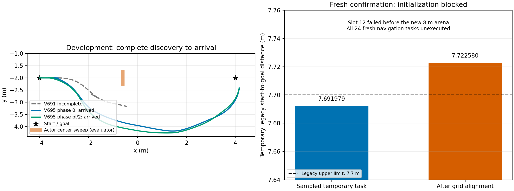

# 动态夜间实际收尾：开发通过，新确认在初始化停止

**两种初相位下的“正常行驶→首次发现→完整减速停车→新因果路线→继续→严格到达”开发已通过；独立24项新任务确认未完成，本夜提前停止。** 新确认不是动态碰撞失败，也不能报24项导航成功率：24项导航均未执行。

## 实际完成与未执行

| 项目 | 实际结果 |
|---|---|
| V695相位0主任务、完整重复 | 765/765公开步严格到达，最低实际净空0.449255m |
| V695相位pi/2主任务、完整重复 | 770/770公开步严格到达，最低实际净空0.398714m |
| 两个完整重复 | qpos/qvel/ctrl/mocap误差均0，模型/规范初态/真实接触事件一致 |
| 全部开发物理与功能审核 | 原生零障碍接触/穿透/未知，完整状态重放、合法命令、自体、源模型、因果覆盖、规划/路线/尾/发现链审核及独立前提复核通过 |
| V696新任务t0预检 | 已尝试12：前11通过，第12在旧初始化阶段失败；另12未执行 |
| V696新24项导航 | 全部未执行，不能给出0/24或任何导航成功率 |
| V696预定3完整重复 | 全部未执行 |
| 第二确认池 | 未启动，不以换池抹去第一批失败 |

actor从t0在距起点锚点3.4m处真实存在，原3m传感自然进入视野。开发在第32/33步行驶时由真实回波触发，随后41公开/328原生步实际制动，末速分别0.000056408与0.000011354m/s，再重规划并到达。公共t0未知中心3m排除先验属于受控课程条件，不能解释为任意遮挡突入保证。actor直径0.20m、振幅0.25m、最大0.08m/s，完整扫掠不封堵保护路口，传感/噪声/漏检和原安全门保持。

## 新确认为什么停止

固定slot12（seed97010012，初相位1.0726209215571556）在构建实际8m空白场地之前，先执行继承的旧随机长距离场景初始化。旧采样起终点直线距离7.691978931m，落在[6.8,7.7]范围内；栅格对齐后变成7.722579601m，超过旧上限7.7m。旧全局路径8.121326m、端点误差和起点净空检查都通过，唯一直线距离条件失败，抛LONG_GOAL_NATIVE_GATE_FAIL。日志随后EGL清理报错是后续析构异常，不是首个停止原因。

冻结factory在旧初始化成功后才调用arena.prepare，而该函数才构建(-4,-2)→(4,-2)的实际8m场地。因此本次失败发生在新场地/动态控制开始前，不能归为这条新动态轨迹撞障或算法全局无解。零积分原因复核逐项重算原门槛，与原ERROR/COMPLETION和12项预检账目一致。

原V696协议明确任一前置失败停止，不替补种子、不改冻结源码/门槛。夜间3个开发名额已全部登记，故不追加第四修订、不换第二池重试。V696原STOPPED_EXCEPTION/COMPLETION保留；原冻结audit_final.py按完整条件得到FAIL，另有FINAL_ACCOUNT_DIAGNOSIS把11通过、1失败、12未预检、24未导航、3未重复分开记录。

## 完整账目、截止与证据

V695四运行共有24560导航原生、24560完整重放、14141040导航私有预测。固定73诊断另584重放和3776私有（含328完整串行证书），V694已观测失败1原生重放另列。夜间已观测总重放25145、私有14144816；V693被输出guard遮蔽的旧诊断仍独立保留重放[0,584]/私有[0,20000]未知区间，不回填成功或假称精确总数。V6941步重复计数经原记录显式纠正，原账目更正文件也保留。V696新确认导航/重放/私有预测均0，训练/冻结SAC更新/Stage/实机均0。

V695原开发绝对截止2026-11-01 22:17:54.814不变，实际1544.801秒闭合。V696于21:28:59.821启动，批硬截止原为11月2日01:38:59.821，实际114.037秒按前置失败提前关闭。全夜11月2日08:00硬截止没有延长或重置；本次按停止规则提前停止新增仿真并删除自动接续。未远端验证的原始runs保留。

V695全证据647原文件/235清单逐字节哈希回读已通过，内容寻址归档evidence/dynamic_discovery_v695_20261101。本确认全部已执行预检、未执行清单、原失败/冻结源码和独立诊断一并另归档。没有把4个开发运行当作4个独立确认样本。

## 下一轮准备方向（本夜未执行）

先将空白课程的直接初始化从旧随机长距离任务中解耦，明确分离场景构造与传感噪声种子；保留实际8m场地的起点/完整扫掠/原车/因果/控制/原生安全门。先在0积分全池构造测试中验证所有已锁定任务的初始化，再冻结新协议和源代码。原slot12与原24分母失败原样保留，不能静默换种子或放宽旧门槛后重写本次结论。

6.56秒前瞻目前只是有证据的规划消融，有限课程完整功能改善已出现；RAS论文仍需有效独立确认、同感知同计算预算基线、多场景和机制消融，不能以开发成功保证投稿说服力或接受。

最终确认/预检及紧凑夜间封账证据已归档至evidence/dynamic_confirmation_v696_20261101：915份原文件、228份清单文件，存储5096886字节，全部解压字节/哈希回读通过，原始runs未删除。

最终报告/全部证据本地提交4b433d94d4aba3cb4a947be99921d8bb98181d02。本次一次60秒推送exit124超时，随后5秒只读远端核验亦exit124，最新远端未验证；上次成功读取的远端为V690的28d350e04c3979ff628a5d902bb858822df76d14，不能据缓存断言当前最新。原始runs全部保留，不重复推送，不再追加仿真；自动任务已删除。
