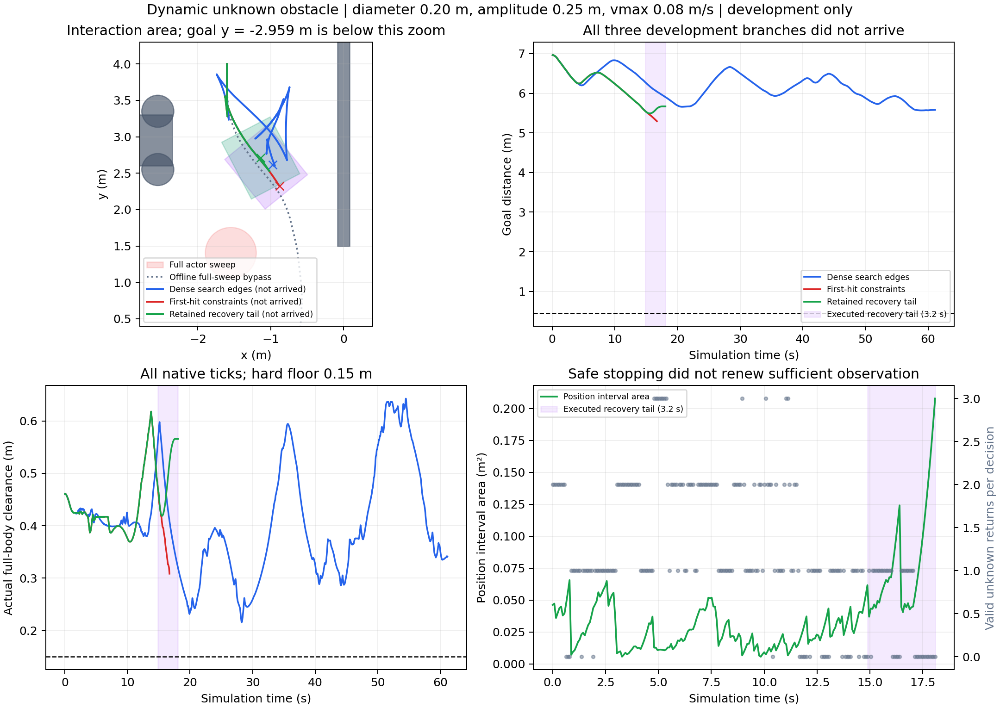

# 动态未知障碍：观测一致性与有限恢复 · 2026-11-01

**本轮三个开发候选均未到达，动态稳定仍未通过。** 静态V657原23/24有限工程验收保持通过。新的实际进展是：首次命中信息可缩小一致集合；保留的反向—制动尾已在真实原生动力学中完成，完整状态/控制与证书匹配。但停车后仍不能接续安全计划，不能把有限恢复完成称作动态通行成功。

## 原任务、冻结与实际结果

仍为同一开发seed95000011，直径0.20m、幅度±0.25m、最高0.08m/s的小圆柱，脚本mocap运动，不主动让路。沿用整个扫掠不堵中央保护区和完整车身绕行合格证。导航planner改动与任务构造明确分开：task_planner.py逐字保留V664旧搜索，三候选模型SHA与规范初态均匹配V664；没有移动障碍、换场景、调小噪声/运动界或降低0.15m硬净空。恢复普通准入仍0.155m。

| 开发候选 | 公开/原生步 | 到达 | 终距(m) | 最低实际净空(m) | 停止原因 |
|---|---:|---|---:|---:|---|
| V666 密集搜索边 | 764 / 6112 | 否 | 5.580765 | 0.215650 | 普通与后备均无安全控制 |
| V667 首次命中一致集合 | 209 / 1672 | 否 | 5.295253 | 0.308371 | 普通与后备均无安全控制 |
| V669 保留反向—制动尾 | 226 / 1808 | 否 | 5.668414 | 0.369382 | 恢复尾结束后无新的安全控制 |

三条导航共9592原生步，障碍接触/穿透/未知均0、完整自体覆盖、静态实体不动、无积分外根改写均通过；9592控制日志重放完整qpos/qvel/mocap匹配。源与模型冻结、原始接触SHA独立核验通过。三个版本来自同一个开发任务，不能合并成独立成功率，也没有动态独立确认。

V666确实越过原285步密集证书拒绝点，但实际走了7.167m，仅获得1.520m起点净位移，13次重规划，271步目标距离回退超过1mm；普通安全候选数中位数16。原生首公开步位姿预测误差至多4.45e-16。说明仅修几何证书还未解决恢复与进展，不能直接归咎为执行模型错误。V666/V667/V669墙钟约为仿真时间10.14/8.44/12.24倍，均无实时性结论。

## 首次命中约束：有效的感知改进，但未产生到达

对可确定来自单未知圆柱的射线，首次命中点P=o+Dd与上一采样点Q=o+(D-0.08)d满足||P-c||²≤r²<||Q-c||²。相减得d·c>d·o+(D-0.04)||d||²。用有界测距的D下界z-b及保守数值余量给出必要半平面；不能确认前一样本时不添加。该约束排除的是与实际传感器矛盾的位置，噪声、速度、加速度与安全界不变。它是几何一致性补充，不单独主张首创。

导航前5000条独立有效首次命中几何检查通过；首次5000生成中4978命中/22未返回原统计保留，非返回未当作约束成功。旧264测距帧因果回放有限覆盖通过，平均位置集合面积减少10.13%。在V667实际新轨迹的相同210测距包上，开/关首次命中约束的配对估计器回放均覆盖真实未来，新集合平均面积减少14.53%，且是旧外集合的子集、保存状态重算误差0。这是估计器消融，不是旧控制器在该新轨迹上的导航结果。

V666/V667分别765/210决策帧各121个未来时刻核验；V669为227帧各165个0..3.28秒未来时刻。所有有限检查通过，不等于任意环境或连续时间的集合认证，更不能写成已校准的概率风险。

## 反向恢复：从“能制动”到保留有限后备

V668对原V667轨迹的160/192/209三个事前固定状态，逐一检查135个执行器目标/制动时序组合，共405项。原209控制1672原生步重放误差0；108000私有预测积分单列。0.15可行项分别133/91/0；192步真正反向且满足普通0.155准入的候选只剩1个。这说明该固定库的可恢复余地会耗尽，不能推断所有物理控制都不存在。

V669对普通首8原生tick之后再保留一条320tick反向—制动轨迹，合成3.28秒；要求完整车身、原速率限制、≥0.155净空、自体域余量≥0.002、末速≤0.025m/s，并有真正反向位移。新提议不能保留后备时，就执行前一时刻已核验的尾部；每公开边界全qpos/qvel必须匹配保留状态，否则异常停批。使用的是过去的因果占据外推，不读取真实未来。

实际第186步开始执行185步保留的轨迹，到225步完成40公开/320原生步。每个完整qpos/qvel/ctrl误差0，指令速率与过去因果集合覆盖独立核验通过。实际沿起始朝向净反向位移0.143321m；过程有向速度从正值经过反向，最低约-0.211610m/s，末端速度0.000541m/s。因此这是实际完成的有限反向制动，不只是把命令变号。

但第226步仍无新的安全控制。恢复中只有21/40帧有效未知返回，最后失观测1.04秒；位置区间面积从185步0.053718增至226步0.207851m²，两个速度坐标区间最终都接近完整运动界。有限制动尾不保证终端仍有足够信息生成下一计划，更不保证无限停车安全。当前机制只完成了有限后备，尚未建立持续可更新的终端条件或恢复进展。

预导航attempt01在160检查点首步误差0、恢复候选有效后，因日志父目录缺失而中断；原失败、部分重放和源版本完整保留。只修parents=True后独立retry02完成首步和私有恢复尾全状态核验；没有改写失败、扩大原总截止或把诊断算成导航救回。

## 下一步应解决什么

当前值得推进的具体问题是：恢复应停在哪里，才能在带噪、有限射线与丢失条件下继续更新占据集合，并保留后续可执行动作。单纯最大化制动净空不够。需要把观察几何、测距一致信息和终端恢复能力共同纳入选择，然后验证真实目标进展。

冻结数据的零积分诊断显示，227帧中201帧存在尚未利用的附近“首次返回之前未命中”样本；约22.71%的诊断点假设与这些空前缀矛盾，终止帧为27.58%，实际圆心未被排除。这只是约0.01m点网格上的信息诊断，不是连续后验集合、第四个算法或导航改善。未来可研究带保守单元外包络的正/负测距一致表示，并与观察姿态选择耦合，不能直接把该比例写成性能增益。

丢失率5%不等于有确定的最长丢失串。若要证明观测更新或恢复进展，必须明确几何覆盖、噪声/丢失及持续通行条件；概率条件也须单列验证，不能从期望观测改善跳到确定性活性定理。相关工作的可见性约束、终端集合与后备可恢复性已经存在，Phase须给出具体增量及公平同任务对照。

[文献与差异核对](DYNAMIC_LITERATURE_DESIGN.md)已覆盖RAS2024动力学避障、在线不确定集合、DS-MPEPC死锁代价、主动探测、OA-MPC、SIPP-IP、RTD-D，并补充2026的OcclusionCBF/RAYA与IJRR安全/活性术语。[方法与条件性论证草稿](PHASE_DYNAMIC_METHOD_DRAFT.md)明确已实现、条件推导和未证明进展。当前仍不足以称RAS创新已经很强，也未复现完整强基线或建立优越性。

## 原预算、完整账目和证据

新授权窗口从2026-11-01 10:52:12.945至12:52:12.945+0800，未延长任何旧窗口。本轮3/3候选、3/6导航，因主任务未到达，条件重复0、95000039/95000053新几何预检/导航均0、独立确认0；未执行不是成功或失败。最后实际仿真连同常规审计在原轮2652.820秒内结束，当前无活动仿真，不追加第四候选。

9592新导航原生步、9592常规控制重放、4624诊断控制重放（含日志中断的1280部分步）分列。5745416导航私有预测和127552诊断私有积分分别计账，诊断与重复不加入独立任务分母。训练/实机/Stage访问0；current/runtime及冻结模型、静态V657原结果不改。账目见最后证据包ROUND_FINAL_LEDGER.json。

- [V666完整未到达](../evidence/dynamic_dense_navigation_v666_20261101/README.md)
- [V667首次命中、全部测距与未到达](../evidence/dynamic_first_hit_v667_20261101/README.md)
- [V668固定405候选诊断](../evidence/dynamic_recovery_probe_v668_20261101/README.md)
- [V669有限恢复、日志失败/重验及未到达](../evidence/dynamic_reserved_recovery_v669_20261101/README.md)

四包289清单文件、173来源引用及三条导航原始接触SHA核验通过。原始runs全部保留，GitHub最新同步结果另见SYNC_STATUS.json。证据PASS与安全前缀不替代动态到达。

