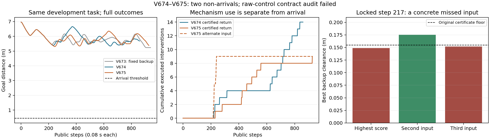

# 动态续接开发 · V674–V675最终结果

**本轮未通过：两个同任务导航均未到达，且最终发现原始命令与实际执行命令的契约不一致。已停止新增仿真，无第三候选。**

用户继续授权后登记5400秒窗口，原硬截止为2026-11-01 14:49:01.924+0800，未延长或重置旧轮次；实际两个候选及导航完成后提前关闭。最多2候选/4导航，实际2候选/2导航、0重复/新几何/独立确认。障碍直径0.20m、幅度0.25m、最高实际速度0.08m/s与不堵口扫掠证书、传感条件及安全门槛保持不变。训练/实机/Stage访问0，V657本轮未重跑或改写。

| 同一开发任务95000011 | V674 后备内切回 | V675 联合输入准入 |
|---|---:|---:|
| 公开步 / 原生步 | 860 / 6880 | 928 / 7424 |
| 导航结局 | BOUNDED_WALL_STOP，未到达 | BOUNDED_WALL_STOP，未到达 |
| 最终 / 最佳目标距离m | 5.6840 / 5.3409 | 5.3828 / 5.3087 |
| 最低实际原生净空m | 0.258814 | 0.252713 |
| 接触 / 穿透 / 未知接触 | 0 / 0 / 0 | 0 / 0 / 0 |
| 有证书切回 / 次优普通输入采用 | 14 / 0 | 9 / 9 |
| 完整qpos/qvel/mocap控制重放误差 | 0 | 0 |
| 新增全面命令核验不一致公开步 | 10 | 10 |
| 最终完整命令契约 | 未通过 | 未通过 |

图中切回和候选采用是机制事件，不能当作到达或完整验收通过。

## 两项已实施修复与其证据

V674允许后备执行至少4公开步后，每4步尝试重新准入普通控制。只有原2.4秒普通预测和首8+完整320tick后备通过，才事务替换旧证书；失败不改旧cache/cursor/expected，切换前后完整状态和时间必须匹配。固定221/241/924/936四点仅221可切回，原940公开控制重放7520原生误差0，私有检查28856积分。实际第221步首次与V673不同，此前状态/输入误差0；51次提议14次切回仍未形成到达。

原首尝试输出被冻结写域守卫拒绝，发生在预测器构造之前，积分0；原console保留。第二次仅将全部输出嵌入同一允许的runs目录。首尝试源码按记录的输出域改动重建，明确标为重建，不能冒充事前快照。

V674新增日志找到11次最高分普通安全输入无可追加后备，其中10次还有不同普通安全首输入。锁定最早217/225，只按原分数及首输入去重测试前3/2项：217次高分有原328tick证书，最低预测净空0.174780615m，首8与完整320tick私有执行状态匹配；225两个所测输入均失败，未测项不推断。1808控制重放原生、25968私有积分，均非新导航。

V675据此只调整普通筛选：依原评分，最多试3个不同首输入，选第一条能追加原后备者，全部失败才用旧缓存。输入库/模型/估计/普通评分/后备内恢复/时域和门槛不变。实际9次采用次优输入，第一次与V674不同在217，此前完整状态/输入误差0。它修复了具体漏选，却仍未到达，也不证明方法新颖性。

## 最终命令审计异常：不能用状态一致掩盖

V675独立审计FAIL：9个普通公开步294–296、300–303、495–496的原始证书命令超出执行器转向范围±0.52弧度，实际写入ctrl时被裁剪；后备497步也有差异。最大原始偏差0.178131701弧度。保留原FAIL及原COMPLETION，不把它们改成PASS。

零积分扩大核对后，V674也发现10个普通步272/274/276–278/430–434有同类差异。其原独立审计PASS文件永久保留，只代表当时已覆盖的检查项；原检查没有逐一比较普通候选的原始命令与实际ctrl，因此不能据此声称完整命令契约通过。候选02启动时依赖的原审计当时确为PASS；该遗漏是收尾扩大检查后发现的，不能倒称已在272或294步在线拦停。

所有20步在应用模型已声明的执行器裁剪后，与实际ctrl误差均0；模型内置ctrl裁剪启用。这解释了完整物理状态为什么仍精确匹配，但只是诊断，不是补充验收PASS。实际命令变化仍满足0.10转向/0.70轮速限制。两个版本的逐原生净空、零障碍接触、完整自体、模型/初态/源码及329未来时刻有限覆盖检查保留其实际结果；它们不能替代原始命令契约。

根因位于控制管线：last_command及部分缓存保存裁剪前命令，而direct_control向物理ctrl写入裁剪后命令。原生模型内部也裁剪输入，因此原在线qpos/qvel匹配不足以发现这一差异。原命令缓存超出饱和值还可能延迟后续转向响应，但本轮没有证明它是全部停滞的唯一原因。

## 原因分析与下一优先事项

V674的15个空间计划中12个到达几何目标，V675的21个中20个到达；实际182/253个普通步在预测局部弧长增加时目标距离反而增加。倒车机动可能必要，这些计数不是每步都错误的证明，但说明不能简单归因于没有任何空间绕路。

**下一版本先统一实际执行器命令映射，再谈时序规划。** 评分预测、首步、后备整尾、命令缓存、日志和实际执行应使用同一满足硬范围与速率的命令；在线须同时核对qpos/qvel和实际ctrl，首次异常就停批。不能仅事后规范化旧日志并回填通过。修复先针对已锁定异常状态作独立有界核验，之后才考虑导航；本轮候选额度已用完，没有实施第三版本。

控制契约修复后若仍停滞，再依[下一阶段规格](DYNAMIC_TEMPORAL_EXECUTION_NEXT.md)核对空间引导与真实时序/执行原语的一致性。[原论文对照](DYNAMIC_BACKUP_RELATED_WORK_V674.md)明确gatekeeper/预测安全过滤已有更新后备结构；Phase必须用公平强基线、消融与新池证明测距集合、完整车身与可执行接续的增量，当前没有RAS投稿成熟、递归可行、实时或无限安全结论。

## 完整账目与证据

本轮新导航14304原生，导航控制重放14304原生，导航私有预测8777016；固定诊断控制重放9328原生、私有54824（小于60000）。输出域失败与后续零积分命令诊断分别记账；0严格到达/0重复/0独立确认/0训练。所有真实积分经run_phase.sh单CPU顺序，current/runtime和冻结模型不改。

机器账目为runs/v674_dynamic_renewable_backup/FINAL_ANALYSIS.json，原审计和失败文件原样保留；全轮原始文件按内容寻址保存在[evidence包](../evidence/dynamic_renewable_backup_v674_round_20261101/README.md)，原始runs在远端核验前不删除。同步实际状态单独记录，不将本地提交当作远端已验证。

收尾核验：320份原始文件经内容寻址保存，253份清单文件逐字节/哈希回读通过；只读准备检查0环境实例、0仿真、0训练且Stage不可见。两候选冻结源码/协议哈希均保持原值。
