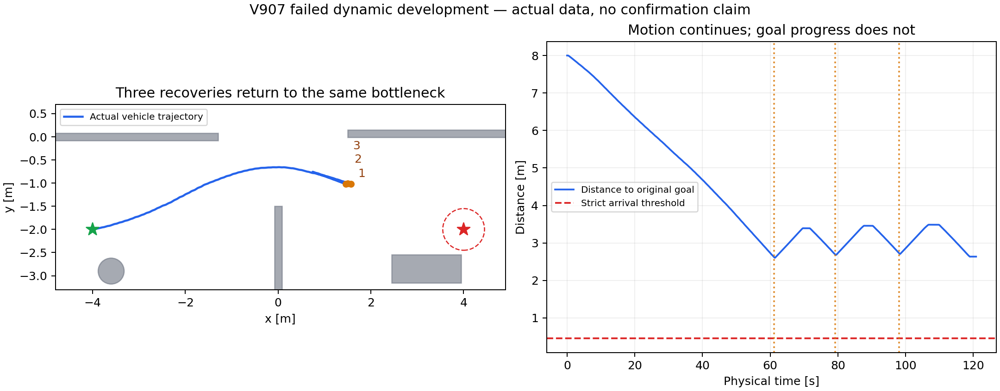

# 动态实验复盘、论文证据与收敛路线（2026-11-09）

**当前没有完成最终版本的动态验收，论文也未达到可投稿状态。不是完全没有进展，而是算法、模型、控制骨架与评价接口多次变动，局部成功没有稳定转化为同版本完整动态证据。** 本复盘按原因和证据组织，不以版本数衡量进展。旧失败与旧期限保持；今晨V900/V901/V903/V905/V907均已失败封账；其中V907把退让做成了三次真实闭环，却仍未取得持续进展，且暴露一处异步状态时间错配。V908只有零模型准备，未启动导航。

## 1. 已经可靠完成什么

|证据|实际结果|能支持什么，不能支持什么|
|---|---|---|
|旧V657静态未知障碍确认|锁定24项，23严格到达，3完整重复；最低实际净空.181062m|旧版本有限静态基准；不能迁移为新模型/新控制器的确认|
|旧V803–805关闭actor的固定WE|5/5到达，5个噪声种子但状态轨迹相同|已知地图下固定路径可跟随；不是五种独立几何或动态鲁棒性|
|旧V827动态三路线开发|两个新主、复用NS保存参照、三个完整重复通过|旧算法已能完成部分动态全链；复用和重复不计新独立样本|
|旧V828动态确认|执行前8项，6完整链、2失败，剩16项和确认重复未执行|不是“动态从未到达”，但该确认失败；不能报告全24成功率|
|Nav2 V884/V885当前静态开发|三条固定路线主及完整重复通过；合计54043实际+54043自重放；最低净空.211161m|成熟骨架和当前车辆在这三条静态路线可运行；6次导航不是6个独立任务|
|V898平台资格|12秒直线前进、制动、倒车、制动；1200实际+1200重放，误差0|有限直线制动/执行能力；不是任意弯道、滑移或倒车末端跟踪保证|
|V897昨晚动态开发|三t0通过；WE首主110.86秒后退让超时；11086实际+11086重放，最低.269001m、坏接触0|安全与证据完整，但原目标未到；其余5导航、新24未执行|

依据：`STATIC_ACCEPTANCE_V657_REPORT.md`、`RPCCR_NO_DYNAMIC_FIVE_V805_REPORT.md`、`RPCCR_GOAL_ACCEPTANCE_20261105_REPORT.md`、`records/nav2_v885_20261108/RESULT_SUMMARY.json`、`NAV2_REFUGE_OVERNIGHT_20261108_REPORT.md`。旧成功不抹掉，旧失败也不追认通过。

## 2. 为什么卡住：四类原因必须分开

### A. 原RP-CCR安全预测代价与活性设计耦合过重

旧方法把大量完整328步控制尾验证放在线上，对每个提案做大量原生模型积分。V800约776.9秒墙钟只推进16秒物理，私有预测3213248步；V802约781秒只推进18.88秒物理，私有4670152步。这里延长回合或加GPU训练不能直接消除安全验证计算。局部几何提速也不能代表端到端同倍提速。

更深的问题是：能够保存一条有限刹停尾，不代表刹停后能继续取得目标进展。早期未见域/失观测可达域扩大导致普通动作与恢复动作持续拒绝；有时规划有路但控制后备倒退、耗尽可续接余量。V828失败槽2剩1.660m时没有获准恢复命令，槽8剩2.152m时触发墙钟限制；不是一个“A*太慢”的统一原因。

### B. 模型、规划与执行器没有先统一验证

V856暴露前轮与底盘代理碰撞体内部持续接触；精确装配对排除后固定命令响应改善。这是工程模型修正，不能包装算法收益。原全局曲率、局部控制预测与实际Ackermann转向约束又不一致，随后经过可实现Twist投影与路径检查才完成同版本静态三路线。单独换A*或仿真引擎不会自动修正这些契约。

当前模型仍是简化模型，仿真真值里程计不等于实机定位；.04m工程制动预留不等于经过全状态域证明的鲁棒轨迹管。

### C. Nav2动态集成的状态与语义不一致

- V886原逐束射线是测距计算热点；V887等价批处理后组件加速，V888物理周期滞后已到毫秒级。这一瓶颈已有实测改善。
- V890/V892：因果未来地图与目标/搜索根语义不一致，加上整图清空产生全未知地图，触发无路与等待；后来完整地图就绪门和取消全图清空修复了这一工程环节。
- V894：车停住后actor继续靠近，等待5.5秒最终净空.149958659m，低于.15门。最后2秒40/40实际观测命中，不能归因于“雷达看不见”。**停车并不是对移动障碍无限期安全的状态。**
- V897：提前退让确实发生、23条退出路径通过、车走了1.569m；但临时目标最近仍差.276m，25秒超时。不是此时求解很慢，也不是碰撞监控把所有命令置零：最后5秒有97条非零命令。

### D. 实验流程没有围绕最小失败闭环收敛

此前多次零模型资格只覆盖数学集合、序列化或短指令，却没有覆盖即将依赖的完整控制过程。接口缺失、冻结后入口错误和审计字段不一致反复打断长流程。另一个损失来自把“通宵”安排成单候选首失败即停：如V89722:25启动、22:28就封账，之后机器空闲；断网不是原因，也不能把剩余整夜算成有效实验。

这些安排保护了失败证据，但没有充分提高诊断效率。后续每轮必须有一个可复现的失败、一个可证伪假设、对应真实生产函数/记录测试、明确的物理检验，并按结果收敛。不能再用局部资格替代闭环验证，不能用不断增加版本号替代方法进展，也不能靠降低成功门制造通过。

## 3. 今晨新诊断与正在验证的修订

保存记录的23条退让路线：前10条起始向后，第11条开始多次出现先前进再倒车的短换向段；RPP的前视点方向决定速度正负，频繁路径替换与末端换向可以解释观察到的前后运动。这里能确认路径和命令相关机制，但尚不能据此断言某一个Nav2函数存在缺陷。

更直接、可避免的设计错误是临时目标语义：真正需要的是进入“可实际刹停、可有限驻留、可重新观测”的区域，旧监督器却强制精确到达一个历史坐标。对同一真实轨迹重新计算，在92.36秒已沿原退让方向投影退让>=.75m、当前因果集合满足6秒驻留+1秒延迟，距旧坐标仍.536311m。旧逻辑因此继续执行无必要的末端对点。

V900只修改内部退让终端条件：实际进入上述区域后取消临时导航，核验取消完成、实际刹停、至少1秒/100原生步驻留和新真实命中后再恢复原目标。原最终目标.45m、实际每步.15m净空、完整车身/合法ctrl/无穿透与完整自重放不变。41项零模型检查包含真实失败输入、监督取消/拒绝/未停/无新命中、独立审计篡改负例及授权边界；这不等于新物理闭环已经通过。

今晨实际结果进一步区分了两类失败：

- V900三t0通过，但ARM握手后第一份RUNNING/tick0消息仍含4.470345617秒前初始扫描，正确的时效门停止。203实际+203自重放、私有0；这次未触达算法修订。源冻结与原错误完整保留。
- V901只修正该消息顺序，科学逻辑逐字节V900、仍沿原10:38:29.771335截止；执行11666原生+11666自重放，最低.269073m、误差0。实际到达退让触发，但19条真实Smac退出路线全部被原EXIT_TIME_OCCUPANCY门拒绝，25秒未完成退出；原目标还差2.793869m。历史候选预估14.45秒，实际Smac路径在约23.54秒预测位置已冲突。**准入评估的路线与控制器最终收到的路线不是同一条，这是可复现的设计不一致。**
- V903单独冻结新科学候选：只对退出过程保留真实已走历史逆向路径，最新测距和实际位姿重新检查原完整足迹/时间占据，控制器收到同一条已检查路线；正常Smac不改。保存V897/V901两真实输入、生产回调、篡改/偏离/旧观测负例及监督/授权共38项零模型检查通过。测试导入曾被依赖改写搜索路径导致读到旧模块，准备错误已记录并在冻结前绑定生产模块校验，0模型。其随后实际结果见下文，不能以局部资格追认物理通过。

本次各候选都保留独立失败与源冻结，物理阶段共享唯一10:38:29.771335绝对截止，未再次新开90分钟。每候选三路线主/成功完整重复最多6导航、首失败停；V900三真实t0仅复用为相同模型初态资格，不冒充V901/V903新样本。Nav2异步完整重复要求相同物理配置/初态、两次完整功能安全成功及各自控制重放<=1e-8，不宣称两个异步导航轨迹逐值相同。新24未执行。

### 本轮完整物理结果和未上车的反证实验

V903首WE完整180秒限时后失败：18201实际+18201自重放/私有0，原目标4.163225m。退让事件0，修改的退让路径未触发，故不能说该机制已被物理验证成功或证伪。134次全局请求中51次目标区域不可用、42次Smac208，车从约52秒停在中央通道等待。

V904围绕三个真实失败车位做零车辆的真实Nav2固定输入诊断：当前占据硬图、移除全局原始点层、目标最近偏移、2秒搜索、6.6m解析连接、正向搜索及关闭启发式缓存，都未恢复这些输入的完整路径，均保留，未追加物理。已知静态地图对照三处均成功，说明不能把这个失败解释为静态车辆必然无法转向。原Smac1.3.13源码也显示墙钟耗尽可返回208，并非所有208都是完备搜索证实无路：[搜索循环](https://github.com/ros-navigation/navigation2/blob/1.3.13/nav2_smac_planner/src/a_star.cpp)、[错误转换](https://github.com/ros-navigation/navigation2/blob/1.3.13/nav2_smac_planner/src/smac_planner_hybrid.cpp)。

软全局参考与原硬局部预测分离的真Nav2探针则三处均出完整路线。初次soft配置仍使用trinary映射，会把软值当空白，这不算有效软风险证据；随后显式trinary=false，实际主图读回cost126/无未知格，六个软件请求均通过，原局部未来占据保持100。V905据此准备并通过57项保存生产函数/监督/授权资格，另冻6953源启动开发，仍共享原10:38:29.771335截止。全局规划只给参考，不能当动态执行证书；局部原未来占据、有限驻留/退让、真实物理.15门仍必需。这是当前架构修订，不是证明原更宽运动类/递归安全。

### 最新闭环：问题从“退不出去”变成“退完仍回到原堵点”

V905实际8146步+8146完整自重放，最低.269073m、坏接触0、误差0。一次实际退让投影.756460m，取消后约.205秒实际停稳，新命中后恢复原目标；第二次找不到获准的历史逆向路线，剩2.674348m。所有15条历史候选都包含此前倒车形成的前后回环，并被时间占据拒绝。把第一次已保存走廊在当前实际位姿重新核验，偏差.026734m<.04且原退出门通过，构成V907的明确修订依据。V905审计器又把“失败时无候选”误当成非法输入而异常，原整体NOT_PASSED保留。

V907修订保留真实历史走廊、每次按新观测/当前偏差重验原门，67项零模型检查后冻源。实测12080实际+12080自重放/私有0，最低.269150m、坏接触0、状态重放误差0；记录出现三次退让—停稳—新观测—恢复，然后因最多三次恢复耗尽停止，原目标仍差2.634226m。发现后走了6.309144m却没有持续靠近目标。不能靠再加退让次数解释为解决。

此外，V907一次恢复事件将body tick8985和scan tick8986组合，**观测比该事件的位姿晚10毫秒**，独立因果审核拒绝；这是异步读取不成事务，不能因位置误差很小就追认完整证据PASS。物理/接触/控制/自重放与观测集合审核通过，但完整事件来源门未通过；旧自动摘要中的局部evidence_passed=true不能单独代表全门。

零模型回读100条实际发布路径并按请求时间/起点对应：其中35条已跟踪actor的正常路线，**35个规划终点全部不满足监督器当时的6秒驻留条件**。这是规划器和监督器的准入冲突，并不证明未来所有时刻或所有控制都无解。原49个终点候选内，35份真实来源只有10份存在同时通过静态和驻留条件的候选，25份没有。三个真实位姿改用一致6秒硬地图+一致终点后的真实Smac查询仍返回208；5cm保守最大池化搜索、固定49终点软件诊断也未恢复，全部保留，不追加车辆试错。

V908已实现一致观测快照模块：实际tracker更新与决定用位姿在同一锁事务内提交，读者深复制同一对状态，过期/来源超前拒绝；真实扫描和确定性并发7项检查通过。另有4项终点共同准入检查通过。**这些是准备，不是已接入的新导航，也不能把缺少完整可执行续行路径叫“准备完成”。** 后续核心修订必须从“每个移动位姿都能静止6秒”的充分但保守条件，转向按同一绝对时间评估实际行驶轨迹、制动/恢复及后续进展；它是新的科学合同，需要重新验证，实际.15净空不能降。

本次新增五次导航合计50296实际原生+50296自重放，私有模型预测0；没有新增24项、对照、训练或实机。旧V898资格1200/1200与昨夜V89711086/11086单列，旧V896工厂内部积分未知保持。所有导航均按各自首失败停止，V907为本轮最后物理候选；不等待到截止继续复制实验。

## 4. 查阅成熟方法得到什么

1. [RPP原论文](https://arxiv.org/abs/2305.20026)把它定位为路径跟踪与速度调节，并有实体机器人实验。它是可信工程基线，但不能替我们证明退让监督、动力学误差或持续可通行性。
2. [Nav2 Jazzy RPP说明](https://docs.nav2.org/jazzy/configuration_and_development/configuration_guide/controller_plugins/configuring_regulated_pp/)明确反向行驶由路径换向支持，末端曲率外插是可选配置。[实际采用的1.3.13源码](https://github.com/ros-navigation/navigation2/blob/1.3.13/nav2_regulated_pure_pursuit_controller/src/regulated_pure_pursuit_controller.cpp)与[路径处理](https://github.com/ros-navigation/navigation2/blob/1.3.13/nav2_regulated_pure_pursuit_controller/src/path_handler.cpp)是本次行为分析依据。文档中的可调项不是已验证修复；本轮没有同时改RPP参数来混淆归因。
3. [RTD-D原论文](https://arxiv.org/abs/1902.02851)区分环境预测与相对预测的正确控制，并离线计算带后备的跟踪可达集合。这支持我们把“轻量在线准入”和“离线执行误差验证”分开，而不是在每个在线候选里无界积分；其not-at-fault结论不能转用为我们的无碰撞保证。
4. [预测安全过滤器原论文](https://arxiv.org/abs/1812.05506)已有名义控制与约束安全策略分层。简单加过滤器不构成新颖性，需要证明恢复与持续进展机制的具体增量。
5. [PRIEST原论文](https://arxiv.org/abs/2309.08235)采用投影引导采样，具有可GPU并行结构。它值得成为后续合格对照；论文中的相对性能数字不能直接套到本车、传感器或当前硬件。贸然迁移全部引擎/训练会再引入模型与接口变量，当前先修明确失败环节。

6. [DS-MPEPC](https://arxiv.org/abs/2303.10133)将预计到达时间与碰撞时间用于终端代价，以降低死锁。这说明“恢复后能继续走”本来就是需要单独优化和验证的问题，简单增加退让不是充分创新。
7. [当前实际版本Nav2 MPPI文档](https://github.com/ros-navigation/navigation2/blob/1.3.13/nav2_mppi_controller/README.md)支持Ackermann模型和向量化CPU轨迹采样。是否切换应由同车预测/执行误差及计算实测决定；不依赖先训练大量并行车辆，也不能引用文档频率当作本车成绩。

以上是有来源的工程选择与研究方向，不是宣称完成上述方法复现或全文理论复核。

## 5. 论文还差哪些步骤

|顺序|交付物与退出条件|当前状态|
|---|---|---|
|1 最终方法闭环|最终模型、名义控制、因果动态层固定；三路线及完整重复均完成发现—恢复—续行—到达；新失败可归因|V900/V901/V903/V905/V907失败；V908仅零模型准备|
|2 冻结独立动态确认|完整预注册任务表、全部已执行/未执行、重复单列；失败不替换，不在确认集调参|旧V828失败；最终Nav2版本未完成新确认|
|3 公平多算法对照|同车辆、任务、观测、控制权限和计算预算；合格Nav2 RPP/MPPI，条件合格后PRIEST；报告失败及配对区间|尚未完成；旧MPPI工程失败不能当公平劣势证据|
|4 机制消融与失效边界|提前恢复、终端区域、信息更新/时效分别消融；测恢复后进展、代价、安全与损害，排除仅更多算力收益|尚未完成；当前组件测试不是消融|
|5 泛化和时序证据|留出几何、相位/方向、感知/执行失配、延迟注入；报告全分母、p50/p95/p99和最大值|固定单图开发远远不够；目标20Hz不等于硬实时|
|6 实体机验证|仿真门全部满足后接入真实定位/雷达/驱动和急停；同低速场地逐级验证|用户要求后置；目前接口未接入，没有实机证据|
|7 完整稿件与投稿包|贡献及假设准确、方法公式/伪码、全部表图/失败/统计、复现实验与公开记录、相关工作和最终格式|有工作稿，结果和贡献有效性尚不完整，不能保证录用|

24项可作为有限工程门，不能单独支持普遍高可靠性。三个固定路线共享一张地图；重复用于可复现性，不能扩大独立样本数。创新重点应由公平消融决定：若主要收益只是修模型、换成熟控制器或放宽内部不必要的对点约束，则这些是工程修复，不能包装为新安全理论。若恢复机制没有显著收益，应收窄论文，而不是强写RP-CCR优势。

## 6. 此后的执行方式

每轮先给出失败位置、原因证据与预计能排除的假设；只有局部资格覆盖真实失败控制链后才跑全程。单次导航现在是分钟级；将在线运行、离线重放、审计压缩分开计时。保留旧失败、源哈希和准确信息，不无限增加候选/种子，也不把一次成功叫验收完成。

本轮物理候选均已关闭，原总截止未重置；先完成V908所列统一轨迹/执行契约及生产链资格，再另行冻结有界物理检验，不能直接重开已失败批次。新算法和场景可以改变，但必须在新协议中显式声明，并让全部比较方法使用同一条件。论文目标保持RAS，交付承诺是可核验的实验和诚实稿件，不能承诺特定成功结果或录用。
