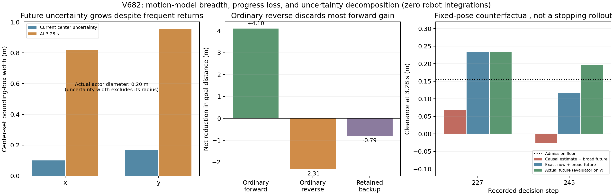

# 动态未知障碍为什么反复失败：V682原始证据复核

2026-11-01。用户要求彻底查因。本次读取完整V680的804帧和原冻结源码，补充几何与解析反事实，**机器人积分、重放、新导航、训练、实机、Stage访问均为0**，不重新打开V679或任何旧窗口。

现有证据支持的主要失败链条是：**小物体的速度估计仍很不确定 → 在线未来运动类比真实小范围往复更宽 → 2.4/3.28秒最坏情况准入拒绝一些临近动作 → 机器人后退 → 普通空间路径与局部弧长评分持续认可后退，但缺少保证接续和持续到达的机制 → 多轮进退最终用完墙钟预算。** 这是一条可核对的机制链，不是已经辨识出每因素独立因果贡献或证明全场景无解。

## 1. 物理场景没有堵死，但在线算法不知道真实运动包络

真实障碍直径0.20m，中心在半径0.25m范围内正弦往复，实际最高矢量速度0.08m/s、最高矢量加速度0.0256m/s²；整个真实扫掠域距保护路口0.611419m。V677同物理模型/初态474公开步安全到达的特权见证排除了“物理场景完全无路”，但它获得真实完整扫掠信息，不能当未知动态算法成功。

当前在线Tracker只声明**每坐标**速度0.12m/s、加速度0.04m/s²；不包含真实锚点、轴、周期、0.25m半径活动区域，也不将场景构造的保护路口约束编入未来可达集合。因此在线必须防范的未来比实际正弦运动广。0.12不是0.08的等义写法，每坐标界也不同于矢量范数界。

这不是已查实的预测算错：当前覆盖审计通过，算法是在对一个更宽运动类做保守规划。直接读取真实锚点/运动轴收紧将改变信息条件，不是修复。若要利用活动范围，需独立公开定义活动区域及其有效性，或另行研究该区域的可证估计；只知道振幅而不知道锚点并不等于知道活动区域。所有对照应共享相同公开先验。

## 2. 看见障碍，不等于能精确估计它未来去向

804帧中711帧有可确认属于未知物体的返回；观测年龄中位数0、90分位0.08秒、最大0.64秒。长时间失联不是本例主要普遍现象。

但365帧只有1条可确认物体射线，236帧2条，109帧3条，1帧4条，另93帧0条。传感器只有32束lidar和15束depth；射线前进采样0.08m，保留的量测硬误差界分别±0.06/±0.09m。障碍在一个0.08秒控制周期最多移动0.0064m，即6.4毫米，远小于单帧测距粒度/有界误差。这里是信号量级比较，不是不可观测性定理，不能说历史数据一定无用。

实际当前位置集合宽度中位数x0.101m、y0.169m；速度宽度中位数x0.140m/s、y0.205m/s。3.28秒后，联合单元并集的**中心集合外包框宽度**中位数变成x0.818m、y0.955m，尚未加物体直径。这不是把真实物体改成1米，也不代表外包框每一点都是可达，而是规划防范的不确定范围显著大于实体。

先前V671固定64帧线性时序约束检查仅让y速度宽度最多改善约2.16%，说明简单多存历史并没有显示明显增益；它也未编码全部非凸测距条件，不能推出所有更好估计器都无效。

## 3. 首次后退由哪一道门触发，已有精确账目

| 触发步 | 普通2.4秒检查 | 后备追加 | 直接原因 |
|---|---|---|---|
| 227 | 12个普通目标候选安全 | 前3个不同首输入×21个后备，共63条全部TIME_CLEARANCE | 普通可行，但所测后备不可接；59条最差点在第328原生时刻 |
| 245 | 18个全部TIME_CLEARANCE | 没有普通输入，未测新尾 | 最好最小净空0.148895m低于0.155m |
| 696 | 18个普通目标候选安全 | 63条后备全部TIME_CLEARANCE | 普通可行，但所测后备不可接；56条最差点在328 |
| 712 | 18个全部TIME_CLEARANCE | 未测新尾 | 最好0.146931m |
| 753 | 18个全部TIME_CLEARANCE | 未测新尾 | 最好0.151735m |

这些关键拒绝没有SELF_DOMAIN或TERMINAL_SPEED原因；227/245/712当时观测年龄均0。不能简单归因为“车身模型异常”“末速太高”或“刚好没看见”。227和696已直接显示普通2.4秒准入与更长复合后备准入之间的缺口。拒绝覆盖的是测试库，不是所有可能的输入序列。

原普通原语是朝一个目标控制驾驶0.8秒，再刹车至2.4秒；后备库主要是停车、倒车后停车，V680只在旧库全败时追加低速前进2.4秒后刹停的有限尾。它们并未搜索完整“转出去—再转回—继续通过”的多阶段原生轨迹。停车在动态环境也可能变危险，这种终端结构与宽泛未来运动类之间存在实际张力。

## 4. 当前估计误差、未来运动类，两者的保守性已被分开

下面固定决策前的机器人姿态，比较3.28秒时的几何净空。全部为停止后的评价器反事实，**不是假设机器人能瞬停、不是执行轨迹、不是新成功**。

| 状态 | 原因果估计+原未来界 | 精确当前位置/速度+原未来界 | 实际正弦未来 |
|---|---:|---:|---:|
| 227 | 0.067172m | 0.234254m | 0.234254m |
| 245 | -0.025992m | 0.117436m | 0.196470m |
| 696 | 0.145761m | 0.327385m | 0.327385m |
| 712 | -0.029662m | 0.219143m | 0.259690m |

227/696这两个冻结姿态的拒绝可由当前状态集合不确定性解释；245即使当前状态准确，广义未来运动界仍不能对该固定姿态证明0.155m净空。它们不能直接归纳为任何控制器/任何完美传感导航的成败。

还构造了相同实际当前状态出发、朝固定机器人方向加速且逐坐标速度限0.12/加速度限0.04的解析替代未来。245状态的一条替代未来在3.28秒使冻结姿态净空降至0.143833m，离真实锚点达0.456932m，但仍在原因果单元外覆盖中、距已知地图障碍至少0.999720m、距保护路口至少0.800050m。它说明原速度/加速度假设允许一类真实正弦场景不会出现、却对机器人更不利的未来；该替代未来可与实际过去拼接，不必假称会收到未来观测。它不证明碰撞不可避免或不存在其他机器人机动。

## 5. 大部分后退不是紧急后备：普通目标函数也在认可后退

| 实际执行类别 | 公开步 | 对目标距离的净改善 |
|---|---:|---:|
| 普通前进 | 504 | +4.100328m |
| 普通倒车 | 220 | -2.310727m |
| 保留后备 | 80 | -0.790830m |

三个净改善相加只剩+0.998770m，而机器人累计走了8.3706m。普通倒车220步中217步实际远离目标，**220步全部同时满足“预测沿当前局部路径弧长增加、预测真实目标距离增大”**。这是源码评分与日志共同支持的差异：score奖励局部弧长、轮廓/航向跟踪，未直接加入目标剩余代价或跨重规划的持续进展条件。

倒车可以是必要机动，不能据此简单禁止倒车。问题是目前没有独立证据证明这些临时后退可以完成后续转向与通行；反复重规划会重新选择局部可得分的前缀。

上层Hybrid A*键为(x,y,yaw,gear)，没有时间、速度或上一控制；下层再用真实动力学和未来占据过滤。当前已经有原生动力学预测和时间门，缺的是联合搜索及一致的进展目标，不能笼统说当前“没有预测/没有动力学”。15/17空间全局路线没有变成持续可执行的动态轨迹，后备可证切回5次也没有转化为到达。这样的空间—时序接口仍是结构缺口。它与SIPP-IP讨论的非瞬时停车问题相关，但不能继承其已知动态离散图的完备/最优保证。[AAAI原论文](https://arxiv.org/abs/2302.00776)。

## 6. 还必须纠正两个判断

**最后停止是墙钟预算耗尽，不是已证明无安全命令。** 最后803步仍有16个普通安全候选、已追加停车尾、正在普通倒车；下一次循环达到780秒soft限制退出。结果必须算未到达，但不能说804步证明“控制集合彻底为空”。增加时间是否最终能到达仍未知，现有多次进退不足以保证继续等待会解决。

**当前不是冻结SAC直接执行这804步。** 源码direct_control将底层轮控替换成几何预测/安全恢复产生的desired命令，实际804步均记录覆盖。冻结SAC动作仍被计算和记录，但不能把当前未到达直接解释成“SAC没训练动态”。当前测试主要检验感知—几何搜索—预测过滤—恢复控制栈。

**计算开销是限制，不是这次仿真的传感延迟解释。** 本次777.73秒墙钟推进64.32秒仿真。障碍按MuJoCo仿真时间移动，搜索耗时本身不会让障碍在后台多走12倍；不能据此编造额外实时迟滞。这个实现若用于实机还不满足实时要求，且本次预算限制了能执行的机动数量。

此外，有限3.28秒尾没有得到可保持安全的终端集合或持续逃逸保证；它同时可能对通行很保守、又不构成无限安全证明。gatekeeper明确需要可稳定到控制不变集的后备及相应适用假设，不能将Phase有限尾视为已满足该结论。[作者原稿§III–IV](https://dev10110.github.io/pdfs/2024-gatekeeper-tro.pdf)。

## 原因优先级与下一验证顺序

1. **先对齐任务信息与运动假设。** 明确要求算法解决“有公开活动区域约束的小范围未知运动”，还是“只有速度/加速度界、去向未知的更广运动类”。不偷偷供给真实轴/相位，也不靠降低安全距离修补定义缺口。
2. **补受控原因消融。** 下一有界导航先区分“精确当前状态+原未来界”的诊断分支与原因果分支，并严格单列特权信息；现有固定姿态反事实不能替代这项实际导航。避免在信息瓶颈未辨清时直接增加庞大搜索量。
3. **统一可执行轨迹与接续。** 在同一绝对时间下包含速度、上一合法控制和完整可重放状态，搜索多阶段机动并保存完整安全尾。无新证书时保留旧证书，终端到期条件明确。对应接口见DYNAMIC_TEMPORAL_KERNEL_DESIGN.md，尚未实现。
4. **验证持续进展。** 后退可以保留，但需连同可实现的后续前进一起评价；增加跨重规划的剩余代价/停滞检测，分别报告真实目标进展与局部弧长。任何改动先同状态证明增量，再原失败例到达和完整重复，最后新池确认。

此前测距删失修复、命令裁剪修复、联合集合和后备库有各自必要性，但没有给出持续通行的正面证据。继续在这些过滤器上加小分支，不能被当成动态已经接近验收。当前已查实上述接口和假设差异，尚未证明某一单项修改必然救回，也没有未知动态独立成功率。

可复核产物：runs/v682_dynamic_root_cause/ANALYSIS.json、EXACT_STATE_ABLATION.json、OBSERVATION_OBJECTIVE.json及各自输入/源码SHA。协议和脚本位于experiments/v682_dynamic_root_cause，全部新数据来自零机器人积分的停止后分析，未修改任何原验收/失败。
