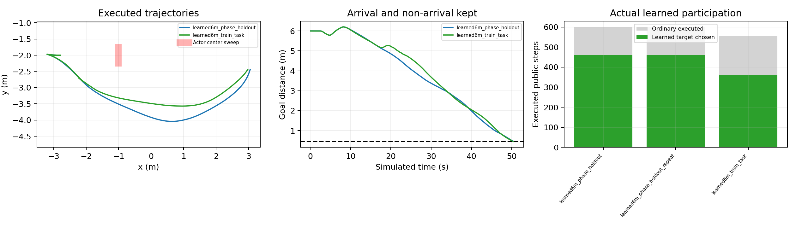

# 6米动态学习课程通过与8米初始化阻塞 · V689

2026-11-01。**6米两个运动相位均到达，并完成同版本完整重复；原生安全、完整状态/命令重放、因果覆盖与证书核验通过。** 这是有限空白场地课程门通过。随后已按授权尝试8米，但起步前没有有效actor回波，执行0步后停止，8米训练与通行未通过。

## 这次具体修正了什么

V688旧日志的15次重规划中，13次仅由未来空间投影压到旧路线触发，当时当前因果联合占据仍安全；另2次在前后换向时净位移抵消，同参考弧长实际已推进。新版本保留初次3.28秒因果投影绕行搜索，旧路线局部重核验改用当前因果联合占据；停滞判定增加同参考弧长30步推进<0.08m的条件。

完整15项固定输入及合成真停滞/当前占据失效前置检查通过后才导航。6米网络使用V688原checkpoint（SHA c77b5f833fe77d3cadbab9fb41835426a058249728eee94a0cf8e92aa88796c0），没有新增梯度。原2.4秒普通预测、8+320原生步3.28秒保留尾、.155预测/.15实际净空、自体.002、末速.025及执行器幅值/速率全部保留。

保留路线只是保留候选动作的参考，不直接授权行驶。每个实际动作仍需从真实完整状态通过原未来占据和动力学门。详细机制和边界见[ROUTE_COMMITMENT_MECHANISM.md](ROUTE_COMMITMENT_MECHANISM.md)。

## 6米实际验收证据

任务为起点(-3,-2,0)到(3,-2)，6米指起终点直线距离；未知圆柱直径0.20m、振幅0.25m、最大速度0.08m/s，原47束3m传感/噪声/漏检不变，整个扫掠不堵中央口。真实锚点/相位/未来只供场景和独立评价，在线使用因果测距。

| 预注册任务 | 公开/原生步 | 最终目标距离 | 最低实际净空 | 网络实际普通执行 |
|---|---:|---:|---:|---:|
| 6m相位0 | 629 / 5032 | 0.447449m | 0.775546m | 360 / 554步 |
| 6m相位pi/2 | 631 / 5048 | 0.449640m | 0.581488m | 460 / 599步 |
| 相位pi/2完整重复 | 631 / 5048 | 0.449640m | 0.581488m | 460 / 599步 |

三项均达到原目标距离<=0.45m。逐原生障碍接触/穿透/未知0，完整自体覆盖、无积分外根改写、静态模型不动、实际合法命令和未来集合有限网格核验均通过；15128原生完整重放qpos/qvel/mocap误差0，原始ctrl逐步一致。

完整重复模型字节/规范初态相同，全部公开qpos/qvel/ctrl/mocap误差0，实际接触事件精确一致。原始接触SHA含各自生成XML目录而不同；在XML字节已核验一致的前提下，只按原事前协议规范化该目录，未删除或容差化物理字段。全部原始日志和摘要保留。

主规划各1次。相位0仍执行40公开步后备，3次通过完整证书切回；另一个相位及重复无后备执行。不能将本轮描述为完全没有接管。所有已存尾/交接的328原生几何、合法控制序列、方向与制动时序重算通过。路线维护独立审计分别复算当前占据/参考进展，与实际记录误差0。

## 与上轮同模型、同初态的学习版比较

| 相位0指标 | V688 | V689 |
|---|---:|---:|
| 结果 | 900步仍距目标1.074496m | 629步到达 |
| 主规划次数 | 9 | 1 |
| 普通倒车步 | 201 | 43 |
| 普通倒车对目标净进展 | -1.751297m | -0.412821m |
| 实际路程 | 10.546668m | 7.922485m |

网络权重、物理模型字节和规范完整初态相同，首次完整状态/控制差异正好出现在旧第一次重规划的71步。本轮没有靠追加6米训练取得变化。该配对提供了路线维护机制的开发证据；两项触发规则的各自贡献、网络相对无网络的贡献和统计优越性尚未分离。

## 8米真实失败：未建立初始可验证观测

6米门通过后，原协议确实启动8米：起点(-4,-2)、目标(4,-2)，actor锚点仍(-1,-2)。预检几何可通行，但第一次传感决策没有actor有效回波，center=null、certified_unknown_rays=0。原覆盖检查返回NO_INITIAL_ACTOR_OBSERVATION，driver原状态STOPPED_EXCEPTION、任务原FAILED保留。该任务公开/原生步均0，无8米梯度更新，后续8米评估/重复未执行。

零积分复算原始47束包与原筛选、集合约束完全一致：中心距3m、圆柱表面2.9m、0.08m射线采样的首次命中为2.96m。有效hit上界分别为LiDAR2.93999m、depth2.90999m；原中心束实际读数2.998768m和2.938978m均被排除。理想无噪声2.96m也不满足这两个筛选上界，因此不是简单换一个随机噪声就可以算解决。

这暴露了课程构造中的耦合：后移起点却保持actor世界坐标，同时把初始遇障距离从2m改成3m。它同时引入了传感边缘/未知空间初始化问题，不能只归因8m控制能力。本轮没有放宽传感筛选、给真值位置或绕过覆盖检查；原8m永久保留一次未成功。

下一距离课程应单独事前定义可比的初始遇障/可观测性，明确变更的几何并重新做全车身/保护口/边界证书；原8m任务不能被覆盖。若研究的是初始不可见障碍，则需另立未观测空间和探索安全协议，不能借“延长路线”暗中改变问题定义。这里尚未执行新8m任务，也未训练8m模型。

## 总账与范围

4次导航尝试：3次实际6m成功（2开发相位+1重复）及1次8m起步前失败；另1次8m零积分几何预检。15128新导航原生、15128完整重放、9234400私有预测；原8m失败0原生/0私有积分，本轮监督/SAC梯度均0，复用旧512更新的6m模型。880.148秒内按失败规则结束，原7200秒绝对截止1793537212.430891未延长。

全来源、任务/训练额度、6m门依赖、8m原失败账目独立核验通过。Stage/实机0，current/runtime/Phase20/Phase6不改。原V688失败、本轮8m原FAILED/COMPLETION、原始runs与完整证据均保留，当前无活动实验。

本轮通过的是**有限空白场地6米动态学习课程**，不是原墙体场地、任意未知动态、统计稳定性或实机验收。下一步先修正8米课程的初始可观测性定义，再推进更长训练；还需独立新任务和同预算消融，不能仅凭这两个相位称RAS论证已经充分。
