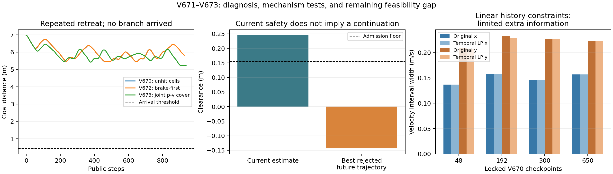

# 动态未知障碍：V671–V673原因分析与两次结构验证

2026-11-01。本轮按用户要求检索原论文、分析失败并改算法，两个有界候选已完成；**动态未知障碍仍未通过**。静态V657原验收与全部旧失败不变。

## 实际开发结果

| 版本 | 改动 | 结果 | 原生步/控制重放 | 最小实际原生净空 |
|---|---|---|---|---|
| V672 | 制动停车后备优先，不可用才原倒车后备 | 929公开步，780秒soft门限停止，未到达；最终距目标5.8154m | 7432 / 7432 | 0.338080m |
| V673 | 在V672上，以连续联合位置—速度覆盖统一当前/未来准入 | 940公开步，NO_RESERVED_RECOVERY_COMMAND；最终距目标5.2364m | 7520 / 7520 | 0.247080m |

两分支都同一个开发几何95000011。障碍/穿透/未知接触均0，完整公开qpos/qvel/mocap重放误差0，完整自体域覆盖、无积分外根状态改写、模型/初态与冻结源码审计通过。合计14952原生导航和14952控制日志重放；0到达、0条件重复、0新几何、0独立确认。证据核验通过不等于动态验收。

原5400秒全轮绝对截止为2026-11-01 13:57:35.555+0800，未延长；两个候选上限已用完，约13:02结束导航及常规重放，后续只有零机器人积分整理/数学诊断。没有第三导航候选、训练、实机、Stage访问或新自动任务。

## 排除了哪些过于简单的解释

**不只是左右换边。** V670的21次规划有19次右侧，仅3次绕行侧变化；首档方向变化9次。279步局部弧长进度增加而实际目标距离增大，但倒车本身可能是必要机动，不能仅据此判错。

**不只是强制倒车。** V672保留657次制动停车证书，但真正触发恢复时仍使用3条倒车尾，共120公开步；与V670共有前843个公开状态/控制完全相同。这次更改没有修复关键执行行为，不应因为实现了停车分支就称算法改善。

**不只是位置矩形面积。** V671用1545旧观测包验证当前位置和速度必须同属一个联合覆盖块，并在165未来时刻检查覆盖。固定100个真实模型控制中，原外矩形99个可用，联合并集100个；说明存在表示增量，但这些检查点不以控制集合完全为空为主。

V673在1545旧包上进一步通过每原生0.01秒的329时刻覆盖，5000几何对照中保守快速下界没有高估精算并集净空；底层全局位置/速度区间与旧Tracker逐值相同。实际941决策帧的联合覆盖及8条完整后备证书均独立重算通过。它改变了第48公开步开始的实际状态/控制，执行了7条倒车和1条停车尾，但仍反复进退，没有解决到达。

## 最后失败定位

V673第900–939步执行了一条完整40公开步制动停车尾，末端已制动。第940步从该真实状态重新规划，当前估计完整车身净空0.244529m；普通候选没有自体几何拒绝，但其最好被拒绝的未来最小净空为-0.143156m，未满足0.155m准入。没有剩余保留后备，停止未成功。

这给出了实际的有限后备末端缺口：一条有限时间安全的尾部，不能保证结束后仍有下一条安全计划。当前实现一旦进入后备就完整执行40公开步，中途更新观测但不重新评估普通通行控制；完成后清除旧证书。应把“当前安全”“后备时段安全”“能接续规划”三件事分别验证。最后的拒绝只覆盖当前生成的候选，不能据此证明全控制空间或全场景无解。

仍有一个诊断限制：转入后备时，原普通控制拒绝/新增后备失败的详情被后备记录覆盖。除最终停止记录外，不能完全区分每次是普通候选为空还是追加后备失败。下一实现应先补齐这些原因和候选计数，避免继续盲改。

## 历史时序信息是否明显遗失

另做固定V670四点48/192/300/650、各末64帧的32个线性规划。只用当时外区间、测距必要半平面和同一0.12m/s、0.04m/s²运动界，把所有历史位置/速度及相邻积分关系同时约束，优化当前四状态边界。真实轨迹只在求解后核验，不进入约束或控制。

四点x速度区间几乎不变，y速度宽度最多只缩小约2.16%；位置面积也仅少量改善。因此在这组线性必要约束下没有发现明显的速度信息增益，不能承诺换线性时序估计器就会通行。该诊断没有编码所有非凸精确射线条件，不能上升为信息论不可观测或所有估计方法无效的证明。

首次因缺SciPy而未执行LP，原错误保留；仅在runs/analysis_dependencies独立安装SciPy1.15.3，冻结环境与在线实现未修改。32个LP共约1.8秒，0机器人积分，没有形成第三在线控制候选。

## 怎么解决：下一实现应改结构

以下为**未实施、未验收的下一实现规格**，本轮不追加第三候选：

1. 补齐每次后备切入前的普通候选拒绝、尾部拒绝、最差时刻/部位及当前/未来净空，先区分候选生成不足与真实证书不可行。
2. 后备执行期间每个公开步都评估新证书。只有新计划从当前完整实际状态出发、首步与新后备全部通过相同原生安全准入时才允许替换旧证书；没有替代则继续旧证书。避免为了软奖励直接打断后备，也避免看见新信息后仍无条件退满40步。
3. 在同一时序动力学规划中搜索前进、转向、真实制动等待和倒车，保持完整自体、执行器/换向约束和同一占据预测；让空间引导参与候选排序，而不是先生成理想几何路径再只用常输入短轨迹过滤。
4. 把恢复终端能否接续有效观测/控制作为单独条件。任何预期观测收益只能作为启发式，实际返回及集合收缩必须记录；不能假定下一帧必定观测到，也不能以真实轴/相位/未来选动作。

可更新预测安全策略、真实加减速等待和部分闭环信息规划均有既有研究。应借鉴它们的结构，并核对各自终端/可达/观测假设；不能因换成上述结构便继承递归可行性或全局到达。具体原文、读取范围和差异见[文献与失败分析](DYNAMIC_LITERATURE_FAILURE_ANALYSIS_V671.md)。

## 论文力量与预算

本轮更有价值的结论是用可证伪对照定位了“有限安全尾≠持续恢复”的实际缺口，未取得动态正面成功证据。RAS目标保持；“强创新、优于已有方法、实时、独立动态稳定通过”目前均不成立。后续必须完成可更新后备/时序规划的实际通行，再补新任务、强基线、同约束消融和计算延迟。

导航私有积分8056688；固定诊断重放5200原生、私有网格24000及初始后备检查1296（含原JSON写入失败648）分别记账。数学覆盖检查/LP/依赖安装不产生机器人积分。V673每公开步8原生tick，940步共75.2秒仿真，实际执行712.27秒，仍非实时。全部原始证据保留，GitHub远端未验证新结果前不清理。

