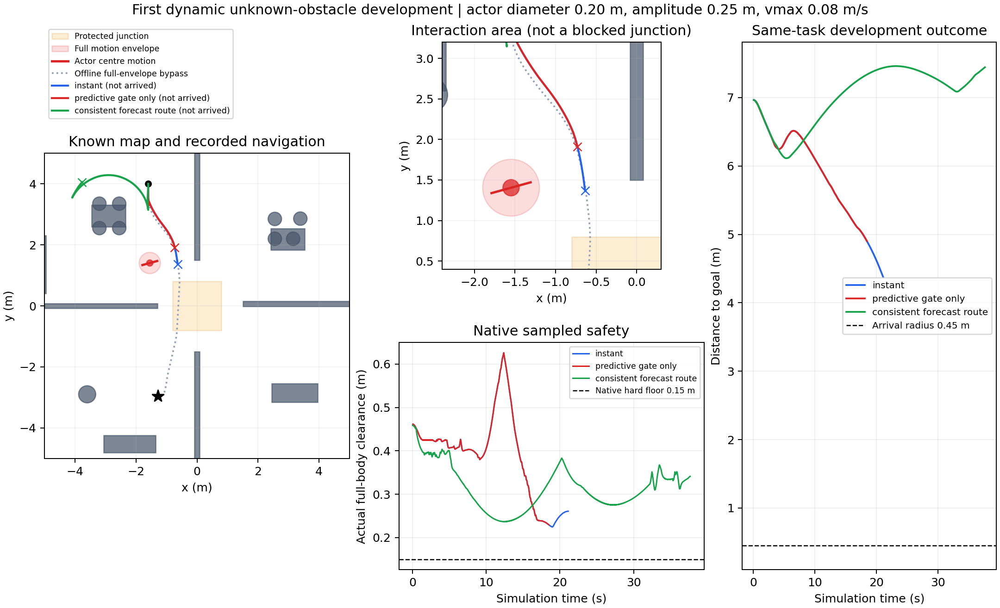

# 动态未知障碍首轮开发报告 · 2026-11-01

**已进入动态开发，但本轮未取得严格到达，动态稳定未通过。** 静态V657的23/24有限工程验收保持原样。本轮仅一个复用静态几何的开发任务95000011，三个算法分支不是三个独立任务，更不是动态确认率。因未到达，所有条件重复均未执行。

## 障碍尺寸与不堵口证据

运动学圆柱直径0.20m，小于原静态0.50m/0.32m；正弦幅度0.25m、两端中心相距0.50m，最大速度0.08m/s。整个扫掠圆盘半径0.35m，距已知实体/边界至少0.952172m、距中央通行口保护区[-0.8,0.8]²至少0.611419m。把整个扫掠圆盘当作永久占据后，完整车身仍有起终点参考路径：密集最小净空0.172075m、姿态插值下界0.166406m，超过0.15m硬下限。该参考仅供离线场景核验，没有作为在线人工路点。

这是当前任务起终点与中央保护区的非堵口合同，不宣称任意地图所有路口均已认证。mocap提供脚本运动输入，物体不自主避让；不是受力驱动行人模型。障碍位置、速度、相位和未来真值不向在线规划公开，在线使用测距历史、已知静态地图和声明的尺寸/速度类。

## 实际结果

| 开发分支 | 公开/原生步 | 严格到达 | 终距(m) | 最小实际净空(m) | 停止原因 |
|---|---:|---|---:|---:|---|
| V659 当前占据 instant | 264 / 2112 | 否 | 4.376486 | 0.224428 | 当前感知域净空0.147400m，低于0.15m |
| V660 只给控制准入加入时间预测 | 231 / 1848 | 否 | 4.901846 | 0.229582 | MPC及后备均无安全控制 |
| V661 路线也避开预测包络 | 471 / 3768 | 否 | 7.443995 | 0.236718 | 无可用进展路径 |

最小实际净空是完整自体原生姿态投影AABB到所有已知实体及真实动态物体的最小距离，不是感知估计净空。三条已执行前缀共7728原生步，障碍接触/穿透/未知接触均0；完整qpos/qvel/mocap控制日志重放误差0，自体覆盖与无积分外根状态修改核验通过。地面支撑与允许的模型自体接触仍在完整原始接触日志中，未删记录。

三分支模型SHA相同、规范初态相同、运动参数相同。两个修订31分支前231步完整状态相同。V661仅对因果预测包络的空间路线投影做一次算法修订，不降低原生时间准入、安全余量或不确定性膨胀。该修订没有带来到达改善。

图中红色圆盘为整个运动包络、线段为物体中心运动范围，橙色为通行口保护区。灰色虚线是仅离线使用的全包络绕行参考，三条实际轨迹均未到目标。绿线展示修复版的退避绕行，不能将更长执行时间解释为更好。

## 失败原因与证据边界

1. 原路线只按当前动态占据构造，而控制准入要避开未来2.4秒包络；到达局部后才拒绝，缺少空间路线与制动准入的一致性。V661把同一因果管投影到路线搜索（7时刻、0.4秒间隔，额外0.0608m插值覆盖余量），没有使用实际未来轨迹。
2. 简单表面点中心估计不够可靠。首配对离线最大中心误差0.174011m，有限未来圆盘对真实圆柱的最大支持超出约0.048891m。这是预测包络漏覆盖，不能称风险校准或安全预测保证；本轮零接触仅适用于已执行轨迹。
3. 修复版绕远后丢失观测，年龄包络持续扩大，之后没有可用进展路径。恢复策略没有把重新获得观测作为目标；不能靠放小包络解决。下一步应先修测距一致集合/运动预测，再加入可观测性和可持续等待的恢复决策。

停止导航时也停止了场景时间，所以“零接触停止”只描述有限前缀，不能证明保持原地等待任意时间仍安全。还没有遮挡突然出现、不同相位/速度、多个运动物体、独立新池、统计优越性、连续时间或实机证据。分支墙钟约为其仿真时间的7.0/7.4/10.3倍，不能称实时。恢复器接管低层轮控，SAC收益尚未隔离。

## 执行修复、预算与证据

V658三个预检均未取得全运动包络参考，导航0；额外诊断发现首例参考0.154664m低于预设0.155m，不等于证明路口封死。V659仅将离线参考搜索余量提高至0.17m，最终阈值未降低，首次预注册任务通过后才导航，其他两个候选不再重筛。

V659原独立重放因缺contact_contract导入路径失败，原COMPLETION及失败审计保留。V660仅修复独立重放入口；补充重放和V661再次核验通过，不回填原失败。本轮4个驱动共享原首驱动2026-11-01 09:27:47.774至10:27:47.774的3600秒绝对窗口，最终1075.222秒闭批，未重置截止、未通宵。9840次重放积分含两次原基线补充重放，另4168080次机器人私有预测积分，均不计新导航任务。所有实际仿真经run_phase.sh隔离，冻结控制器与current/runtime未改，训练0、实机0、Stage访问0。

- [V658原预检与源码](../evidence/dynamic_scene_v658_20261101/README.md)
- [V659参考修复、原基线及原导入失败](../evidence/dynamic_scene_repair_v659_20261101/README.md)
- [V660时间准入与补充核验](../evidence/dynamic_time_gate_v660_20261101/README.md)
- [V661最终修订、全轮账目与独立审计](../evidence/dynamic_forecast_route_v661_20261101/README.md)

四包293份清单文件、248项来源引用及三条原始接触摘要核验通过，全部原始runs仍保留；这项PASS是证据与已执行物理前缀核验，不是导航/动态验收PASS。独立核验位于runs/v661_dynamic_corridor_consistency/INDEPENDENT_DYNAMIC_AUDIT.json，完整轮次账本DYNAMIC_ROUND_LEDGER.json。只读准备检查亦通过，0环境实例/0仿真/0训练，模型SHA及V647冻结源码保持。

主入口仍只有Phase仓库，V661是本轮最终开发实现，旧目录是带冻结来源的必要失败历史，不是多个可互换“最佳版本”。报告和证据已在本地整理；GitHub写入仍受此前认证/链路问题影响，远端未验证前不清理原始证据。

## 后续如何形成论文力量

先完成可覆盖的因果测距与运动估计、持续运动下的减速/停车/重新观测，再冻结新池与同版本重复。随后保持0.20m尺寸和非堵口合同，逐步测不同相位、横穿/同向、0.08到0.15m/s及遮挡，不把变小障碍当算法贡献。详见[动态研究路线](DYNAMIC_RESEARCH_PLAN.md)。

[SIPP-IP](https://arxiv.org/abs/2302.00776)对有加减速约束的等待规划提供建模依据；[RTD-D](https://arxiv.org/abs/1902.02851)提醒预测正确性和相对于预测的控制正确性必须分别成立。[DYNUS](https://arxiv.org/html/2504.16734v3)已有时空走廊和后备轨迹框架，因此Phase需要用完整车身、执行器迟滞、可观测性恢复与严格进展对照建立自己的证据，而不能只以“加入动态预测”主张创新。这里是借鉴与下一步研究设计，尚未实现或比较这些完整方法。
