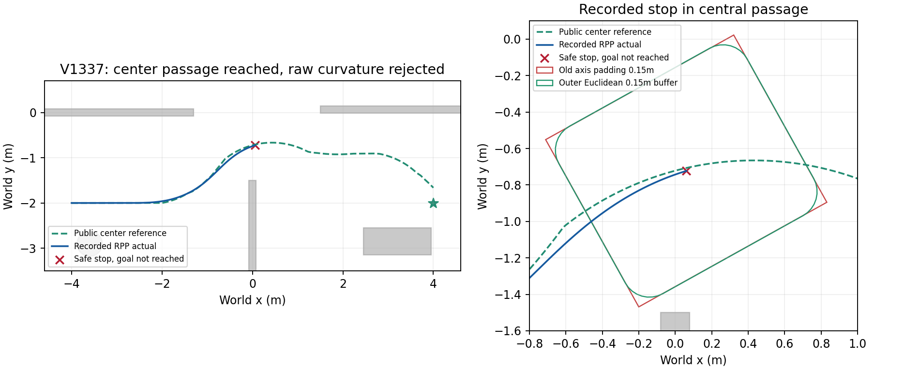

# V1337 欧氏安全边界整路复验与曲率接口诊断

V1337首主未通过，首次控制合同异常后停止，重复未执行。RP-CCR V1281原固定动态24/24保持；本轮是RPP基线工程开发，不是重新做RP-CCR动态验收。

新圆角边界使车辆通过V1333约(-.95,-1.45)拦停点，驶至原中央通道(0.060036,-0.723131)，但仍未完成8米原WE任务。新边界改善这段实际通行，并不证明整路已修好。

|项目|实际保存证据|
|---|---|
|任务|原WE、seed10060001、同公开19实体静态图/32有噪测距/858参考，actorOFF|
|新边界|原名义矩形⊕外切32gon欧氏15cm，36顶点；实际15cm门不变|
|控制器|同V1333原RPP参数，不加控制投影|
|实际步数|4685精确=4485行驶＋200停车尾；trace/journal/finalpacket/time46.85交叉一致|
|最低实际净空|0.25003366463292104m|
|坏接触|0；全部4686接触记录含t0|
|停止后目标距离|4.141704098650921m，未到达|
|最终车体|x=.060035732,y=-.723131013,yaw=.507803192,v=-5.08e-6,w=4.25e-6|
|初始化|规范Vehicle1次，内部模型构造数未知|
|自身重放|最终receipt和RESULT缺失，总数未知，保守范围0–4685；不声称误差0或审核通过|
|私有MuJoCo预测/训练|0/0|
|重复|未执行|

完整原生qpos/qvel/ctrl/mocap/time、journal、200停稳、全部接触和源SHA保存；13项保存证据一致性检查通过，实际ctrl幅值/速率与自体门均合法。但独立分配记忆审核及最终重放receipt不完整，不给整体PASS。ROS合同异常触发原保守abort时native已进入停车/保存，SIGTERM在finally中仍可能中断末receipt；这是未解决的异常路径证据完结问题，下一启动前需要明确允许受限保存排空且不再执行导航，不能把进程消失当完成。

## 精确失败指令

最后原始ROS记录v=0.09998093336673879m/s,w=-0.07575757575757576rad/s。原控制合同要求|w|<=|v|/1.32+1e-6，该v对应界0.07574313133843848。原始pair曲率约0.7577202293>1/1.32≈0.7575757576，超出约0.0191%；不是NaN、源码变更或15cm安全门降低。该pair已记录并在ROS发送native之前拒绝，actualjournal没有执行它；历史897合法raw不改。安全门不能为很小超差放松。

RPP的调速与曲率组合缺少最终耦合合同，原因可用原实际输入稳定复现；对一般RPP本来没有相同机械硬曲率保证，不把此工程接口失败说成论文算法天然不行。

## V1338已准备的修订及资格边界

独立新工程RPP子类源码已写：先调用固定上游compute，再用(v,w)成对投影满足机械速度/死区/曲率，之后在同地图与欧氏足迹下重新核验实际投影后的pair，保留原1.5s碰撞时域；禁止只在ROS输出端盲截角速后直接执行。此版本必须标适配RPP，不叫未经改动的上游，也不是RP-CCR理论贡献。

命令`python -B experiments/v1338_rpp_executable_pair/build_and_qualify.py`实际完成生产C++projector检验：898条旧raw中897逐字不改，只修正末条角速1.4444419137282782e-5rad/s；修正后共享原合同接受，100000确定随机pair、零速/非有限负例通过，0模型。该命令随后因已清理的旧编译头不存在失败，准备错误保留。隔离恢复原版本DEB又收到404；原站/快照只读可用性检查URLError，未替换版本、未改旧runtime。故新插件**尚未编译、尚未加载真实ROS动作、尚未获得物理启动资格**。不能把纯数学PASS说成修订已整体通过。

冻结V1337原证据/窗口保持，不追加物理重跑；新候选需先恢复固定ABI编译依赖，完成真实插件正/负动作和异常保存排空资格，再另立有限整路验证。当前REVIEW_PENDING/锁空闲/无后台导航，Stage/实机/训练0。

## 证据交付

32原始成员/15941990逻辑字节，7443574字节压缩档8块≤1MiB；失败和未知分账保留。Git源/报告/metadata与Release必须完整下载逐块/整档/逐解压成员SHA、恢复实测后才清原件。旧V1329未核验raw不动。备份完成以records/v1337_margin_route_20261118/FULL_REMOTE_VERIFIED.json为准。

交付完成：源码报告9b04b151ab3348018a900515c310985edee116ba已push/HEAD核验；同仓Release已发布，32成员及全部11资产/整档/解压成员SHA、标签commit和31普通文件恢复实测通过。之后按清单清理47069251逻辑字节，冻结依赖0删；缺失的原nativeRESULT/重放回执不会因备份完成变成已存在，ownreplay仍未知。旧V1329未核完raw保持。
