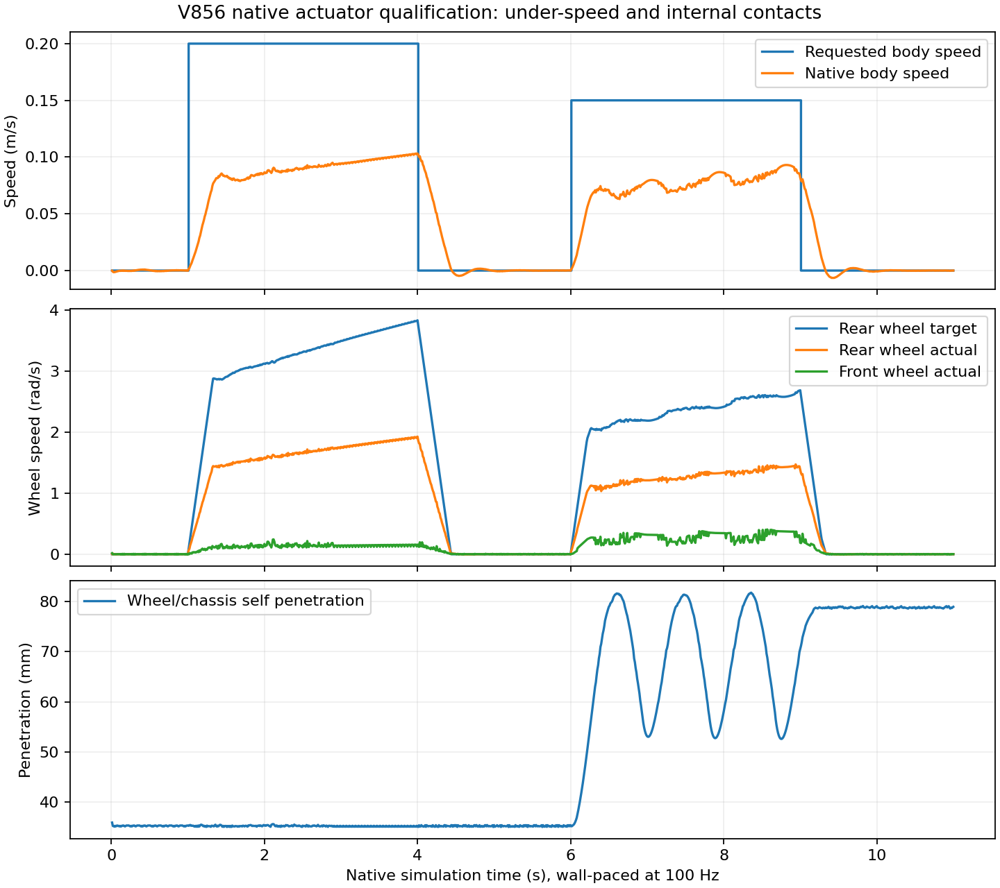

# V856：真实 Nav2 框架接入及本车执行器资格

2026-11-07，按用户“采用成熟Nav2导航骨架开始；实验结束上传GitHub”执行。**真实Nav2软件全链通过；本车执行器资格未通过，场地静态/动态导航均未启动。** 本轮及唯一输出目录接口接续均已闭批，REVIEW_PENDING原字节恢复、执行锁空闲。原20:00绝对截止没有延长，旧失败没有重开。

## 已实际完成

Ubuntu24.04上使用用户目录解包的官方ROS2 Jazzy/Nav2 1.3.13二进制，不使用同名自写替代品，不修改系统安装。469个依赖包下载SHA与APT元数据核对；ROS索引签名和压缩索引SHA通过。使用官方map_server、Smac Hybrid规划器、MPPI Ackermann控制器、行为树导航器、生命周期管理器、速度平滑和碰撞监测。移除本车不能执行的原地Spin恢复，保留有限清图/等待/倒退。模型、旧runtime、网络参数原字节保持，Stage隔离，无训练或实机。

软件测试是在有边界空栅格上的解析运动学接口测试，明确不是物理/动态验收。固定6米直线任务B05成功：墙钟40.233秒，末目标距离0.341174米，最大横向偏差0.058674米。控制命令间隔p50 49.997ms、p95 53.151ms、最大56.833ms；这是话题发布时间间隔，不能替代纯求解延迟或硬实时证明。

B01的OMPL库搜索路径错误、B02生命周期尚未激活即发目标、B03进程消失且无最终结果、B04固定复用噪声导致偏离/180秒未完成均原样保存，全部零物理。B05仅将MPPI regenerate_noises从false改为true，完成原任务；这是本配置的软件诊断，不证明MPPI普遍优劣。准备期间的字段/解释器/JSON类型错误亦无物理积分。

## 实际物理分账与停止门

| 项目 | 实际执行 | 结果 |
|---|---:|---|
| 原资格入口 | 1次环境初始化调用、0积分 | 旧B.OUT仅允许paired子目录，初态保存越界被拒；错误结果也被同一守卫拦住 |
| 单次输出目录接续 | 1次环境初始化调用、1100原生步/11秒 | 执行器资格未通过 |
| 已执行控制完整重放 | 1100原生步 | 全qpos/qvel/ctrl/mocap误差0，接触一致 |
| 私有模型预测 | 0 | 本链不执行旧百万级私有搜索池 |
| 三路线静态主 | 全部未执行 | 资格依赖失败 |
| 三路线动态主及三重复 | 全部未执行 | 资格依赖失败 |
| 新24、训练、实体机 | 0 | 未启动 |

这里统计的是两次环境初始化入口调用；底层MjModel建模/加载对象次数未单独插桩，报告未知，不把它写成2。原首入口的INITIALIZATION_PROVENANCE确认bootstrap0积分、时间0，失败发生在首个step之前。退出时EGL销毁告警不是停止主因。

原冻结V856源码未修补。唯一接续仅在factory返回后将B.OUT扩大至本轮runs/v856_nav2_foundation，保留原审计钩子和源码不可写；零模型guard正负测试先通过，独立接续源再冻结。同一个11秒固定命令表仅在旧入口0积分后实际执行一次，旧失败不追认为通过；没有换阈值/动作/种子，也没有第二接口接续。

固定资格先静止1秒、直行0.20m/s三秒、制动2秒、0.15m/s与0.05rad/s转弯三秒、制动2秒。原生物理100Hz按墙钟推进，最大滞后2.317ms，实际最小外部障碍/边界净空0.278178米、完整自体包络余量0.009378米，障碍/未知接触0。合法执行器幅值和原每秒速率门通过。转弯区间实际平均角速度0.021577rad/s在注册范围内，末平动速度0.00000708m/s低于0.03；**直行测量窗口实际均值0.096115m/s，低于事前0.10–0.30m/s资格范围，故停止全部后续导航。** 目标0.20m/s与实际仍相差约52%，不能因接近资格下界而降低门槛。

## 保存数据发现的模型缺陷

独立零模型分析读取全部1100原生状态/控制及1101帧含t0接触。每个实际原生步均记录前轮与底盘自接触，几何对为25/23和27/23，即left/right_front_wheel的碰撞圆柱与chassis_collision箱体，直行窗口穿透约35mm，转向阶段最大约82mm（完整精确值见DIAGNOSIS）。原“坏接触0”仅指障碍/未知接触，**不表示自碰撞不存在**。

对应直行窗口：两后轮平均目标3.5565/3.5574rad/s，实际1.7841/1.7815rad/s，前轮实际约0.1440/0.1406rad/s。碰撞箱与轮体重叠是已确认异常；它可能增加阻力与转向扰动，具体因果份额尚未做对照，不能把全部旧RP-CCR失败倒因为它，也不能仅凭拟合就增加PI增益。

下一物理版应先依据真实底盘/轮罩结构修正碰撞分解，或仅排除机械安装处本不应求解的轮体—底盘碰撞对；继续保留轮体、底盘与外部障碍碰撞及全车包络。先验证接触分类/完整自体、速度阶跃、角速度和制动，再开展三路线静态→动态。不能全局关闭自碰撞、删除障碍或用根位姿修正救回。本报告只给出该设计，未生成新物理模型、未再积分。

## 科学和部署边界

Nav2名义基线没有RP-CCR未知动态集合与完整328尾证书，不能追认成原RP-CCR通过，也不是论文创新本身。当前尚无场地Nav2结果、算法对照或新24验收。软件解析运动学通过不证明MuJoCo本车能跟随。此次物理资格只使用模拟器当前本车速度反馈；没有验证实机编码器、IMU/EKF、定位误差、通信延迟和计算平台。后续拟用的理想机器人里程计也必须单列假设。

软件最多4CPU（Nav2三核＋单核物理），与旧单CPU全模型搜索不是相同计算合同。实际原生回路与规划解耦，禁止因规划计算暂停物理；本轮只证明11秒执行器回路和一次非物理任务的有限观测，不能宣称完整导航实时、递归安全、任意遮挡/地图、多actor、RAS全面优势。

## 证据及存储

独立保存审核在closed_analysis/FINAL_INDEPENDENT_AUDIT.json，全15项非功能证据门通过，科学资格仍false。保留本轮所有失败/成功软件日志、命令/轨迹、固定任务/冻结SHA、实际MJB/初态/1100状态控制与接触/完整重放结论。必要原生证据约8.75MB压缩、精选ROS运行库约43.70MB压缩及第三方许可约0.60MB压缩已上传同仓Release；共9附件/54,736,913字节全部通过GitHub服务端digest与流式下载SHA回读。源码与报告存Git，开发头文件、静态库、APT可重建缓存不上传。源码提交69876c5已在main和Release目标核验，4个关键源码/报告/索引远端原字节SHA回读一致；恢复脚本另从公开Release重建完整证据组、逐成员SHA通过。随后已清除本地临时环境、开发/下载缓存、已验证原始证据与重复打包缓存，释放约1.43 GiB；需要时按组恢复。恢复入口与最终远端核验见records/nav2_v856_20261107/README.md及RECORD_INDEX.json。

上游参考：[Jazzy默认配置](https://github.com/ros-navigation/navigation2/blob/jazzy/nav2_bringup/params/nav2_params.yaml)、[MPPI噪声生成实现](https://github.com/ros-navigation/navigation2/blob/jazzy/nav2_mppi_controller/src/noise_generator.cpp)。实际下载版本和本地字节SHA在本轮元数据中锁定，分支链接不替代内容哈希。
