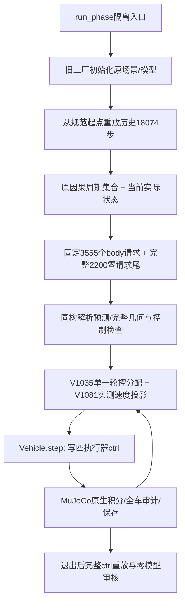

# Phase动态导航全线复盘 · 2026-11-12

**当前结论：做出过静态和动态的真实成功，但还没有形成在当前模型、当前执行控制和当前任务定义下，可稳定完成三路线与独立确认的统一版本。** 最近的失败集中在“完整输入预测—执行器真实瞬态—后续减速可行性”之间；更早还存在全局参考续接、稀疏感知、名义控制方向切换、模型装配和时钟交接等独立问题。不能用一个原因解释所有历史失败，也不能因为后续失败抹去旧成功。

本复盘只读已有实验/源/记录，并清理冗余，不启动新车辆或物理积分。Stage完全隔离。以下数字以各版本自己的原始合同和审核为准。

## 1. 从头到尾发生了什么

|阶段|已实际完成|真正卡点与证据|阶段结论|
|---|---|---|---|
|V647迁移基础→V657静态未知障碍|旧静态24项全部执行，23严格到达，原3完整重复及审核通过|这是静态未知障碍合同，未覆盖当前移动actor、当前Nav2/新控制模型|保留静态成果，不能直接移作当前动态结论|
|V658–V701早期动态/发现恢复|发展因果测距集合、有限制动与发现后恢复；较窄的“移动发现”旧锁定池跨批完成记录存在|旧池含13导入/11新增，合同和当前完整场地全链不同；有限尾安全与一次局部进展不推出整程可续行|旧证据保留，独立样本和任务口径不能混用|
|V702–V805完整场地与计算诊断|逐步增加全局参考、保留尾、观察与恢复；V803–805无动态同一路线五回合全部到达|五次轨迹实际相同，主要是已知静态固定跟随复现；动态加入后占据不确定性和续接再次阻断|证明“车并非所有路径都跟随不了”，尚未解决动态|
|V806–V821真实发现后重规划|V820西东主+重复通过；V821南北发现、完整328刹停、重规划及停车后3.876m续行成立|V821发现后SAFE_PROGRESS_PREFIX终点仍距原目标1.929m，后续搜索拒绝，测距长断档使集合扩大|失败首先在路线后继/信息可维持性，而非完全不动|
|V826–V828旧RP-CCR全线高点|V827组合原NS观察主、WE/EW新主和3次完整重复，三路线开发通过；V828前8项成功6项|两个失败后按原规则停止，剩16未执行、3确认重复未执行；8项全为WE|确实有动态成功；原池即使剩16全过也最多22/24，达不到原23/24及WE7/8|
|V829–V855进展/速度/准备开销修订|持续研究返回、前进恢复、完整目标参考、GPU预测等|V843南北96秒仿真用了4293.713秒墙钟，约44.726倍；私有预测19918224/实际9600；全局规划占墙钟33.144%|性能是真问题，且未到达也不是单纯墙钟不足|
|V856–V858接入官方Nav2并发现物理装配异常|真实ROS2 Jazzy/Nav2软件链通过；确认两个轮体—底盘碰撞对重叠；修正后同actuator序列直线响应.096→.326m/s，同体命令闭环.186m/s|旧自接触具有可测因果贡献；修正模型后原名义控制仍会失败|这是必要工程修复，同时改变了模型和控制适配条件，旧成功不能自动转移|
|V862–V867 MPPI/RPP与静态余量|V862 MPPI静态180秒失败；V863只换官方RPP后同WE45.69秒仿真到达；V867 NS成功|MPPI频繁正反；全局统一膨胀.20又让WE目标/EW起点占据，NS成功不能拼成同版全线|成熟名义控制有用，但不能随意叠加全图余量|
|V874–V885可执行曲率/时序适配|V884 NS主+重复，V885 WE/EW四次，同版本三路线静态全部通过；54043实际+54043完整重放|实际轨迹可异步不同，各自安全/到达/停稳成立|当前模型体系中确实恢复过三路线静态基线|
|V886–V924 Nav2动态与时域恢复|扫描加速保持原传感逐值一致；V888发现actor后续行1.634m|V888实际动态净空.149996878低于.15；随后有限占据、终点、等待、周期集合等改进又出现观测断档、目标占据、零运动/接收时钟问题|当前点碰撞监控不足以替代未来制动可行性；把整周期占据硬贴图又会封死通道|
|V928–V934名义MPPI支线→RP-CCR归位|修复曲率与停车死区，V931仍静态180秒失败，108次换挡；V934重回RPP+RP-CCR|V934新替代分支触发0：上游参考消失后只给零，恢复逻辑只等“非零提案被拒”而永远不介入|干预入口选错；固定保存正例不保证闭环会触发。MPPI支线未证明改善，不应继续作为主线|
|V943–V960最后两米、倒车与转向交接|V945到过1.85m附近；固定响应和停车合同不断澄清|最后22.31秒走1.135m，其中倒行.493m、16次方向切换，目标只净缩短.143m；更早恢复段航向越.035；零Twist保留轮角，不能当已回正|部分是名义参考/恢复振荡，部分是交接与瞬态失配；不是“再跑两米必到”|
|V974–V998保存恢复态与转向辨识|四项完整辨识完成；实际轮角/速度加转向速率项能解释固定响应|简单运动学遗漏转向瞬态的车体偏航；仅减慢回正仍留累计偏差；50/100ms墙钟门和初始化/记录入口也多次失败|必须区分目标轮角、实际轮角与车体响应；后验解释不是在线误差保证|
|V1002–V1025控制输入一致规划|原子交接实际通过；把完整输入检查放入搜索接受条件；V1025静态WE完整到达|早期只找首个.4m合格段，段末未保证后继；V1020后级未产生输入就停。改完整目标后原困难动态仍NO_COMPLETE_DYNAMIC_INPUT_ROUTE|本阶段首要问题是可执行全程/后继，而非已经下发的路线跟不上|
|V1030明确新较易课程|只改变actor中心的新课程主+重复通过，目标.36649m|原窄通道课程仍未通过；时间规划期间物理/actor按仿真时钟暂停|有工程正例，但不能冒充原任务或实时能力|
|V1032–V1055速度/曲率预测与发布交接|.08直/左/右响应资格通过；逐步修复保存态输入与原子发布|完整时域/等待/低速搜索仍可能无完整解；测量包取得后做重计算导致过期|速度、动态时间窗和参考可达性需共同处理|
|V1056–V1067回到真实起点与三路线|V1056原WE主从头完成发现、328停稳、4.128m净续行与目标.12170m；V1058重复未全过；V1067新三主0/3|V1058包龄失败；EW原起点不满足新统一储备，用户另列北移.10m课程；V1067三路线继续暴露源生成/恢复问题|有单主里程碑，尚无当前统一三路线/重复通过|
|V1070–V1075重新接入冻结SAC|真实186维传感→双SAC→安全筛选及125实际控制+2200停车组件通过，移动.09015m|SAC尚未集成到当前完整导航worker，不参与最近3555目标续行；0训练|加入接口不等于RL已解决完整动态导航|
|V1076–V1082当前最后一段|.125完整目标预测出现，五速度响应及左右回正组件通过；实际长轨迹连续暴露转角、速度预测与控制可行性问题|V1078转角误差越界；V1080实际纵向超速；V1082新增单步限速约束无合法交集|当前主缺口是可信的执行预测与闭环持续可行性，仍不是完整到达|

## 2. “以前24项成功6个，怎么现在还在组件”

原[V828报告](/home/linghu/Documents/Codex/2026-10-31/new-chat/phase-/docs/RPCCR_GOAL_CONFIRMATION_V828_REPORT.md)是实在的6次完整链成功。原三路线开发也有[V827报告](/home/linghu/Documents/Codex/2026-10-31/new-chat/phase-/docs/RPCCR_GOAL_ROUTE_VALIDATION_V827_REPORT.md)，不应抹掉。

但V828试验只运行了槽1–8，全是WEST_EAST：6成功、2失败。NS槽9–16和EW槽17–24都没运行。该固定池按原门已不可能达到23/24及WE至少7/8，继续补余16也不能把原批变成通过。

后来为速度/实机可用性切到Nav2，修正物理装配、控制映射、曲率限制、后备、控制预测和课程初态；已经不是同一个受验系统。当前组件回归有必要，**但反复重建组件不能替代保护成熟成功基线**。迭代中缺少了一个始终锁定的“模型＋名义控制＋RP-CCR接口＋任务＋计时合同”版本。改动没有持续以旧成功和旧失败成对回归，导致功能反复退回。这是开发路线管理的问题，不能归咎于用户着急、断网或回合时间不够。

## 3. 当前到底在跑谁：从入口到轮子

当前入口结构见[精简控制链](/home/linghu/Documents/Codex/2026-10-31/new-chat/phase-/docs/PHASE_NAVIGATION_CURRENT.md)。最近一次的实际链是：



这次没有运行Nav2 ROS导航动作，也没有用SAC在线选择这段目标路线。最近的“Nav2系列目录”主要继承了车辆/场景工厂，不能凭目录名认定完整Nav2正在闭环。

车体速度、前轮编码器和控制器记忆进入同一个Adapter。V1080全部记录控制已由原单一V1035映射重建到2.22e−16；V1082新增14个实际控制由新映射重建误差0。历史各版本确曾出现多层名义请求/安全筛选/停稳所有权交接不一致，但**当前没有证据支持另一个控制器同时抢写轮控**。初始化里多条Phase9日志属于继承组件启用，不是多个独立导航控制器抢权的证据。

## 4. 最近几轮，问题在什么位置逐层暴露

|版本|分析或实际范围|结果|明确说明的问题|
|---|---|---|---|
|V1076|原NS15290态完整预测|6336步含等待/2200尾，目标上界.36662m，预测通过|.125速度超出旧.08辨识域，当时实际尚未资格|
|V1077|五固定.125响应|5/5通过，11625实际/11625重放，误差0|固定短响应没有覆盖长轨迹的所有转向瞬态|
|V1078|历史15290+2784新续行|转角误差.015070>.015，距目标1.63625m，完整余3555未执行|单一虚拟轮角模型不足，实际指令本身并未被另一owner改写|
|V1079|双前轮位置/速度模型，保存数据回核|同已观察前缀转角误差降.006989；没有新物理|修复解释能力，仍不等于整个新轨迹/新速度闭环已合格|
|V1080|两真实左右回正及条件续行|左右各2605实际和完整重放/审核通过；续行16步后实际.130297>.13|名义速度预测只有.119833，低估转向释放的加速瞬态|
|V1081|转角/转向速率速度修正＋单步实测限速|保存模型、控制幅值速率、完整目标预测通过|经验误差余量是有限数据结果；资格里旧失控轨迹局部12–16已出现无合法投影，未补足含误差闭环可行性|
|V1082|原18074历史+14新实际|完整历史和18088自身重放误差0；第15个请求被拒；距目标1.61845m|单步限速与原轮速slew冲突；实际新段尚未越原.13纵向门，完整停车/到达都没完成|

### 最新拒绝的精确数值

零模型复现命令：

```text
/home/linghu/miniconda3/envs/mk_mujoco/bin/python -B experiments/navigation_review_20261112/diagnose_saved.py --require-feasible
```

实际已运行，约0.24秒返回1，报`V1082_SAVED_TRANSIENT_IS_NOT_RECURSIVELY_FEASIBLE`；它重走真实生产governor函数，只使用原实际当前编码器/体速度/控制记忆，0车辆模型、0物理积分。14个已执行新控制逐值重建误差0。

- 当时实际纵向速度：**.1279826475m/s**，原实际上限**.13m/s**。
- 原每步轮速变化率和当前联合转角要求的后轮共同速度下界：**1.2307090882rad/s**。
- 新单步速度门允许的后轮共同速度上界：**1.2301555096rad/s**。
- 二者无交集；即使取合法最慢轮速，经验下一步上界也为**.12900512096m/s**，比新内部**.129**高**5.12096e−6m/s**。
- **.129是我在V1081新增的内部设计门，不是用户原有的.13实际验收门。** .002也是有限已观察样本上的经验一步误差余量，不是已证明的全域扰动界。这个微小差值不能叫浮点舍入噪声；同样不能据它说原实际安全必然失败。

因此，本轮直接失败是新控制器内部可行性冲突，未证实若继续就一定越原.13。把.129放宽或吞掉断言会改变冻结协议，也没有证明可完成整段；正确做法是重新统一硬约束、必要误差余量、实际执行器减速能力和后续后备。

另确认一个后备交接风险：该拒绝函数先调用原分配器，已改变Python控制器记忆，随后才断言投影可行。对本保存输入，拒绝后last-control变化0.041492441515618816、积分变化-2.9826474644736867e-05，却没有执行第15步原生积分。它没有改变已记录14步的实际ctrl，但下一版若捕获异常后直接用这份已污染记忆生成后备，就会与真实最后执行控制脱节。新接口应先纯计算候选，只有真正准入才提交记忆，或失败时精确回滚；这项检查也应列入固定回归。

我在资格阶段已经见到旧状态上的投影拒绝，却主要依赖名义闭环轨迹通过来启动新物理，没有补足带响应误差的多步可行性检查。这个判断不充分，造成又一次长历史重放。这一轮的责任在实验设计和准入安排，不在用户或网络。


## 5. 根因分层：哪些证实了，哪些仍未知

|层次|已有证据支持的结论|证据没有支持的结论|
|---|---|---|
|物理模型|V856–858确认轮体/底盘装配自接触影响响应，后已修正|不能把所有过去失败都倒因为这个接触问题|
|名义规划/控制|V862/V931有显著正反命令与参考换挡；V934参考消失导致恢复入口不触发；V1020末态前级搜索没有生成新输入|不是每一轮都是A*慢，也没有证明地图物理上无路|
|感知/预测占据|32束3m对.20m actor存在实际观测断档，集合扩大可封住参考；周期/速度假设的改变影响可通时间窗|不能把静态全周期并集等价为可行时变规划；不能声称任意遮挡鲁棒|
|恢复规划|安全短段首解/固定最小进展不保证段末有后继；新的完整输入规划改善了语义但有受限搜索失败|增加时间/层数/换种子并非现有拒绝的充分修复|
|执行预测|快回正引起车体偏航与纵向瞬态；.125短固定响应不够覆盖长轨迹；V1080预测低估实际速度|后验teacher-forced解释和少量留出残差都不能直接当安全误差定理|
|安全与持续可行性|V1082精确显示新增单步门和slew无交集；当前计划可行不保证实测更新后仍能减速|有限2200尾、一次投影或停止积分不等于递归安全/实体车安全停车|
|集成与流程|输出目录、Path、元数据、导入、就绪、包龄、审计浮点语义多次造成独立失败；克隆版本和依赖链膨胀|不能把每个入口错误称算法失败，也不能用“安全审核过”冒充到达|

**仍未知：** 该MuJoCo车辆瞬态的完整高阶接触/轮胎机理与实机是否相同；新限速继续执行后的实际结果；原困难任务在所声明误差/控制/时间合同下的全域可达性；最终RP-CCR相对强基线的独立优势。现有有限搜索或拟合不能填补这些未知。

## 6. 为什么一轮看起来很久

早期确有计算瓶颈。V843仿真96秒对应4293.713秒导航墙钟，离线独立审核还不在这个时间里；约2075个私有预测原生步对应1实际步。源码的固定work_limit分支绕过了配置的墙钟budget，曾有单个细搜索114.6秒。把所有慢归给离线审计不成立。

Nav2迁移后也有接近墙钟的实际正例：V863完整WE45.69秒物理、约51.41秒ROS总墙钟；V884–885三条静态主/重复85–98秒物理能完成。它们表明整个研究不必天然慢几十倍。

**最新V1082的约358.12秒批次，绝大多数时间用在18074步历史恢复、逐步几何/接触/传感核验和18088步自身重放，而新科学续行只有14步，即.14秒仿真。** 这是严格保存态复现成本，不是控制器每0.01秒本来就该花几分钟。当前CPU2、SCHED_IDLE、nice19、CPU渲染是共享资源政策；所得墙钟也不适合作实机实时声明。

本次已把最新直接拒绝缩为只重建14步控制记忆的一次零模型检查，约.24秒复现。后续应先用这种小闭环反例把准入问题解决，再付出长历史物理成本。不能靠GPU自动修正模型和控制语义；GPU/向量化可加速批量搜索，其收益仍需单独计时和等预算对照。

## 7. 哪些东西确实冗长，已经怎么剪

清理前：experiments约249.6MB/11142文件/618目录；runs约1.791GB。当前冻结清单覆盖131个实验目录中的2052个Python路径，只有1409个不同源码内容，**643个是额外同字节副本**。这只是冻结清单范围，不能解释为同时运行131条算法或加载3002个源文件。

已执行：

1. CURRENT_EXPERIMENT.json从433582字节压为3985字节，全部旧字段无损存入records/navigation_review_20261112/CURRENT_EXPERIMENT_HISTORY.json并记录SHA；当前入口不再混杂数百个过期活动/成功字段。
2. 新建一份当前控制链说明和本完整复盘，旧报告按版本作为历史证据引用；没有新物理并行支线。
3. 删除1749个未跟踪、可重建的Python字节码，24209978字节。
4. 删除6份同字节重复归档，93537750字节，每组保留已核对SHA的同内容副本。
5. 34个模型输出按4个相同内容组处理，30个额外模型实体合并为内容相同的硬链接，合并298199790逻辑字节；原路径、模型字节和SHA全部保持。

共减少或合并**415947518字节（约396.68MiB）**冗余。独有证据未删，当前冻结源码/输入全SHA再次核对一致。模型硬链接是磁盘实体去重，不能把各路径st_size相加后声称它们仍占同样磁盘块。

没有盲删643份历史源码：它们被后续硬编码路径、冻结哈希和旧记录恢复引用。直接删会破坏已有复现。真正需要剪的是**后续活动架构**：保留一个参数化控制/预测内核、一个驱动、一个审核入口，历史包退出当前入口。后续重构必须在新目录完成并对固定保存集等价检查；不能边运行边改冻结源。

不保留为当前活动方向：未通过的MPPI换挡支线；没有触发入口的旧恢复分配变体；已证明控制逐值不变的重复物理组件；不参与当前完整续行的SAC提案接口。它们作为历史成果/否定结果存档，不再每轮默认重跑。

## 8. 下一个合理实验应回答什么

现在不应再直接押“三路线→24”或完整通宵。先回答一个可证伪的问题：

> 在同一个转向释放状态及已登记响应误差范围内，能否持续生成满足原幅值/变化率/实际速度门的控制，并一直保留可执行完整制动后备，最终回到能完成目标的参考？

必要的修订边界：

- 区分原物理硬门与后来添加的工程余量，重新统一推导；不靠堆叠额外断言制造“形式上严格、实际上动不了”的系统。
- 控制预测必须包含轮角/轮速状态、控制器积分与速率限制；输出命令经过投影后，重新检查同一个实际模型/执行语义下的未来，而不只看下一个点。
- 保存反例先覆盖V1080超速、V1082不可行和已通过左右组件，既要消除原反例，也要保持成功正例；拟合数据、开发回核和真正新物理留出明确分开。
- 先建立实际可执行后备再放行运动；新提案失败时调用该后备并真实验证停稳。当前异常退出冻结仿真、末速仍.128，不可写成实体车完成安全停车。
- 完整目标/时变通行窗口继续联合核验；单纯降到.03或提高上限可能改变动态时间窗，不能假定更慢必安全或更快必可达。

上述尚是下一轮设计要求，不是已经修好。只有局部闭环和完整目标资格同时过，才值得一次短物理关键段；随后单原任务主＋完整重复，再同版本三路线，最后新独立确认。旧已观察24不能重新包装为未暴露确认。

## 9. 论文目前还差什么

|环节|现状|必须补齐|
|---|---|---|
|可陈述的方法贡献|有因果集合、完整车体输入证书、恢复/后备/交接等实现与否定证据|把主贡献收敛到一个统一方法；Nav2替换、严格日志或“SAC+规划”本身不能代替新颖性证据|
|功能闭环|旧三路线动态、当前静态三路线、较易课程动态、当前原WE单主均有正例|当前统一模型/算法的完整动态主＋重复＋三路线；不能跨版本拼接|
|独立确认|旧V828八任务6成功2失败；旧静态确认通过|冻结最终方法和未暴露任务，完成预声明全分母及固定重复；统计结论和工程门槛区分|
|外部算法与消融|存在旧机制组件对照和名义控制器试验|同模型/传感/地图/噪声/计算预算的可运行强基线、主机制消融及失败分析|
|部署与实时性|有部分ROS近墙钟运行；当前保存态/暂停式搜索不是真实时|端到端p50/p95/p99/max、超时及后备行为；实机接口/估计器/延迟资格后实体实验|
|稿件与投稿|已有方法设计/研究判断和大量分散报告|统一符号、假设、理论/经验边界、可复现实验表/图、最终局限与初稿；目前不宜写“已验收、实时、全面优势”|

**最需要纠正的不是再增加一条支线，而是让同一个方法的参考、预测、执行、后备和评价口径一致，并让每次修改守住已经成功的回归基线。** 当前先完成复盘/整理；没有自动启动下一物理批。

## 10. 可核对的主证据

- [旧动态三路线V827](/home/linghu/Documents/Codex/2026-10-31/new-chat/phase-/docs/RPCCR_GOAL_ROUTE_VALIDATION_V827_REPORT.md)与[8项6成功V828](/home/linghu/Documents/Codex/2026-10-31/new-chat/phase-/docs/RPCCR_GOAL_CONFIRMATION_V828_REPORT.md)。
- [物理接触因果对照V858](/home/linghu/Documents/Codex/2026-10-31/new-chat/phase-/docs/NAV2_VERIFIED_V858_REPORT.md)、[RPP单静态正例V863](/home/linghu/Documents/Codex/2026-10-31/new-chat/phase-/docs/NAV2_RPP_STATIC_V863_REPORT.md)、[同版本静态三路线V885](/home/linghu/Documents/Codex/2026-10-31/new-chat/phase-/docs/NAV2_RUNTIME_V885_REPORT.md)。
- [动态净空失效V888](/home/linghu/Documents/Codex/2026-10-31/new-chat/phase-/docs/NAV2_DYNAMIC_GAP_V888_ANALYSIS.md)、[恢复入口未触发V934](/home/linghu/Documents/Codex/2026-10-31/new-chat/phase-/docs/RPCCR_RETURN_V933_V934_ANALYSIS.md)、[最后两米可视化V945](/home/linghu/Documents/Codex/2026-10-31/new-chat/phase-/docs/RPCCR_V945_PATH_REPLAY.md)。
- [完整转向辨识与解释边界V995](/home/linghu/Documents/Codex/2026-10-31/new-chat/phase-/docs/RPCCR_SIM_TIME_RECOVERY_V995_V998_REPORT.md)、[前沿续接诊断V1020](/home/linghu/Documents/Codex/2026-10-31/new-chat/phase-/docs/RPCCR_V1020_TERMINAL_FRONTIER_DIAGNOSIS_20261111.md)。
- [较易课程正例V1030](/home/linghu/Documents/Codex/2026-10-31/new-chat/phase-/docs/RPCCR_DECLARED_COURSE_V1030_REPORT.md)、[真起点主成功/重复失败V1056–60](/home/linghu/Documents/Codex/2026-10-31/new-chat/phase-/docs/RPCCR_FRESH_START_V1056_V1060_REPORT.md)。
- [当前新速度组件与失败V1077–79](/home/linghu/Documents/Codex/2026-10-31/new-chat/phase-/docs/RPCCR_SPEED125_V1077_V1079_REPORT.md)、[实际超速V1080](/home/linghu/Documents/Codex/2026-10-31/new-chat/phase-/docs/RPCCR_TURN_RETURN_V1080_REPORT.md)、[新内部可行性失败V1082](/home/linghu/Documents/Codex/2026-10-31/new-chat/phase-/docs/RPCCR_SPEED_GUARD_V1082_REPORT.md)。
- [早期计算计时纠偏](/home/linghu/Documents/Codex/2026-10-31/new-chat/phase-/docs/RPCCR_REALTIME_AND_PAPER_RECOVERY_20261106.md)。
- 本复盘机器可核对回执：records/navigation_review_20261112；最新拒绝数据在runs/navigation_review_20261112/LATEST_REJECTION_REPRODUCED.json。原本地闭批193来源归档保持原字节；本次新复盘/诊断作为补充存档。
