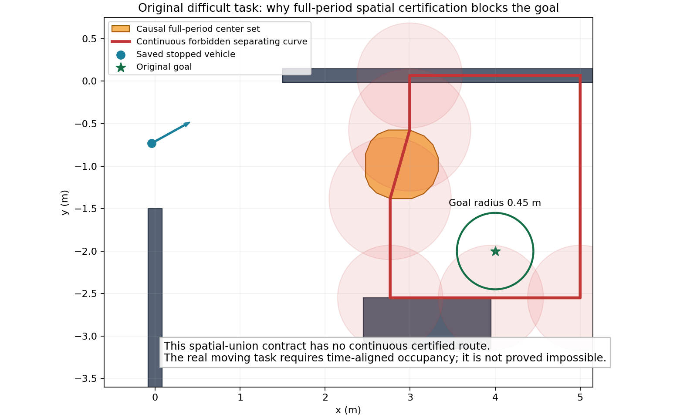

# 原困难任务全周期空间合同的连续封路证据

已取得原V1025保存状态的连续充分证据：在当前整周期占据静态并集与原.2435342102净空合同下，任何朝向、前进或倒行连续路线都无法进入整个原.45m目标圆。不是只因A*慢或搜索扩展不够，也不证明真实动态任务无解。

原因果中心多边形与上横墙、下矩形、右边界形成闭合禁止曲线；整车包含.375m内接圆，保留全部预测余量后，三桥段重叠余量约.696/.169/.187m。起点绕数0，目标绕数1，目标中心到曲线最近.550m，大于完整目标半径.45m；连续路线无法越过。所有数据来自公开静态图及实际历史雷达的原因果集合，未向规划器泄露actor未来真值。

固定允许倒车的几何搜索仍30k扩展未找到整路，仅最近1.892m；解析分隔证据说明继续在同一空间合同里增搜索/换倒车无益。V1031仅改因果启发式的时间源码仍30k/52.36s无整路，尚无实际执行资格，原失败保留。

已实现保守的合同选择门：遍历实体而不写死下标，找到充分分隔见证才返回TIME_ALIGNED_OCCUPANCY_REQUIRED；其余UNKNOWN，不当作存在通路。9正负资格通过，保存输入本机查询约0.00031226099235937秒；这不是整套规划实时性。当前仅离线源候选，未集成实际导航。



下一轮应固定时间对齐的原因果占据方案，并先完成该输入范围动力学、完整停车和时钟接收资格，再做原任务；不再重复注定被空间合同排除的导航。0.08m/s新组件实际左转未获1cm资格，不直接用于新时间导航、不事后放宽门。原.03m/s较容易课程主+重复通过保持独立；原困难任务、三路线和原24仍未通过。

本诊断0模型/0积分。V1032有限组件是2模型/843实际+843完整重放、私有0，直行通过/左转343步误差.0100219失败/右转未执行。前缀控制独立重建最大6.94e-17、状态/ctrl/mocap重放0误差、最低.406080/坏0；功能失败不升级。所有物理窗口已闭、guard原字节/锁空闲，训练实机0。

```json
{
  "passed": true,
  "checks": {
    "inscribed_disk_positive": true,
    "upper_static_segment": true,
    "upper_bridge": true,
    "convex_actor_segment": true,
    "lower_bridge": true,
    "lower_static_segment": true,
    "boundary_bridge": true,
    "right_boundary": true,
    "simple_monotone_vertical_chain": true,
    "start_outside": true,
    "goal_inside": true,
    "entire_original_goal_disk_inside": true
  },
  "curve": [
    [
      5.0,
      0.06623069196939468
    ],
    [
      2.994757687694639,
      0.06623069196939468
    ],
    [
      2.994757687694639,
      -0.5748847235226944
    ],
    [
      2.765055736081296,
      -1.3821007761987922
    ],
    [
      2.765055736081296,
      -2.5499998927116394
    ],
    [
      3.950000047683716,
      -2.5499998927116394
    ],
    [
      5.0,
      -2.5499998927116394
    ]
  ],
  "required_raw_clearance_m": 0.24353421020226934,
  "inscribed_vehicle_radius_m": 0.375,
  "static_forbidden_ball_radius_m": 0.6185342002022692,
  "actor_forbidden_ball_radius_m": 0.7185342002022692,
  "upper_overlap_slack_m": 0.6959529849124493,
  "lower_overlap_slack_m": 0.16916928389169117,
  "boundary_overlap_slack_m": 0.1870684480882543,
  "distance_goal_to_curve_m": 0.5499998927116394,
  "start_winding": 0,
  "goal_winding": 1,
  "models": 0,
  "integrations": 0,
  "source_native_tick": 16740,
  "continuous_witness": true,
  "full_cycle_certificate_route_impossible": true,
  "real_moving_task_impossible": false,
  "reverse_or_more_expansions_cannot_fix_this_spatial_union": true,
  "maximum_sampled_curve_raw_clearance_m": 0.1499999761581421,
  "all_3927_sampled_orientations_rejected": true,
  "negative_cases": [
    "reduce_clearance_invalidates_overlap",
    "swap_start_goal_invalidates_winding"
  ],
  "next_required_change": "time-aligned reachable occupancy and qualified input dynamics, or separately declared nonblocking course; never lower safety margins"
}
```
