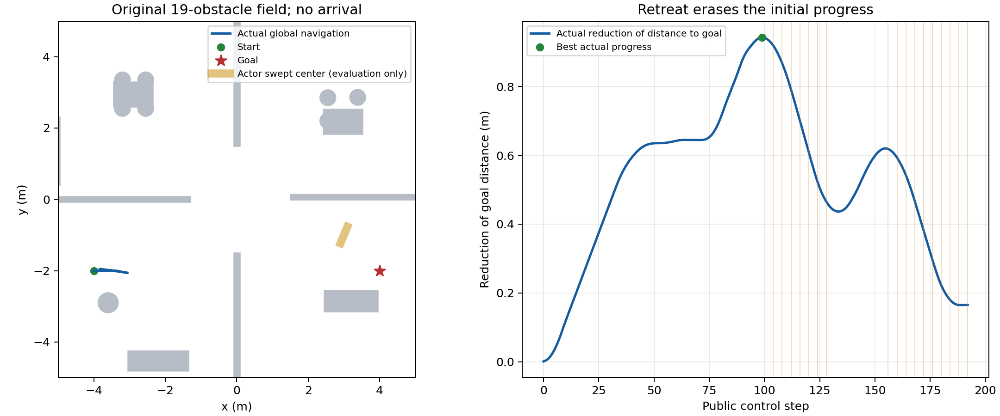

# RP-CCR完整场地动态 V778–V780 实际结果

独立终审：**GLOBAL_DYNAMIC_NOT_PASSED**。本轮按用户要求回到原完整场地从起点至目标的导航；不是从保存中间状态出发的局部组件。

原任务10010001，主任务尝试1，条件重复尝试0；新24确认0。导航原生1544、私有787008、控制重放1544；未知计数以null保留。

- main01：NO_RESERVED_RECOVERY_COMMAND，193公开/1544原生，目标距离7.834762390170145m；发现None，再接入0次。
  原及新审核完备通过=False；完整功能链通过=False。

V778在t0完成后路径对象JSON记录失败，尚无导航/积分；原ERROR/COMPLETION永久保留。V779只修新入口命令记录字符串化，因预检记录缺causal_audit字段再次0积分停止。V780补齐预检台账入口字段，复用原t0及已PASS因果审计，沿用V778原始绝对截止，冻结原V778算法/审核源码未修改。

方法只将MAP_HISTORY条件可达域和保留尾因果再接入接到原全局控制流程。新条件明确要求未知actor不穿透已知实体；不代表原任意运动类无条件保证。原地图19实体、小actor尺寸/运动、传感噪声、.15实际/.155预测、完整328时域和状态重放门未放宽。

未通过时必须继续解决当前真实失败，不能宣称完整场地动态验收已通过。单任务开发即使通过也不等于三路线24项新确认，更不能代替公平外部算法对比、复杂地图/多actor/遮挡泛化或RAS录用判断。

全证据：`evidence/rpccr_global_reentry_v778_v780_20261103`，614原文件，全部来源及解压哈希回读通过。原始runs保留。训练/SAC/Stage/实机0，旧失败/截止永久保留，REVIEW_PENDING恢复。

## 保存证据补核与真实瓶颈

V781补核在结果变量与输出目录变量同名时末写出TypeError，0模型/积分；V782仅修补充输出变量名，原失败保留。原扫描审核唯一false来自forecast payload不含日志step，journal多出step=32；完整payload逐字段相同，且step独立核对。补核没有更改线上证书或降低安全门。V782扫描、路线、投影/冻结BC、全部尾、原机制、新17次再接入的全量255候选与独立NumPy/SciPy域重建均通过。全部194原始包/因果状态与329未来覆盖一致；发现、发现后刹停/重规划/续行、到达四功能仍false。此处“证据完整”不代表功能成功。

本轮完整全局开发成功0/1，条件重复未执行，24项新确认全部未执行，不能报全24成功率，也不与旧空白场24/24混算。原完整状态及控制1544原生重放误差0，最低实际净空0.298434091m，坏接触0；导航1544/重放1544/私有787008精确，新增再接入预测83640已包含在私有总账中，不能重复相加。

四次因果全局搜索均找到GLOBAL_GOAL_PATH，静态地图不是此轮无路的证据。实际目标距离改善最多0.943357522m（第99公开步后），最终只剩0.165237610m，反向尾损失0.778119912m。原参考续接成功1次；新增17次再接入选择0次。在116/120/124/128时15个原安全合格，但mean>=1的候选最佳预测进展分别为-0.1985/-0.1778/-0.0787/+0.0055m，均未到事前.05m推进要求。第二段退让156–192时全部候选未知未来拒绝，最后15项静态检查全部通过、未来未知域全部拒绝，最终仍有31条严格submaximum原始测距，不能解释成传感器完全无返回。

这说明仅在开始退让以后重试短窗口不足：原完整尾已把车辆带入反向运动，合格候选短期无法补回目标距离；后续观测又不足以给出新的完整时域前进证书。下一算法重点应前移到退让前，联合选择已认证的减速/观察/再前进序列，显式检查未来能否再次获证，不能只按即时净空挑反向后备，也不能降低完整328/.155/.15门或借用真实actor未来。尚未实现或验证该改进，不宣称已解决。

所有实际仿真已停止，REVIEW_PENDING恢复。后续仍以完整场地起终点闭环为目标，局部资格和零碰撞不当作全局验收。
