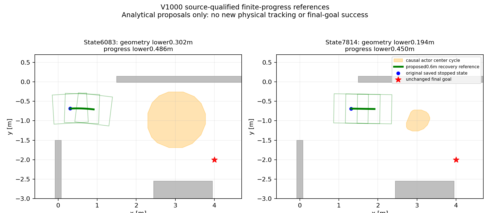

# V999–V1001：恢复不应先依赖完整目标路线，两个原状态的短参考资格已通过

结论：**新有限进展恢复参考已实现，并在两个原保存态通过独立原因果几何与进展审核；实际控制/恢复/整路尚未验证。** 本阶段所有车辆模型初始化、实际积分、私有动力学预测、物理重放、导航、训练和实机均0，旧闭批不重开。

用户问“解决了几步？下一步要解决什么？然后开始下一步的”。按当前排障链可明确区分四个已完成环节：

1. V995固定输入离线执行与原完整实际轨迹等价，全部状态/控制/接触/传感误差0。
2. 原保持角、快转、慢转和往返四项完整物理辨识取得，全部停车尾和自身轨迹重放完成。
3. 完整数据排除了“只减慢转向即可消除累计偏航”的解释；取得有限响应关系及两项未参与拟合数据的检验，尚非因果预测器。
4. 本次找到并修订恢复参考构造的前置条件：不再必须先找到最终目标整路才允许生成已有合同要求的安全进展短段。两个原保存态的参考源码资格均通过。

这些是开发排障环节，不能写成动态验收四关已通过，更不等于论文和实体机已完成。

## 一、先复现失败，再检验“搜索漏路”

`python3 -B experiments/v999_search_resolution_diagnosis/run.py`直接执行冻结V997原函数，在原7814状态精确复现1697扩展/2009生成、无完整目标路线。

固定同一响应参数、控制/目标、几何与5000搜索上限，仅分别加细状态键xy和航向：

| 状态键 | 6083完整静态路线 | 7814完整静态路线 |
|---|---|---|
| xy.05m/航向72格 | 找到，324扩展 | 堆耗尽，1697扩展 |
| 仅航向144格 | 找到，278扩展 | 5000工作上限 |
| 仅xy.025m | 找到，431扩展 | 5000工作上限 |
| xy.025m/航向144格 | 找到，297扩展 | 5000工作上限 |

第一个状态四种设置的短段独立几何均通过。第二个状态的结果仍不能证明无路；更细分辨率增加工作量，没有在同预算下解决问题，故没有盲目扩大搜索上限或宣称A*本身不行。

## 二、定位到恢复目标被额外的全局先决条件阻挡

原`state_reference.construct`先调用`search_static`，要求在原固定目标[4,-2]的.2m邻域找到整条静态路线；只有找到后才截取最多1.2m段，并核验进展下界>=.4m及全周期几何。因而“存在合格短恢复段”会被“尚未取得完整目标路线”提前否定。

新V1000直接搜索满足原有限恢复合同的短段：同一原目标、原因果source、初始实测轮角、原响应律、.1m边/5目标/原状态键/5000工作上限；全静态与actor周期集合几何逐边通过；参考最多1.2m、扣除两端各.04m跟踪包络后实际目标进展下界>=.4m。最终目标没有改成近点，正常导航后续仍需回到原目标。

这是新的局部恢复构造策略，未改变原0.155m几何下界或0.4m实际进展要求。几何准入比原静态整路搜索更严格：每条短段边都检查原因果actor全周期集合。**找到短参考不表示后续一定存在通往目标的完整连续路线，也不保证闭环能反复执行到终点。**

初次未冻源实现额外带入了深度状态键；为保证对照不混入该变化，已经恢复原状态键并重新核验。两份准备结果均保留，路径与目标序列完全相同；未新增任何模型步骤。

## 三、两个原保存状态的独立审核

| 原状态 | source/body原生tick | 参考长度 | 搜索扩展 | 独立几何下界 | 实际进展保守下界 |
|---|---|---:|---:|---:|---:|
| 6083 | 6081/6083 | .6m | 7 | .301808m | .486325m |
| 7814 | 7811/7814 | .6m | 7 | .194114m | .450193m |

独立.5mm中点重建最大差约5.15e-7/4.64e-7；均超过原几何.155m与进展.4m门。第二项为已有微小初始轮角到直行的参考，不依赖倒车、目标替换、地图改变或actor真值。它构成“完整路线搜索失败不等于没有合格短段”的明确反例；不再有必要仅为此问题先下载整条旧轨迹，猜测必须更早触发。更早触发是否改善后续到达仍待独立研究。

每个状态分别对路径角篡改、未来来源时间戳、进展记录篡改及实际相交障碍四个负例拒绝，总8个负例通过。几何计算只用公开静态图和旧保存原因果周期支持，不读实际未来actor坐标选路线。

两次搜索各7扩展/约几毫秒是不同搜索目标的固定实例计时，不能据此宣称比旧完整目标搜索快数百倍、导航实时或任意场景性能提升。

图中绿线是新解析参考，蓝点是原已停保存态，橙色是原因果actor中心周期集合，红星仍为最终目标；未绘制或冒称一条新实际执行轨迹。

## 四、下一关明确是什么

参考生成门已具备，不应再退回原18项，也不用现在换场地/引擎。下一关是**预测与实际控制使用相同输入，并验证完整停车尾**：先把基于未来实测轮角的解释转成只读取当前状态和计划控制的因果预测，并对未拟合状态/控制验证；接入同一控制分配与参考执行，避免RPP实际请求和参考假设分离。不能在实际运行后重画参考使误差变零。

只有上述源码、因果几何及真实安装控制器的非物理入口资格齐备，才能开启新的有界物理两保存态验证；原位置.04m、航向.035rad、进展.4m、完整2秒停车/最后.5秒停稳、原生净空/接触/控制/状态重放门保留。两状态通过后同版本西向东整路主及成功完整重复，再三路线/新24。新物理窗口未建立，旧90分钟和旧20:00窗口保持关闭。

本阶段没有实施/测试新物理控制器，也未证明旧V991实际航向失配已消除；V997原资格拒绝保持原结论，V1000是新参考策略的源资格，不追认旧批通过。所有current/runtime/冻结网络与旧证据不改，REVIEW_PENDING原字节和执行锁保持。

源码、负例、原失败及全部必要新证据按存储规则交付同仓库GitHub，远端成员SHA核验后清理可重建缓存；旧批同步不重试。闭批回执见records/nav2_v1000_20261110。
