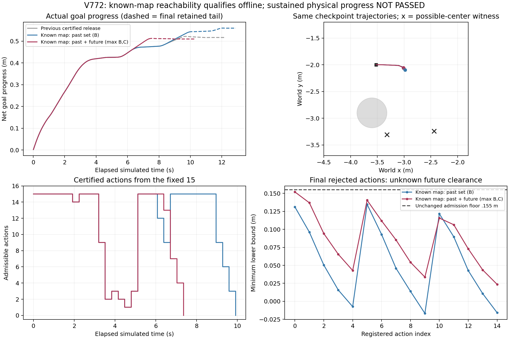

# RP-CCR已知几何与未知可达集合：V769–V777

**离线集合资格通过；两种实际版本均未完成持续推进，完整场地动态仍未通过。** 本轮完成已知几何条件集合的实现/独立验证，并在同一旧检查点按固定表实际运行两种版本。真实安全与完整证据审计通过，原失败和未执行重复保留。

## 1. 固定状态资格发现了什么

原V767局部116时，15固定动作全部因未来未知域拒绝。V769没有重跑机器人或新取传感，只重建33旧起始包+153已发生实际包，并复核原64/96/116各15完整保存尾。

|原固定状态|A 原当前域/Euclidean未来|B 过去已知几何过滤/Euclidean未来|C 过去与未来几何逐轴集合|D 无几何逐轴未来|
|---|---:|---:|---:|---:|
|64|15|15|15|15|
|96|15|15|15|15|
|116|0|6|7|2|

表中数字是同一状态15候选的合格数量，不能计作任务成功率。B的6项中有预测净目标进展0.082342m的合格动作；它们尚未在该固定状态实际执行，随后V772重新闭环产生自己的状态/包和结果。

模型明确限定未知物为半径0.1m、每轴速度≤0.12m/s且不穿透公开已知静态实体的运动类。已知地图仅来自原STATIC_PROTOCOL中10矩形9圆和边界；未知actor锚点、实际位置/运动方向/相位/未来不作为在线输入。原actor全运动相位静态净空至少0.655493m，连续相位采样间Lipschitz误差界0.000192m、实际各轴速度0.030793/0.073836m/s，独立核验符合该类。该条件比原仅速度的任意运动类更强，不能隐瞒为同样无先验的保证，也不能推广至会穿墙、越障或未知尺寸对象。

只删除整个0.01m单元均无法容纳圆心的格子；未来按原0.08秒每轴最多跨1格的3×3外扩，逐步已知静态过滤，未来时刻取上整时间桶，无未来新观测假设。每次42集合（0至3.28s）全部保存。完整条件证明见experiments/v774_map_conditioned_failure_analysis/CONDITIONAL_PROOF.md；全部原执行安全门不降低。

原V770在导入SciPy时因环境缺依赖失败，发生在输出根/模型构造/积分之前，原console和源码保留，不能称V770通过。V771只在runs/v771_audit_dependencies/site安装固定scipy1.15.3，没有改共享Python环境；保存wheel来源/哈希pip报告、2338安装文件清单及完整安装字节ZIP。恢复审计以独立NumPy9方向移位与SciPy精确距离核验252未来集合/45尾，下界最大差2.22e−16。V772事前又重建两模式各186包及90查询接口，误差2.22e−16。全部为0机器人积分。

## 2. 实际闭环结果

V772固定先MAP_HISTORY=B主，成功条件完整重复；再MAP_FUTURE=max(B,C)主，成功条件完整重复。MAP_FUTURE取两个有效下界的较大者，避免C取桶引入新的不必要保守。使用原15动作/原选择器、同原32完整状态与原模型/噪声。每4公开全部15×328原生预测，完整保留.155m因果净空、.002m自体余量、线角末速.025、原控制限幅/速率、每原生真实净空≥.15、零障碍/穿透/未知接触与全状态控制误差≤1e−8。

事前功能门为384主动/96刷新全部有证和完整安全尾：发生观察时，须实际退出后再净目标推进≥1m；若完全未触发观察，则总净推进≥1.3m。两模式均实际观察并退出，随后未达1m。它们是同一旧开发任务的两控制版本，不能合成新独立成功率或全场验收分母。

|条件|接受/尝试刷新|主动公开步|含最后安全尾总公开步|首次退出观察后净推进|最终净目标进展|功能|
|---|---:|---:|---:|---:|---:|---|
|MAP_HISTORY|31/32|124|161|0.133998982m|0.559600389m|FAIL|
|MAP_FUTURE=max(B,C)|23/24|92|129|0.084217195m|0.509818602m|FAIL|

两者首次在64主动步实际退出观察。主功能未通过，各自条件完整重复均未执行，不报成0/4导航失败。V773独立重建全部当前域与MAP_FUTURE每刷新42未来集合、完整候选/执行/真实噪声包/域/覆盖/命令/自体/几何/真实接触与账目全部通过。证据PASS不改变功能FAIL。

最小实际净空（含旧校准）0.311813049m，坏接触0；全原生状态/控制与已认证预测误差0，二者完整执行37公开旧尾停稳。本批1200秒窗在104.281007墙钟秒闭批，无延期/重试。MAP_HISTORY和MAP_FUTURE总工作分别按实际记录，不宣称同实际计算优势。离线更宽下界不保证闭环更好：MAP_FUTURE在新产生的观测/选择反馈下反而更早失去候选，负结果完整保留。

图中虚线是最后完整旧安全尾；地图×号只是当前可能中心格见证，不是真实actor位置。曲线均从同旧32检查点起算，不替代从头全场最大位移/到达率；旧V7590.737740m和V7211.452516m结果保持。

## 3. 原射线与末次证书归因

V774仅对保存证据分析：两模式最后各15候选全部通过已知静态门，全部因未来未知域下界拒绝。MAP_HISTORY首次失证发生在预测第227–314原生步，15项最差点全在328末端；MAP_FUTURE首次失证第225–321原生步，只有3项最差点恰为328，其余在之前。因此问题涉及后续安全尾，不能仅按眼前控制步的净空判断可执行。

两模式拒绝前实际航向范围46.32415°/26.87495°，目标转向符号各改变3次。针对末次当前距离下界，所有候选各自指向同一近邻可能中心格：MAP_HISTORY约(−3.32,−3.31)、MAP_FUTURE约(−2.44,−3.24)。它们都是可能性集合成员；不是测出的actor，也不是唯一原因或全局不可能证明。MAP_FUTURE的未来直接集合可能由另一个中心约束，已分别保存，不把当前和未来见证混作真实轨迹。

原始实际测距检查表明，这两格最近在120/88主动步被可靠前缀直接排除，分别距最后124/92决策4公开步=0.32s。过去32包中分别11/22包有直接排除。最后8包可靠射线数量仍为30–41束，不能简单说传感器没收到数据；新测距对某个中心格的排除也不等于整个未来可达邻域为空。

V775进一步以合法持久历史距离证书验证是否仅因遗忘有效信息。独立直接计算全历史max：249实际旧包、81921真实未来覆盖点、8717查询格，对30条末次完整保存尾的最大重算差6.66e−16，最大最小下界增益0.014240m，但**新准入0/30**。这排除了“仅换成持久距离表示就能救回这30条动作”的解释，不证明所有其他动作或规划无解。新历史场未用于物理执行。

## 4. 保留尾内存在实际信息恢复窗口，但新交接尚未执行

固定尾部几何补充脚本在最终写出前因文件变量覆盖SHA字典失败；原源码、console和缺失结果事实完整保留。新副本只修接口，在新的600秒零积分窗口重新验证各37个旧实际尾状态，输出独立runs/v774_tail_interface_recovery。MAP_HISTORY第138–144局部公开步有3.28秒几何保持参考，MAP_FUTURE没有；这个参考不能替代带原车动力学的完整尾证书。

V776因此另立600秒**资格**协议，仅固定MAP_HISTORY138/140/144三已观察状态，同15动作不改，从原模型/初态完整重放已发生控制，得到完整当前状态，再预测原328安全尾。没有新增控制版本或实际续行，没有改变V772原失败/截止。

|原保留尾状态|旧尾剩余原生步|合格动作/15|其中预测净进展≥0.05m|最好预测进展|对应原因果净空|
|---|---:|---:|---:|---:|---:|
|138|184|12|4|0.081650416m|0.189055823m|
|140|168|9|3|0.082480245m|0.170745749m|
|144|136|2|0|0.011598631m|0.156426272m|

这些动作在实际旧尾中新发生的因果观测下重新可证；没有使用未来新观测假设。138/140最好目标后轮为(−1,5)，全部原安全、自体、末速、限幅/速率条件保持。144只剩低进展动作，说明窗口会消失，不能把过期候选再用在更晚状态。

当前固定组件协议在零候选后会完整执行旧尾并结束，不在尾中重新尝试进展；因此原组件的终止也暴露出监督状态机对RP-CCR持续恢复机制的接入缺口。但V776只证明存在原生预测资格，**新动作没有实际接管，不能声称已救回或动态通过**。V777已独立核验全部45候选、3632重放原生与422复现包，状态RETAINED_TAIL_REENTRY_SAVED_EVIDENCE_VERIFIED，全部通过。新动作仍未实际执行。

## 5. 安全与积分分账

|阶段|旧控制重放原生|私有机器人预测|新实际原生|新真实观测|
|---|---:|---:|---:|---:|
|V769资格|0|0|0|0|
|V770导入失败|0|0|0|0|
|V771独立审核/私有依赖|0|0|0|0|
|V772两主（含校准）|584|275848|2320|290|
|V773独立保存审核|0|0|0|0|
|V774射线/末次/尾部几何诊断|0|0|0|0|
|V775持久历史资格|0|0|0|0|
|V776固定旧尾原生资格|3632|14760|0|0|
|V777独立保存审核|0|0|0|0|
|本轮合计|4216|290608|2320|290|

V772275848=328原扫描校准+(32+24)×15×328；2320=(161+129)×8；290×329=95410未来覆盖查询。旧校准41包另列。所有实际积分仅run_phase.sh，单CPU顺序、一个执行锁；模型/网络/current/runtime不改；训练/SAC/实机/Stage访问0。原V770失败和所有旧实验失败/截止永久保留，不删原始runs，独立确认/新从头导航0。V776资格又准确复现422旧传感包（138+140+144），对应138838覆盖查询，单列而不计新观测；V777审计0新增积分。

## 6. 下一步需要解决的具体问题

下一项已有具体证据的验证是：旧尾每个原公开步继续真实观测，按预注册频率在完整当前状态重新计算原15动作；新完整证书通过并具备目标进展时，以已验证的保留尾交接接口接入；如果没有新证书，原旧尾不变，执行至停止。先在原138/140窗口验证首步和全部新尾的物理状态/控制/覆盖，再从同检查点完整闭环；随后才进入从头场地导航与新池验收。额外预测的真实计算和墙钟必须单列。不得用预测进展代替实际推进1m，也不得在旧尾过期后继续执行过期证书。该实际交接版本尚未实现或执行。另需严格区分完整尾长度、制动停止时刻和终端可保持性，不能缩短检查或放宽.155门假造通过。

本批依预注册上限停止追加控制版本。剩余几何尾部检查仅用已保存姿态，是几何参考，不会替代原生制动预测。完整动态尚未验收，不能报告论文最后实验已完成。

可达占据与后备/终端条件参考[OA-MPC](https://arxiv.org/abs/2211.09156)和[OcclusionCBF](https://arxiv.org/html/2609.06342v1)。这些是设计参照，动力学、终端假设与本系统不同；本实现没有其CBF或递归可行证明，不能移用其安全结论，也不把利用已知地图这一通用处理单独当作RP-CCR原创贡献。论文仍需全场动态稳定验收及公平外部基线与机制消融。

全证据归档：evidence/rpccr_map_conditioned_v769_v777_20261103。最终回读/同步记录为实际依据，原始文件全部本地保留。
