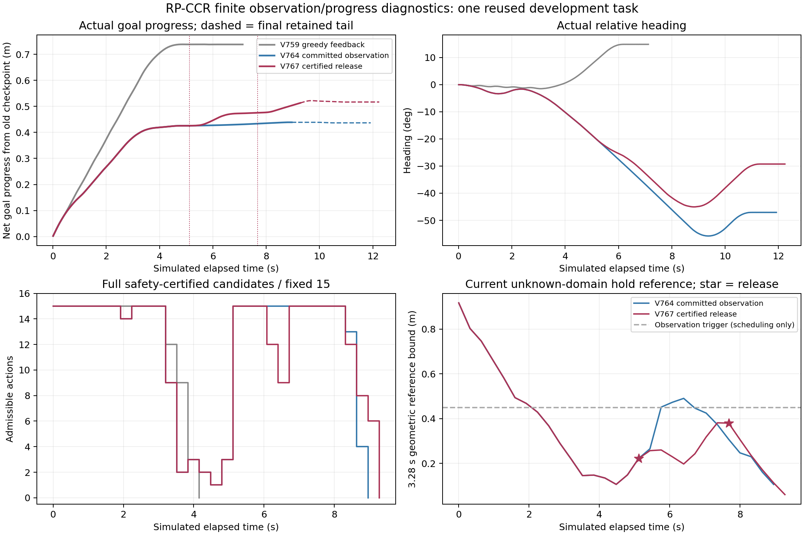

# RP-CCR提前观察与动作承诺：V762–V768

**96主动步有限组件首次通过并完整复现；长周期与完整场地动态验收仍未通过。** 本轮实际实现了提前观察、保持转向和解除观察，三批有限实验共4个物理分支，全部独立证据审核通过。旧失败、截止、模型、网络全部保持，没有把组件门槛或零坏接触当作全局导航成功。

## 实际结果与分母

全部来源于同一旧开发任务的公开32完整检查点。没有新场景、独立任务或新24池，不能报告动态全场成功率。V762主与重复是1个组件案例的两次运行；V764/V767是其后分别预注册的长周期验证和一次控制修订，不混成独立样本。

|批次|事前功能门|实际结果|独立审核|
|---|---|---|---|
|V762 主|96主动/24刷新均有证，96步净目标进展≥0.30m，完整尾停稳|96/96主动、24/24刷新；进展0.433433414m，尾后0.440299214m；PASS|V763完整保存审核通过|
|V762 完整重复|同条件全部状态、控制、mocap、真实接触和原始包匹配|与主完全相同，最大误差0；PASS|V763通过|
|V764 同算法长时|384主动，真实退出观察后再净进展≥1m，完整尾停稳|112主动后全部候选拒绝；未退出观察，149公开含37尾，终净进展0.436672204m；FAIL|V765证据完整，功能失败|
|V767 认证进展解除观察|同384主动和解除后真实1m门|116主动后全部候选拒绝，153公开含37尾；64/96两次实际解除，首次解除后到末仅0.091108371m，终净进展0.516709779m；FAIL|V768证据完整，功能失败|

V762资格只要求上述短组件，并不要求退出观察；后续V764/V767的失败保留，不追溯改写短组件门槛或称全局通过。长批未到384，成功条件重复均未执行。所有最终净进展是从旧检查点起算，不能替代从头到达率或旧V721的1.452515518m最大完整场地位移。V759的0.737740333m虽更大，却只完成52主动且失证；本轮没有宣称更高位移或更少计算的全面优势。

## 方法变更及依据

V759每0.32s按预测完整尾目标进展重选，9次目标转向符号改变、实际航向仅2.82454°；V761证据指出目标转向未充分执行。V762保留同15动作、全部原328原生预测和安全门，只改纯函数调度：PROGRESS下目标动作保持12公开；当前未知域3.28s姿态保持几何下界≤0.45m时提前OBSERVE，优先低平移同转向合法动作。实际扫角范围≥pi/16=11.25°且几何余量≥0.55m才退出。0.45/0.55仅调度触发，所有执行仍须原0.155m因果净空、0.002m自体、线角末速0.025及限幅/速率等门。

V762短组件通过后，V764保持选择器字节完全相同，仅新冻结更长时域和更强功能检查；前96主动真实状态/包/域/24×15所有预测逐数组复现V762。V764足以转向却没有一次退出：V766零积分检查在64–100共10次刷新发现原全门合格、mean≥1且预测末目标进展≥0.05m的动作已存在，0.55姿态保持标量阻挡了已认证进展路径。

V767因此只修调度解除：实际扫角≥11.25°且已有上述安全进展动作即退出，取其预测进展/净空/index最优者；解除后维持12公开承诺，避免同一姿态保持标量立即重触发。全部执行安全门不变，前64实际及16×15预测必须精确复现V764。事前检查曾发现把冷却误用于首次观察触发，会破坏原前缀；该零物理准备失败及源码SHA保留在runs/v767_selection_preparation_failure.json，修正为只在真正解除观察后冷却，376独立转换/前64对照通过后才冻结物理源。

V767实际在64和96退出观察并执行进展动作，76和108又触发观察。两次模式转换成功，但解除后实际推进距离不足，仍不能称持续通行。每次候选只用已经发生的47束含噪传感包和当前确定性域；未使用actor未来/真实位置选择动作，也没有假定会得到未来新测距。

图中的虚线为主动阶段后执行原安全尾，星号为V767实际解除观察。图仅描述一个复用开发任务，不作统计泛化或同计算优越推断。

## 最后仍拒绝的原因

V766最终保存归因重算V767全部450候选：局部116最后15项已知静态净空门全部通过，全部在未来未知域下界上失败。将时间老化人为移除的反事实15项可通过，但该反事实未执行、不能合法当新证书。临界最近可能actor中心均不在已知静态实体内部，简单删静态实体内部未知格点不能解释本次失败。

V767拒绝前真实航向范围已达45.05408°、目标转向符号改变3次。原“频繁换向导致几乎未实际观察”已得到针对性改善，剩余问题是这些实际观察没有持续提供足够的未来安全信息。实际安全停稳不等于未来任意actor运动都安全，也不能仅凭15有限动作全拒绝证明全局无解。

本轮不再调整解除阈值或追加物理修订。下一研究需要明确区分：当前动作集合是否朝向了难获证的观测方向、有限噪声射线能否给后续进展提供足够覆盖、3.28s完整承诺在新状态下的哪一段先失证。应先用已有原始射线/所有预测定位信息缺口，再事前冻结以已知几何和因果域为输入的观察方向/进展联合规则。任何新规则仍需完整状态物理校准和独立审核，随后才进入从头全场导航与新池验收。该设计尚未实现或运行，不把新算法名称或新调度参数当作RAS创新证据。

## 全安全与积分分账

|批次|旧控制重放原生|私有预测原生|新实际原生|新真实包|329覆盖查询|
|---|---:|---:|---:|---:|---:|
|V762 主+完整重复（含旧校准）|584|236488|2128|266|87514|
|V764 长时主（含旧校准）|584|143008|1192|149|49021|
|V767 最后修订主（含旧校准）|584|147928|1224|153|50337|
|合计|1752|527424|4544|568|186872|

每批41个旧复现包另列，合计123，不计新观测。独立V763/V765/V768与V766诊断零模型初始化/零积分。所有原生qpos/qvel/ctrl与已承诺预测误差0，V762完整重复误差0，最低实际净空含旧校准0.311813049m，坏接触0，自体/控制速率/固定静态模型/原始噪声包/确定性域与覆盖均通过。所有三批分别在52.961633/34.610287/35.192540墙钟秒闭批，没有延长各自1200秒绝对窗；全实际模型初始化/积分仅run_phase.sh、单CPU顺序执行。

新从头完整导航0、新确认0、训练/SAC0、实机0、Stage访问0。current/runtime与冻结模型网络不改，旧V759等失败和所有原截止保留。REVIEW_PENDING恢复，执行锁空闲，无后台模拟或自动任务。完整原始证据归档evidence/rpccr_observation_commitment_v762_v768_20261103，逐文件解压/哈希/来源回读，原始runs保留；同步结论见RPCCR_OBSERVATION_ROUND_SYNC_20261103.json。
