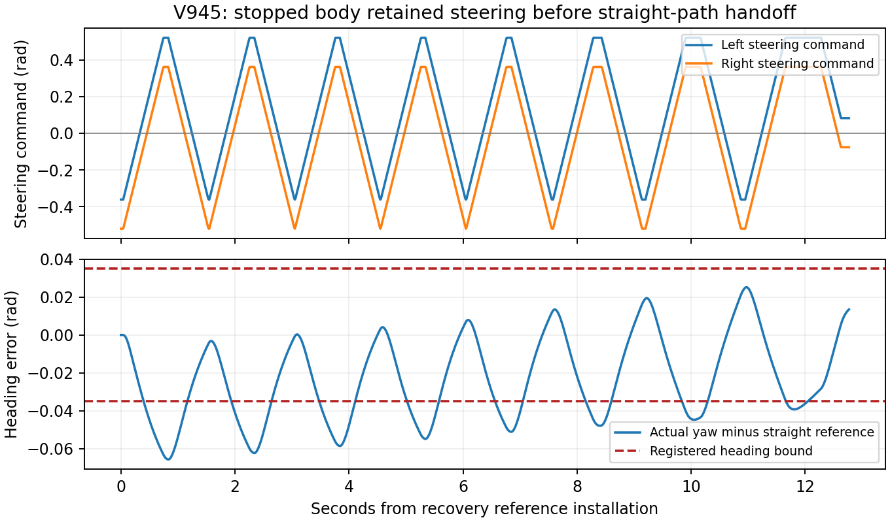

# 历史成功回归与V945监督合同修订

2026-11-09。用户指出“24项成功八个、现在越调越差”。本轮先核对原始终审，再修复当前可复现的中断；不能以新增版本号或局部无碰撞代替任务到达。

## 历史结果不能丢，也不能混成当前成绩

|冻结实现与场景|实际已取得|尚未取得|
|---|---|---|
|V698，简化空白8米课程|13项物理到达；前12项原完整链审核通过，第13项原审核有空观测形状误报|其余11项、3重复未执行；不是原19实体场地验收|
|V826算法/V827，原19实体场地|3固定路线开发与3完整重复通过；南北主为原保存参照，不重复计样本|不是独立新24确认|
|同算法V828，原10060001–24|执行8项：6项完整链成功、10060002/10060008失败|16项与3重复未执行；不是8项成功|
|V884/V885，FeasibleRPP|3固定静态路线及完整重复通过|动态能力不能自动继承|
|V943，Nav2+RP-CCR恢复段|新入口实际触发、安装恢复段并前进.580617m；物理/自身重放通过|恢复段和原目标都未完成；监督STALE_BODY中断|

机器可读历史锚点保存原V827/V828独立终审和静态RPP里程碑及SHA。
这是历史证据核验，不是用旧结果填充新版本回归表。原V828即使余16全过也最多22/24，且西向东6/8低于7/8；不能重开旧批来拼通过。

## 为什么看起来越改越差

结果层面确实退步：当前整条软件链没有恢复到旧版三路线开发、六项确认完整成功的水平。最近的工作不只是对旧RP-CCR调参：名义规划/控制框架、模型预测计算方式、安全管实现、恢复入口与异步消息监督均发生过替换。旧版的完整328步原生预测合同与当前.2秒命令+2秒刹停/全周期终端、经验执行界不是同一算法或同一理论合同。当前还增加公开.32周期先验，不能把两者作为同假设公平优劣比较。

旧版计算量大，V828八导航含37224712私有原生预测；当前Nav2分支私有积分0，执行时间已经换了数量级的工作方式。但计算省下来并没有自动保住原目标参考更新、恢复交接和持续进展。V934主要是失去正常参考后没有真正触发替代控制，V943刚证明新恢复入口确实介入，又被新增监督检查打断。它们不是同一个失败原因，不能统称A*慢、车跟随不了，或靠放宽到达/安全门解决。

推进流程的问题是缺少“新版本先保住旧成功”的固定门，组件资格越来越多，整体能力却未得到同版本确认。本轮将原西向东成功任务固定为首个回归锚点，不再换名义控制器、生成新池或立即上24项。之后仍需同版本南北/东向西，再针对已观察失败做开发，独立确认另按冻结的未用清单注册，绝不混入旧6个成功。

## V945唯一修订与已完成资格

原生产monitor的100ms合成年龄输入稳定报STALE_BODY（具体V943故障年龄未保存）。新事务继承原request/install/finish_segment50ms新权限门；仅持续监控改为原200ms活性上限。监督层不发Twist、不创建或延长证书。旧命令和原生准入、不可变旧尾到期、.155预测/.15实际、曲率/死区/执行误差、自体与全部重放门原样保留。增加故障的packet/source/检查时钟和部分事务事件持久化。

- 原复现红、新复现绿；41项时间边界、过期证书和篡改负例通过，0模型。
- 实际V934历史触发4947下的完整生产监督夹具13门通过，包括100ms继续、201ms停止和故障输入保存；端点/回调为合成，不称实际到达。
- 4固定原因果走廊388个解析控制样本通过原准入，12项独立源/跟随正负门通过；不是新实际轨迹。
- 43项继承科学和集成检查、8项真实ROS预目标启动检查通过。18旧车辆响应资格仅复用，不重跑计数。

准备时曾因协议措辞修正晚于预冻结快照被哈希核验拦住；重复口径审阅也发现协议误写旧同步轨迹逐值相同。两处原快照/错误保留，均在新授权与模型前纠正。Nav2重复实际要求同完整模型/场景/初态、两次完整安全功能链及各自控制全状态重放；异步两轨迹可不同，不声称旧同步式完全重复。

## 本轮固定物理任务

新窗口一次锁定18:52:30.937012–20:22:30.937012+0800；旧V943失败即停窗口永久关闭。原WEST_EAST/10010001/相位.6573753567727383一个180秒主，所有门通过才一次完整重复；首次失败即停，不自动其他路线、新24、消融或训练。原目标仍[4,-2]，恢复段终点不当目标。

实际结论：**NOT_PASSED**，18:55:06提前封账，完整重复和新24未执行。13517实际/13517完整自身控制重放/私有0；最低实际净空.244691090m，坏接触0，完整状态误差0。最终距原目标1.857010m，发现后实际行驶5.823760m。恢复动作段从tick5021到6298完成，目标改善.927720m，但不等于获证完整恢复成功。

原独立审核保持evidence=false/function=false：整个1278原生点的参考位置最大误差.016540m在.04内，航向最大.065701rad超过.035；最早安装后.4秒、tick5061超界。本次实际恢复参考是直线，不能归因为曲线切角。新增50ms监督误报没有再出现；后来原MotionPublisher在读取新快照前报STALE_COHERENT_OBSERVATION。故障记录明确exact_check_input=false，仅保留前一个已返回快照；异常捕获时距最后已记录body/scan时间约.194712/.223937秒，不能冒充未保存的内部比较时刻。

原审计因参考超界提前结束，之后单独零模型核验原因果包络、全部命令管、原生接收和恢复控制来源均通过；只作分项证据，不覆盖原全审核FAIL。原生最大墙钟滞后.002894s，本轮不能直接称MuJoCo积分算不动。

**更具体的交接缺陷已重建：**车身满足原停稳门时，两路转向命令仍为[-.361269,-.52]rad。原Adapter零速度分支保留转向、仅停驱动。用真实保存体速度/角速度和原Adapter逐条重新计算13517路控制，最大误差2.22e-16。数组反例中继续发10秒原零Twist仍保持同一转角；相同直行Twist从旧转角和中立转角产生不同首控制。因此“车身停稳→按当前朝向构直线”的交接忽略了执行器状态和转向速率，不能用更长被动等待修复。它是有实际输入支持的缺陷，不声称单独修复后必到达。

下一修订先做**转向状态感知的RP-CCR恢复交接**：加入可落地的转向编码器本体反馈，验证零驱动下合法转向对齐，或构造满足当前转角/转向速率的起始走廊。原限速/净空/自体/重放门不降；转向命令也必须进入原生审计，不能直接写qpos。先固定本次交接状态与原18车辆响应做新的受控资格，未通过不再花整回合预算。另将观测接收与图像/地图压缩、路径落盘的重工作分离并记录生产者异常瞬间，不把200ms改得更大。本轮不修改冻结源或追加物理。

原始必要证据按同仓库Release下载解压SHA回读后清临时缓存；本轮临时预算2GiB。

本工作仍只覆盖单actor公开周期课程与经验执行条件，不是任意遮挡、多actor、实时性、递归安全或RAS接受保证。论文还需统一方法假设、完整动态回归/确认、公平对照和机制消融，以及仿真跑通后的实机验证。

实际转向指令与完整恢复段航向误差图（原生保存数据，0新积分）：

ROS回调隔离的依据是官方[callback groups说明](https://github.com/ros2/ros2_documentation/blob/jazzy/source/How-To-Guides/Using-callback-groups.rst)：同一默认互斥组仍会串行，即使使用多线程执行器。本代码观测timer与部分重回调未显式分组，构成需排除的阻塞路径；当前证据没有记录实际内部回调耗时，不能据此断言唯一停因。RPP参数语义参照[官方Jazzy文档](https://docs.nav2.org/jazzy/configuration_and_development/configuration_guide/controller_plugins/configuring_regulated_pp/)；几何跟随器不自动满足本项目另加的执行器交接包络，后者需自行验证。

完整段还显示：左转向命令在正负.3rad之外发生15次大幅符号切换，航向误差反复振荡，问题不只起步一个瞬间。原Adapter把`w+1.5*(w-measured_w)`再曲率截断、限转速，可能与执行器滞后构成摆振；这是依据代码和轨迹的待检验机制，尚未证明唯一因果。下一资格需同时检验当前转角交接和持续转向反馈稳定性，不能把“回正一次”当作已解决整段跟随。先固定保存输入重现，再对受控转向响应做有边界验证，最后恢复完整路线。
