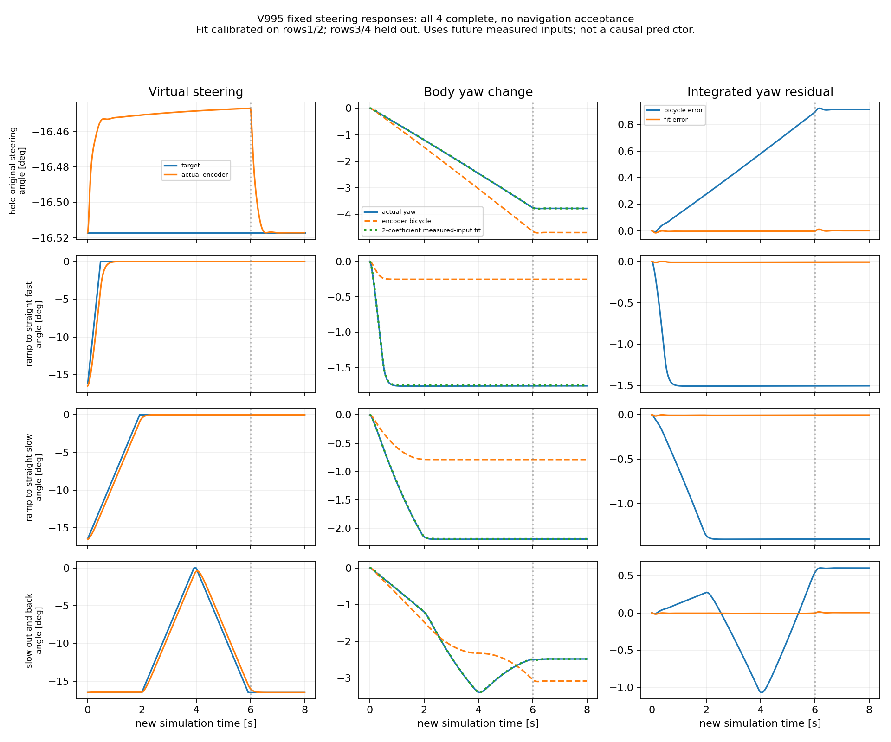

# V995–V998：完整转向辨识通过，响应参考候选在模型前被拒绝

本轮结论：**四项固定转向辨识及执行时钟等价桥接全部通过；唯一科学候选的第二保存态参考资格未通过，未进入新恢复物理或完整导航。动态验收仍未完成。** 原V991航向失败、V993计时中断、V828六次成功及所有旧失败均保持。

用户2026-11-10明确“开始”接受新90分钟方案，随后说“继续”。首次模型前锁根17:46:08.652762至19:16:08.652762+08，独立于已闭的旧20:00窗口。四项实际任务17:46:08至17:50:24完成，约255.59秒；源/解析候选至18:07:15闭批，不冒称持续运行到19:16或整路已开始。

## 1. 首次取得完整的四项固定输入证据

同原WEST_EAST/10010001/相位.6573753567727383，真实t0与6083原历史状态逐原生恢复，随后原冻结V993协调分配/偏航反馈0。每项.03m/s运动6秒、完整2秒停车，共800新增原生步。没有换模型/场地/噪声/actor/门槛，不训练。

新执行方式以固定仿真dt=.01推进，无外部ROS实时输入，故离线辨识不以墙钟100ms延迟判物理响应失败；完整记录各阶段wall/thread耗时、保持每任务300秒和根绝对截止。**这不是实时资格或放宽在线门**。后续实际Nav2在线原100ms门、观测龄和控制门仍保留。

首项保持转角与原V993完整轨迹全部time/qpos/qvel/ctrl/mocap/净空/自体误差0、相同规范模型初态、接触、传感、发现与控制输入，只有命令事后墙钟时间戳与预声明两项构造耗时不同；两条各自完整重放均误差0。这是当前固定任务的执行方式等价，不是任意控制器、任意系统的等价证明。

| 固定辨识任务 | 历史恢复原生 | 新实际原生 | 自身完整重放 | 物理证据 |
|---|---:|---:|---:|---|
| 保持原转角 | 6083 | 800 | 6883 | PASS，且与旧完整轨迹精确等价 |
| .6rad/s转直 | 6083 | 800 | 6883 | PASS |
| .15rad/s转直 | 6083 | 800 | 6883 | PASS |
| .15rad/s转直并返回 | 6083 | 800 | 6883 | PASS |
| 合计 | 24332 | 3200 | 27532 | 4车辆任务初始化、私有0 |

全部逐原生最低真实净空.273036567m、坏接触0，原完整自体/合法ctrl幅值与速率/静态固定/无根改写/原生完整状态与接触重放通过，末.5秒停稳与原2秒完整尾均通过。四项是固定输入辨识，不是四个导航成功或新24独立样本。

## 2. 慢转向没有消除累计航向偏差

将误差分为目标轮角到实测轮角、实测轮角到实际车体偏航两段，同一原车体参考点及完整800步统计，不事后平移实际状态。

| 固定任务 | 目标运动学全程航向残差峰值(rad) | 实测轮角运动学残差峰值(rad) | 两参数实测输入解释残差峰值(rad) |
|---|---:|---:|---:|
| 保持转角 | .016443 | .016092 | .000267 |
| 快转直 | .027965 | .026363 | .000182 |
| 慢转直 | .025985 | .024503 | .000249 |
| 慢速往返 | .020043 | .018643 | .000267 |

快/慢转直最终目标运动学误差约-.027904/-.025941rad；降速显著改变瞬间偏航速率，却未消除最后留下的航向偏移。目标角到实测角造成的偏航率RMS只有约.000745/.000369rad/s，而实测轮角到车体残差RMS约.011699/.006051rad/s。此固定任务证据不支持只降低转向速率或只解释成前轮没跟上。

用保持转角2–6秒拟合a，再仅用快转直实际转向段拟合b，得到描述式：

`observed_yaw_rate ≈ .806021089 * actual_forward_speed * actual_encoder_curvature − .093855578 * actual_virtual_steering_rate`

慢转直、往返均未参与拟合，完整尾最大累计残差分别.000249/.000267rad。这是使用未来实际速度和轮角的teacher-forced解释，**不是因果控制预测器、全局动力学模型或安全误差界**；唯一轮胎/惯性/接触因果仍未证明，不能直接把a用于全局最小转弯半径或实机。原轴距XML为.60m，没有凭拟合任意改轴距、轮胎或实体。

真实保存数据曲线（虚线6秒为停车开始）：

## 3. 唯一候选为何未进入物理

V997只准备一个响应一致的解析参考候选：保留原转角状态、控制限幅、5目标、.1m边、5000搜索上限与原因果几何，将参考航向增量纳入上述a和b，并对增大的航向变化率增加采样余量。没有用第二状态重新拟合a/b，也没有修改旧冻结参考。

原6083保存态生成1.1m参考；独立.5mm中点重建最大差5.20e-7，独立完整周期几何下界.236662m>=.155，实际进展保守下界.974118m>=.4，零模型参考资格通过。

原7814保存态的同一候选搜索耗尽1697扩展/2009生成，未取得合格参考。固定对照：旧理想运动学与原余量2171扩展有参考；新响应律即使用原余量1706扩展也无参考。因此此结果不能仅归因新增采样余量。**有限离散搜索找不到参考不等于连续空间无路，也不证明车辆不可能到达。** 它表明当前“到该状态再用这一参考生成器恢复”的候选尚不具备准入资格。

按照本轮两保存态先过、再条件整路的方案，停止候选物理依赖。新恢复6083/7814、整路主/重复、三路线/新24全部未执行，不补成0%或把诊断PASS混入其分母。没有为了让第一个状态先过就跳过第二状态，没有本轮第二科学候选或模型试探。未使用的未冻源执行骨架已按哈希清单清除，保留必要候选数学、参数、失败和独立审核；不把尚未接通的控制器称为实现完成。

## 下一步应解决什么

下一阶段需要把实测响应纳入可执行走廊和恢复触发位置，验证规划器是否过度依赖理想转弯，而不能继续只加偏航反馈或慢转。先离线检查同一失败轨迹中更早的原因果可恢复窗口，并检验离散搜索分辨率造成的假拒绝；不直接用actor真值选触发点、不凭当前一个稳态角推定全速度/全转角范围。

任何新的预测器须以当前已知状态和计划控制前向预测，在未拟合状态/控制上验证完整尾，不能使用本次未来轮角来宣称预测成功。任何新参考/触发修订都须单独冻结资格；若改变任务入口，要如实承认新开发范围，不能抹掉7814失败或继续沿已闭批窗口补跑。本轮没有请求/建立额外模型窗口。

REVIEW_PENDING原字节恢复，执行锁空闲，训练/SAC/实体机0，Stage完全隔离；current/runtime/冻结网络不改。原完整动态328预测合同没有被此诊断或经验关系自动证明，亦无实时、任意遮挡、多actor、任意地图或RAS保证。

本轮必要证据、候选失败与图/源码按存储规则上传同仓库GitHub，所有资产及解压成员SHA回读后清理本机缓存；同一新根最多一次30秒push/5秒HEAD核验，原批同步不重试。存储实际回执见records/nav2_v995_20261110。
