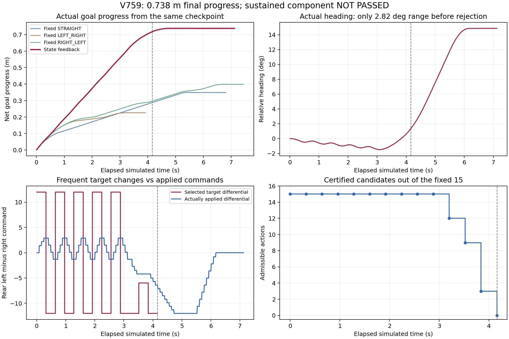

# RP-CCR状态反馈方向/速度：V757–V761实际结果

**有限组件仍未通过；完整场地动态验收尚未通过。** 本轮先验证三原受阻状态存在替代动作，再实际运行确定性状态反馈。相同旧公开32状态出发，最终净目标进展0.737740333m，旧三个固定条件最好0.398365698m；该比较仅描述同一开发状态，计算量不同且未完成成功条件重复，不能据此宣称算法显著优势。0.738m是本组件相对检查点净进展，不是从头导航距离，不替代旧V721完整场地最大位移1.452515518m。

## 1. 已完成的固定状态资格

V757准确重放原V735头32公开256原生，再按原V753三个控制前缀重放384/96/448原生，共1184旧原生。重建116已发生传感包/域，逐原生状态/控制/真实接触与原证据一致；三原失败预测完整数组精确再现。

固定15个动作：前轮0，后轮=(mean+difference, mean−difference)，mean∈{0,1,2}、difference∈{−6,−3,0,3,6}。每候选完整328原生预测，原保持8+320动作/制动，原因果净空0.155m、自体0.002m、线角末速0.025门与执行器限幅/速率保留。

|旧受阻条件|位置（局部公开步）|合格动作/15|其中预测目标进展≥0.05m|最大预测进展|该动作最小因果净空|
|---|---:|---:|---:|---:|---:|
|STRAIGHT|48|5|1|0.062133m|0.164623m|
|LEFT_RIGHT|12|12|11|0.167904m|0.232994m|
|RIGHT_LEFT|56|10|6|0.107064m|0.171225m|

V758独立零模型初始化/零积分审核全部45新候选、3原失败校准、真实重放几何/接触及38164覆盖点通过。这只证明当时固定动作集合存在可行替代，未实际执行这些状态下的替代动作。

## 2. 新闭环实际执行

V759每4公开步完整计算同15候选，只用当时已发生的传感域。先过原安全门，再按预测完整尾的目标进展递减、因果净空递减、原index递增选择。初态、模型、actor运动、噪声、网络均保持。新接口只扩展预注册目标，27合格保存证书纯数组接入与162错误接入负例先通过；实际旧584原生/41包全校准亦通过。

实际连续接受13次刷新；局部52公开（4.16秒）第14次全部15动作拒绝，完整执行旧合同余尾后89公开（712原生）停稳。主动续行只有52公开，随后37公开为旧尾；原SUMMARY中的scheduled_public_completed=89是累计公共步数截断字段，不可理解为89主动刷新步。事前目标为96主动公开/24刷新全部获证及≥0.30m净进展/完整停稳/成功条件重复，故组件资格false，重复未执行。成功率不是新独立任务成功率。

- 拒绝前净目标进展0.717623675m，保留尾再增加0.020116658m，最终0.737740333m。
- 最低实际净空（含旧校准）0.311813049m；障碍/穿透/未知接触0。
- 584旧重放与712新实际逐原生qpos/qvel/ctrl误差0；完整自体/控制速率、全部89新包与29281未来覆盖查询通过。
- 末端线速0.000007848m/s，角速0.010600653rad/s，旧合同完整执行。
- V760独立保存证据审计通过，但功能资格仍未通过。主运行实际21.821848秒提前关闭原1200秒窗，未延时/重复失败任务。

## 3. 拒绝原因及其证据边界

V761固定重算全部210候选。末次15项全部通过已知静态几何门，全部因未来未知域下界不足而拒绝；将时间老化人为移除的反事实15项可过净空，但该反事实不合法、未执行。最差点附近的最近可能actor中心均不在已知静态实体内部，不能靠简单删掉静态实体内部未知格点来解释本次拒绝。

闭环前段选择转向符号9次交替。目标后轮差值经常为±12，但受原执行器速率约束，在每4公开步改选前尚未完成原预测中的转向。拒绝前实际航向范围只有2.824540°；因此“完整预测尾中能转向并取得进展”没有转化为前段真实持续观察。它支持检查短期择优与实际执行承诺不一致的问题，尚未通过同条件消融证明这就是唯一根因。

旧尾继续真实转向后总航向增大，89帧中的第50–89帧仍全部没有所检查的3.28秒姿态保持几何参考证书；第1–49帧有。这个参考只基于已保存姿态和已发生域，不是新的动力学制动/等待预测，不能据此宣布49步可安全切换。结论是：等到全部候选失效再单纯转向，在本次记录中未恢复该几何参考；需要更早验证观察与进展的联合承诺。

## 4. 下一版具体设计（未启动）

研究假设：在RP-CCR连续恢复中显式保持正在执行的观察动作，避免仅因预测终点进展略高而每0.32秒改变转向；同时设置观测余量触发，使较低平移速度的观察发生在证书仍有余量时。

准备方向：保持同15动作和全部原安全门，单独设计“观察承诺/恢复进展”状态机。只有实际航向覆盖或由已收到数据计算的证书余量达到预注册目标，才正常解除承诺；若继续动作不再能获新证，立即遵守原保留尾。任何新切换都必须具有完整原生安全证书。禁止用假想未来测距或已知actor轨迹打分。

下一轮先用原保存状态做纯数组决策/控制速率与无真值访问检查，再冻结单一有限主运行及条件重复；通过再进入从头完整场地导航。需要预先确定实际航向/证书触发、平移限制、承诺解除条件和对照预算，不在结果后修改参数救回。本轮没有实现或运行该新状态机，没有增加第三物理运行。

## 5. 全部积分分账

|阶段|旧控制重放原生|私有预测原生|新实际原生|新真实观测包|从头导航/新确认|
|---|---:|---:|---:|---:|---:|
|V757资格（含3原失败预测校准）|1184|15744|0|0|0/0|
|V758保存独立审计|0|0|0|0|0/0|
|V759主运行（含旧扫描校准）|584|69208|712|89|0/0|
|V760独立保存审计|0|0|0|0|0/0|
|V761归因/尾部几何参考|0|0|0|0|0/0|
|本轮合计|1768|84952|712|89|0/0|

V759私有69208=328旧扫描校准+14×15×328新候选。旧复现包V757116/V75941另列，不冒充新测距。V757旧状态到达以及V759检查点分支均通过完整实际重放建立，分支初始化不是在线积分外根状态辅助。全部实际初始化/积分仅run_phase.sh、单CPU顺序；训练/SAC/实机/Stage访问0。原V753以及此前所有失败、冻结源与截止保留，全部窗口已闭，REVIEW_PENDING恢复，执行锁空闲，无新自动任务。

原始来源：runs/v757_state_feedback_qualification、runs/v758_state_feedback_audit、runs/v759_state_feedback_execution、runs/v760_state_feedback_execution_audit、runs/v761_feedback_failure_diagnosis。全证据归档路径evidence/rpccr_state_feedback_v757_v761_20261103，逐文件原始字节/解压哈希/来源回读后记录归档数量。原始runs不删除；GitHub结果以最后独立同步记录为准。
