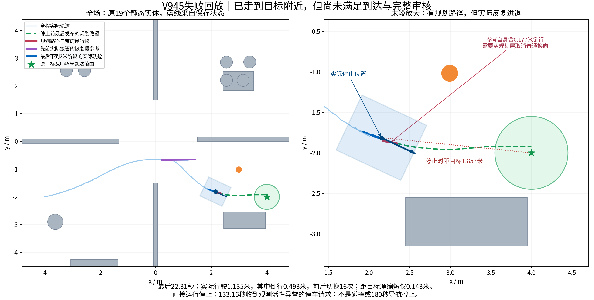

# V945路径与末段失败回放

本页只展示原13517步保存数据，未重启导航、预测、物理积分或训练。图中的绿色是当时已发布规划路径，蓝色是实际轨迹，紫色是恢复段参考；橙色actor仅供离线观察。二维静态矩形按MuJoCo半尺寸展开，已纠正第一张预览的尺寸误画。

## 为什么还有路却没有到达

首次距目标小于2米在112.86秒；结束135.17秒距目标1.857010米，最近也仅1.852317米，未进入原0.45米范围。这22.31秒实际走1.135120米，其中约0.492935米为倒行；实际下发速度命令前后换向16次，距目标净缩短只有0.142718米，中途还退回2米以外。

因此已有全局参考，没有转化为持续的目标进展。末397个决策快照中，名义倒行→实际仍倒行126个，名义前进→RP-CCR选倒行17个，名义倒行→RP-CCR选前进5个。倒行来自名义控制和恢复选择两个层面，不能仅归为一层，快照数也不是独立任务或行驶距离。

运行直接停止是133.16秒原生接收器收到因观测活性异常发出的stop，随后执行约2秒完整停车；没有撞障碍，也没有跑到180秒导航截止。内部快照生产者在返回前抛错，未保存其内部比较瞬间，不能把异常捕获年龄冒称精确内部检查时间。

独立审核另发现更早的恢复直线段航向误差超界：50.61秒首次超过.035rad，整段最大.065701rad。交接时两路转向命令仍为[-.361269,-.52]rad；原零Twist仅停驱动并保留转向，直线段中持续有大幅转向切换。这是控制/执行器交接与跟随包络不一致的证据；不意味着车完全无法跟踪，也没有证明单独回正一次就能修好整任务。完整主报告与原失败保持：RPCCR_REGRESSION_RECOVERY_V945_REPORT.md。

## 回放与来源

- `v945_last2m_with_paths_1x.mp4`：首次接近2米后的原生状态，10fps、约1倍播放、末帧停留3秒。
- `v945_full_route_with_paths_4x.mp4`：完整保存路线，10fps、约4倍播放。
- 路径按每帧BODY_COMMANDS的原记录墙钟，与最近一次已经发布的PLANS对齐；没有调用规划器生成新线。
- 视频只做原生帧抽样，不插值车辆或actor状态。显示像素经过缩放；这不产生中间物理状态。
- 第一次1080p高采样渲染因吞吐量不足主动取消，保留操作记录；第二次降低渲染分辨率与帧率完成。共2次仅渲染模型加载，所有mj_step/step1/step2/rollout入口封死，新增物理积分0。

源数据保存在同仓库原V945 Release；媒体另存Release，下载SHA核验后清除恢复的原始缓存，保留本次用户查看所需的视频和精选图。

## 用户要求：普通导航前进，倒车只用于明确受困恢复

补核最后49点规划：13个相邻点段为倒行，长度.177459米；所以部分来回运动来自参考本身，并非跟踪器完全不听命令。当前REEDS_SHEPP与allow_reversing=true都允许普通倒行。新V947准备版只改变普通模式的两个配置：DUBIN前进搜索及关闭RPP普通倒行；RP-CCR普通候选保留原零/六前进控制，并明确拒绝负名义请求以要求重新生成前进参考，不截成零冒充解决。倒车恢复的受困证据、退出路线和控制合同需单独资格，当前没有授权器或旁路。官方模型枚举见[Nav2 Smac参数](https://docs.nav2.org/jazzy/configuration_and_development/configuration_guide/planners_plugins/smac/smac_hybrid/configuring_smac_hybrid/)。

实际397固定保存快照的9项零模型检查通过：199个原合格名义前进逐值保持，普通模式无倒行输出。但159个原负名义请求仍需新的前进参考，26个状态只获证停车，1个仍无新可证控制。**这只是方向合同准备通过，尚未部署到生产或证明能够到达。** 后续还要同输入真实Smac/RPP前进参考、转向稳定性、观测时序和完整管线资格，原物理窗口保持关闭。
