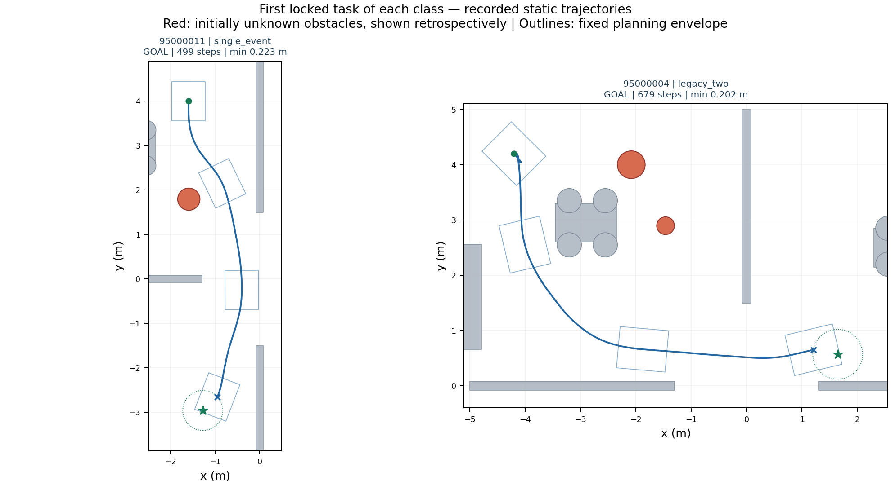
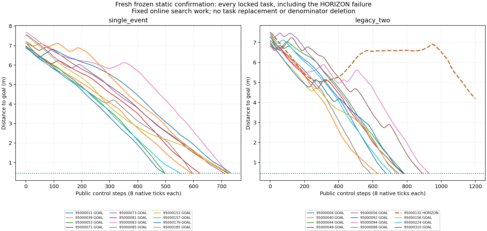

# Phase 静态未知障碍稳定验收报告 · V657

**结论：预注册的有限静态基准工程验收通过，等待用户审阅。** 动态未开始，SAC训练更新0。

全新锁定24项任务，23/24严格到达；单障碍12/12、双障碍11/12。三场景同版本完整重复及27项物理审计已由独立脚本重算。原V652/V653/V654未通过记录保留，不并入本轮分母。

## 核心结果

| 项目 | 结果 |
|---|---|
| 冻结新清单严格到达 | 23/24，门槛≥23/24 |
| 单/双障碍 | 12/12、11/12，门槛各≥11/12 |
| 确认实际原生物理步 | 137368，含未到达任务，不含重复 |
| 连同3次重复审计原生步 | 160112，重复不增独立样本 |
| 新确认原生步实际自体净空最小 | 0.192639338m |
| 含重复的原生净空最小 | 0.181062072m；硬下限0.15m |
| 障碍接触/穿透/未知接触 | 完整逐物理步日志及控制重放分别核验；详见独立门槛表 |
| 动态/训练/实机 | 均未开始 |

## 保留的未成功任务

- 95000132 双未知障碍：HORIZON，1200公开步后终距4.187596m，未到达；物理审计通过。

95000132双障碍先后执行多个安全进展前缀，较晚找到全局路径，绕行耗尽1200步。该项零障碍/未知接触、原生净空0.211213076m，但没有到达，永久计入失败，不以安全停止替代成功。通过23/24门槛不代表该负例已经解决。

## 本轮改动与复现修复

旧同一因果输入的2秒搜索一次在2998扩展后截断，另一次在3197扩展找到路径，造成真实轨迹差异。修订30固定在线优先搜索4000次、必要时回退16000次有效扩展，保留其他搜索代价/原语、感知、控制准入、制动尾、换挡与安全阈值。墙钟仍记录计算开销并由任务900秒硬限约束。32倍人工时钟速率差的零仿真回放得到同路径；随后三个困难基准及完整同版本重复通过，再冻结新池。预算定义本身改变，不能据此单独声称效率或机制净收益。

V653原重复还因接触分类依据含生成XML绝对目录导致原始SHA不同。新池前已注册唯一元数据规范化：仅在路径恰好指向各自pair/assets/isolated_indoor.xml且XML原始字节SHA一致时，用相对路径及已核对XML字节SHA替代该路径比较。所有位置、距离、时间、步号、分类、几何/自体标识与其他字段逐条完全相同，不删除、不舍入。三个重复的原始接触SHA并不相同，各自仍独立核对本次result并完整保留；只在上述严格路径规则下接触事件相同。

这不能改写原V652/V653/V654失败。本轮24项与3次重复均使用同一冻结V657运行源码；除输出目录外，在线算法逐字等同已通过开发的V656修订30。

## 任务选择与范围

候选池95000001–95000600，按种子升序做t0预检；实际检查310项，找到单障碍19项、双障碍12项合格参考，分别取前12项并在首次导航前锁定。其余290项未预检。初始化异常、不合格及未找到参考记录均保留，不按导航结局替换。

任务限定已知先验地图、准确定位、1或2个起初未知的静态圆柱，以及初始完整自体域净空和事前规定的运动学几何参考条件。固定域[-0.44,-0.375,0.44,0.375]，理想Ackermann中心转角上限约0.427221rad；t0参考保持原8秒/22000扩展、离散净空≥0.155m、插值位姿下界≥0.15m、参考终距≤0.28m。真值及参考仅作离线任务评价，不进入在线决策。未找到参考不等于无解，几何参考不保证动力学可达。

## 全部24项任务

| 种子 | 场景 | 结局 | 公开步 | 终距/m | 原生净空最小/m | 物理审计 |
|---|---|---|---:|---:|---:|---|
| 95000004 | 双未知障碍 | GOAL | 679 | 0.445313 | 0.201887 | PASS |
| 95000011 | 单未知障碍 | GOAL | 499 | 0.444329 | 0.222714 | PASS |
| 95000039 | 单未知障碍 | GOAL | 593 | 0.446627 | 0.254490 | PASS |
| 95000040 | 双未知障碍 | GOAL | 628 | 0.446396 | 0.208278 | PASS |
| 95000044 | 双未知障碍 | GOAL | 785 | 0.443530 | 0.195408 | PASS |
| 95000048 | 双未知障碍 | GOAL | 777 | 0.448524 | 0.225759 | PASS |
| 95000053 | 单未知障碍 | GOAL | 499 | 0.433821 | 0.229572 | PASS |
| 95000056 | 双未知障碍 | GOAL | 751 | 0.443975 | 0.205433 | PASS |
| 95000071 | 单未知障碍 | GOAL | 622 | 0.449577 | 0.205364 | PASS |
| 95000073 | 单未知障碍 | GOAL | 711 | 0.443722 | 0.206530 | PASS |
| 95000081 | 单未知障碍 | GOAL | 722 | 0.442849 | 0.199908 | PASS |
| 95000083 | 单未知障碍 | GOAL | 728 | 0.446499 | 0.221604 | PASS |
| 95000085 | 单未知障碍 | GOAL | 597 | 0.433231 | 0.214058 | PASS |
| 95000092 | 双未知障碍 | GOAL | 891 | 0.446384 | 0.192639 | PASS |
| 95000094 | 双未知障碍 | GOAL | 930 | 0.442909 | 0.221447 | PASS |
| 95000098 | 双未知障碍 | GOAL | 588 | 0.447640 | 0.232785 | PASS |
| 95000132 | 双未知障碍 | HORIZON | 1200 | 4.187596 | 0.211213 | PASS |
| 95000153 | 单未知障碍 | GOAL | 727 | 0.448056 | 0.204202 | PASS |
| 95000156 | 双未知障碍 | GOAL | 740 | 0.447030 | 0.203211 | PASS |
| 95000157 | 单未知障碍 | GOAL | 554 | 0.444029 | 0.249580 | PASS |
| 95000179 | 单未知障碍 | GOAL | 734 | 0.448516 | 0.224981 | PASS |
| 95000185 | 单未知障碍 | GOAL | 725 | 0.443141 | 0.214842 | PASS |
| 95000224 | 双未知障碍 | GOAL | 709 | 0.444354 | 0.214049 | PASS |
| 95000310 | 双未知障碍 | GOAL | 782 | 0.447525 | 0.209726 | PASS |

## 三场景完整同版本重复

基准为V656修订30开发分支，重复不进入24项分母。模型、规范初态、严格到达结局、全公开状态/控制及逐条接触事件分别核对。

| 种子 | 场景 | 独立重复核验 | 完整qpos/qvel/ctrl最大误差 |
|---|---|---|---|
| 93000074 | 双未知障碍 | PASS | {'qpos_full': 0.0, 'qvel_full': 0.0, 'ctrl': 0.0} |
| 93000045 | 单未知障碍 | PASS | {'qpos_full': 0.0, 'qvel_full': 0.0, 'ctrl': 0.0} |
| 91000002 | 单未知障碍 | PASS | {'qpos_full': 0.0, 'qvel_full': 0.0, 'ctrl': 0.0} |

## 独立重算全部门槛

| 门槛 | 结果 |
|---|---|
| source_and_protocol_frozen | PASS |
| unchanged_online_decisions | PASS |
| fresh_screening_order | PASS |
| same_first12_each_locked24 | PASS |
| prelocked_before_first_navigation | PASS |
| registered_reference_requirements | PASS |
| all24_attempts | PASS |
| at_least23_audited_arrivals | PASS |
| single_at_least11 | PASS |
| two_at_least11 | PASS |
| all27_physical_audits | PASS |
| three_full_state_and_exact_contact_repeats | PASS |
| bounded_before_overnight_deadline | PASS |

## 时间与计算开销

开始2026-11-01T00:26:04.677864+08:00，实验关闭2026-11-01T03:55:27.259630+08:00，耗时12562.582秒，上限18000秒；原批截止05:26:04.678及全夜08:00均未越过，没有延长或追加新池。

确认分支墙钟/仿真时长中位数6.29倍，范围6.08–7.04倍，包含本机感知、规划与完整记录开销，不含离线审计。该量不是逐控制调用p95，也不支持实时性结论。

## 证据、论文边界与下一步

独立脚本：[audit_v657_final.py](../experiments/v649_static_stability/audit_v657_final.py)；协议：[冻结确认协议](../experiments/v657_static_fixed_work_confirmation/PROTOCOL.md)；完整证据：[V657精选证据](../evidence/static_acceptance_v657_20261101/README.md)。源码、模型、原始接触摘要、完整状态、控制轨迹及所有失败保留。GitHub同步以[同步状态](../SYNC_STATUS.json)为准，远端逐文件验证前不删除原始运行。

通过仅指上述有限筛选静态基准的预注册工程门槛。原生步重建净空不是连续时间安全证明；圆柱估计未独立校准风险，没有统计优越性、任意未知地图/形状、实时性或实机结论。恢复器可接管全部SAC动作，冻结SAC收益未隔离。以RAS为目标，后续仍需同输入/足迹/预算对照、机制消融及真实计算开销证据。

静态结果交用户审阅后再决定下一步。当前停止追加实验，动态、训练和实机保持0。

## 轨迹与进展查看

所有24项都列出，失败保留；示例固定取清单每类第一项，不用挑选最好看的场景代替全分母。灰色为已知地图，红色为起初未知障碍的离线真值展示，轮廓是固定规划自体域；真值不进入在线决策。绘图新增仿真0步。

[全部24项实际轨迹](figures/v657_all_trajectories.png)
