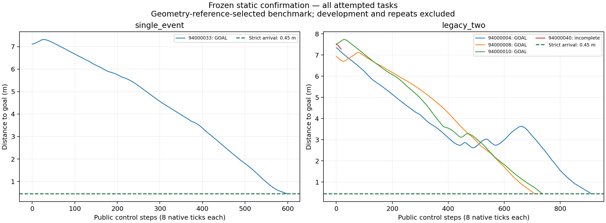

# V652 静态未知障碍新池确认

**结论：静态工程验收未通过。动态未开始，SAC训练更新0。**

运行结束状态`GATE_FAILED_PHYSICAL_SOURCE_OR_SCENE_AUDIT`。预锁定任务24项，完成5项，其中严格到达且物理/记录审计通过4项；单障碍1/12、双障碍3/12。未执行项显式列出，不能填成成功或失败。开发修复与重复不进入这24项分母。

## 冻结、筛选与边界

在线算法为V651修订29的逐字等价副本，唯一归一化差别是runner输出根目录。新池94000001–94000360奇数单障碍、偶数双障碍；按种子顺序t0预检，在首次各类至少12项时锁定各类前12项。该停止规则在新池预检/导航均为0时注册，未来更大种子不改变选定清单。

实际预检286项，未预检74项。参考只用于离线任务构建核验，不提供给在线导航；未找到参考不等于无解。所有初始化失败、不合格和未解记录保留。

目标总体限已知地图、准确定位、1或2个未知静态圆柱、固定完整自体配置域[-.44,-.375,.44,.375]、初始净空≥0.15m且存在规定运动学几何参考的任务。参考按关节/执行器一致的理想Ackermann中心转角上限约0.427221rad；它不同于V650原35°参考，不能直接将两轮成功率比较为算法总体改进。几何参考不是动力学可达证明，在线失败仍计失败。

## 全部预锁定任务

| 种子 | 场景 | 结局 | 公开步 | 终距/m | 原生日志净空/m | 审计 |
|---|---|---|---:|---:|---:|---|
| 94000004 | legacy_two | GOAL | 912 | 0.449518 | 0.233550 | PASS |
| 94000008 | legacy_two | GOAL | 710 | 0.443739 | 0.214382 | PASS |
| 94000010 | legacy_two | GOAL | 737 | 0.447716 | 0.206615 | PASS |
| 94000033 | single_event | GOAL | 600 | 0.448595 | 0.198374 | PASS |
| 94000040 | legacy_two | 未完整完成 | — | — | — | 未通过 |
| 94000052 | legacy_two | 未执行 | — | — | — | — |
| 94000054 | legacy_two | 未执行 | — | — | — | — |
| 94000058 | legacy_two | 未执行 | — | — | — | — |
| 94000069 | single_event | 未执行 | — | — | — | — |
| 94000081 | single_event | 未执行 | — | — | — | — |
| 94000097 | single_event | 未执行 | — | — | — | — |
| 94000103 | single_event | 未执行 | — | — | — | — |
| 94000120 | legacy_two | 未执行 | — | — | — | — |
| 94000127 | single_event | 未执行 | — | — | — | — |
| 94000129 | single_event | 未执行 | — | — | — | — |
| 94000136 | legacy_two | 未执行 | — | — | — | — |
| 94000141 | single_event | 未执行 | — | — | — | — |
| 94000146 | legacy_two | 未执行 | — | — | — | — |
| 94000163 | single_event | 未执行 | — | — | — | — |
| 94000173 | single_event | 未执行 | — | — | — | — |
| 94000177 | single_event | 未执行 | — | — | — | — |
| 94000189 | single_event | 未执行 | — | — | — | — |
| 94000252 | legacy_two | 未执行 | — | — | — | — |
| 94000286 | legacy_two | 未执行 | — | — | — | — |

## 完整门槛

24项至少23项严格到达且单/双各至少11/12；所有障碍接触/穿透/未知接触0、完整自体逐原生步覆盖、积分外根状态修改0、静态未知障碍不移动。每项1200公开步/900秒，第二次未成功即停止；原生控制重放需全公开完整qpos/qvel逐值匹配容差1e-8、重建净空≥0.15m。

| 独立核验项 | 结果 |
|---|---|
| execution_completed | PASS |
| selection_fixed_and_first_eligible_per_class | PASS |
| reference_clearance_and_terminal_requirements_met | PASS |
| 24_distinct_tasks | PASS |
| 24_completed_records | 未通过/未完成 |
| at_least_23_audited_arrivals | 未通过/未完成 |
| single_at_least_11 | 未通过/未完成 |
| two_at_least_11 | 未通过/未完成 |
| all_27_native_and_source_records | 未通过/未完成 |
| three_full_state_repeats_match | 未通过/未完成 |
| execution_within_timebox | PASS |
| current_source_unchanged | PASS |
| protocol_unchanged | PASS |

已通过审计轨迹的重建原生净空最小：0.19837380432135476米。控制重放不增加独立样本，也不构成连续时间安全证明。

## 三场景同版本重复

固定重复V651修订29开发任务93000074双障碍、93000045单障碍、91000002单障碍；规范初态、模型、全公开qpos/qvel/ctrl、接触内容与结局均比较，容差1e-8。墙钟搜索截止造成不同路径也按不匹配处理，不自动放宽。

- `repeat_93000074_legacy_two`：未完成/不匹配；not completed。
- `repeat_93000045_single_event`：未完成/不匹配；not completed。
- `repeat_91000002_single_event`：未完成/不匹配；not completed。

## 时间与后续

该独立窗口使用3577.315秒，上限14400.000秒；前V650/V651窗口独立记账，不重置其失败和时限。

通过仅表示上述有限静态基准的工程验收，不是校准概率风险、连续时间安全、统计优越性、任意障碍/未知地图、实时性或实机结论。恢复器可接管全部控制，SAC收益未隔离。后续论文需要固定感知/足迹下对照与组件消融、到达/停滞/计算耗时和适用边界。

本窗口结果给用户查看后停止；即使静态通过，动态也必须等用户明确继续。新证据未远端校验前不删除原始运行。

