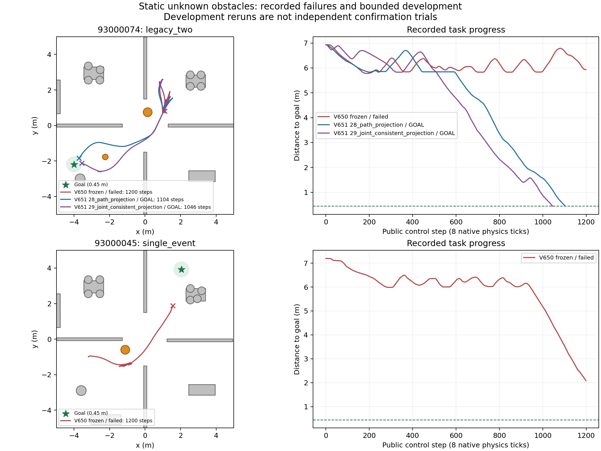

# 静态路径进展修复 V651

**当前开发状态：开发验证进行中，静态尚未验收。动态未开始。** 原V650确认13项11到达2未到达、按预设第2次失败停止的结论不变。以下修复重跑均为开发，不合并成独立成功率。

## 原因与证据

两个失败均曾找到完整目标几何路径：93000045单障碍10次规划中9次完整路径、7次停车换向；93000074双障碍13次规划全部完整路径、12次停车换向，但1200步后仍分别距目标2.09135m、5.93213m。所选控制预测下一XY与记录一致。原13条轨迹82168原生步重放逐值匹配、重建净空最小0.179278m。当前主要缺口是局部执行与持续进展，而非仅看是否找到路径或有无碰撞。

旧控制评分将预测终态朝向与前方固定点朝向比较，又按该偏差指数衰减前进奖励；在转弯或短倒车段，两者容易出现不一致。修订28改为同挡路径投影弧长增量、投影位置处朝向及横向偏差，保留原生预测与所有安全阈值。它救回双障碍，但仍长时间局部停滞。

修订28还暴露最近点索引可绕过停车换向门控：step198换向前速度0.0501245m/s，略高于0.05门槛。该例0.36967rad是前视朝向误差，不是换向点姿态误差；原V650两个失败中未发现该旁路，不能将它写成原失败的已证实主因。修订29禁止最近点索引自行跨换向点，只能经停车/姿态门控放行。

另已查实规划35°虚拟转角与实际左右轮关节/执行器±0.52rad不同。按理想Ackermann几何，0.6m轴距、0.54m轮距对应中心角上限约0.427221rad。修订29据机器人自身约束限制规划原语，并保留原控制候选供跟踪纠偏；它不读取障碍真值。这个解析上限不是滑移、载荷和执行器滞后系统的动力学可达证明，所有实际命令仍逐原生预测并验收。

## 开发结果

| 运行 | 到达 | 步数 | 目标距离/m | 重规划次数 | 重放净空最小/m | 完整开发审计 |
|---|---|---:|---:|---:|---:|---|
| dev28_seed93000074_legacy_two | GOAL | 1104 | 0.448376 | 9 | 0.192787 | 未全通过/待审计 |
| dev29_seed93000074_legacy_two | GOAL | 1046 | 0.441458 | 5 | 0.181062 | PASS |

全部已完成分支的模型与规范初态配对、源码快照、逐公开完整状态、接触内容摘要与逐原生净空审计见DEVELOPMENT_RESULTS和每运行DEVELOPMENT_AUDIT。不能将修订28到达但换向记账审计未通过的结果直接视作最终候选。不同修订不混计独立样本。

## 验收与研究边界

V651共用原V650窗口截止2026-10-31 19:45:11 +0800，最多4次开发导航；每项1200步/900秒，0.15m硬下限、完整自体域、未知障碍静止、积分外根状态修改禁令不变。模型训练更新0。

新V652协议预注册了启动前提：修订29两项原失败及91000002单障碍回归全部严格到达、审计通过。若满足，冻结源码后在全新94000001–94000360候选池先筛选、导航前锁定24项，仍要求至少23项到达及单/双各11/12，另做3场景重复及原生审计。它是单独记账的一次有界窗口，不改写V650失败或预算；最晚23:45 +0800停止，无自动通宵或追加窗口。

新参考采用关节限位一致的转角上限，筛选后的目标总体与V650不同，不将两轮比例直接比较。通过也只代表有限静态基准的工程验收；当前无实时性、任意障碍/未知地图泛化、连续时间或概率安全、统计优越性或实机结论。动态必须等用户看过静态结果并明确继续。

## 文献与论文方向

借鉴[Regulated Pure Pursuit](https://arxiv.org/abs/2305.20026)的曲率/速度协调、[Nav2换向点处理](https://docs.nav2.org/rolling/configuration_and_development/configuration_guide/core_servers/controller_server/controller_server_plugins/feasible_path_handler/)，以及[Liniger等的轮廓控制](https://arxiv.org/abs/1711.07300)所用路径进度与跟踪误差联合优化思想。当前有限候选预测器不是完整MPCC，也不把通用控制组件包装为论文创新。

RAS后续论证应围绕感知包络、规划走廊与实际完整自体执行的一致性：先拿新池结果，再用同状态组件消融与同感知/足迹基线区分因果贡献，同时报告净空、局部停滞/换向次数、到达和计算耗时。恢复器可接管全部控制，不能将改善归因于SAC。

