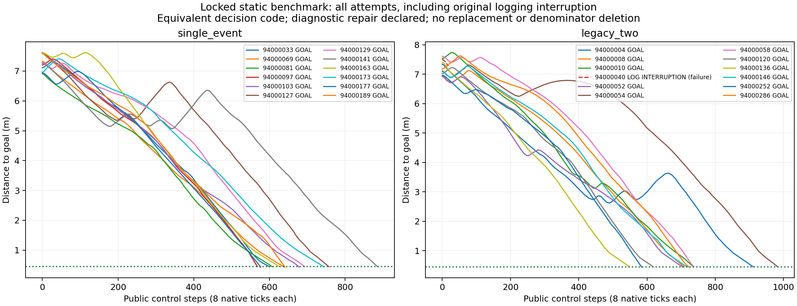
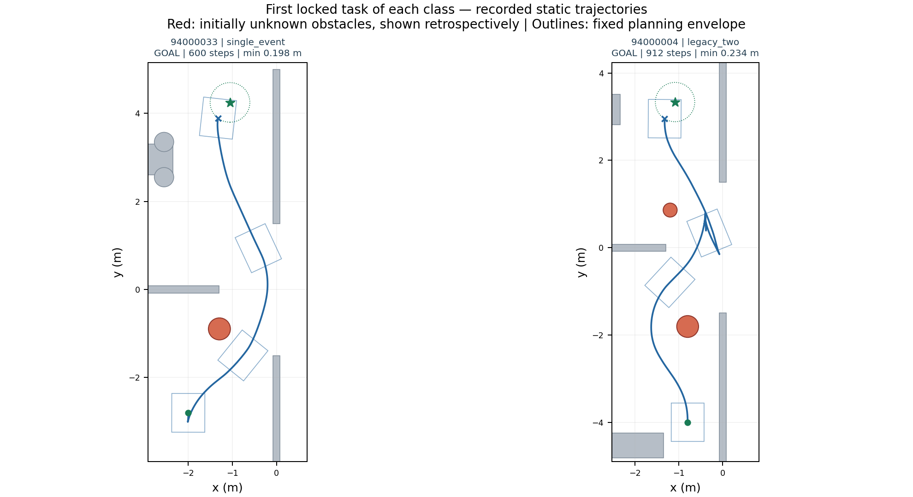

# 静态未知障碍固定清单验收与日志续验

**结论：静态稳定验收未通过。动态未开始，训练更新0。**

原锁定24项中，已有24项尝试记录，23项严格到达并通过独立物理审计；单障碍12/12，双障碍11/12。原94000040双障碍日志中断永久计1项未成功，没有重跑替补或从分母删除。未执行任务显式列出，不补成成功/失败。

## 必须保留的运行来源说明

V652原冻结批次前4项到达，第5项在19公开/152原生步后因规划统计字典自引用发生日志递归异常，原批次已停止且不通过。原代码、COMPLETION和中断记录保持不变。其已执行前缀重放逐值匹配、净空0.601090745m、接触0；前缀安全核验不代表到达，也不覆盖未执行的未来。

V653仅将两处诊断统计赋值改为字典浅拷贝，避免写日志自引用；感知、候选生成、路径选择、阈值、控制器及所有决策模块不变。runner只归一化输出根目录与两处dict拷贝后，逐字恢复原V652冻结哈希。零仿真日志回归通过。它按原清单顺序续跑未执行19项，仍用V652原14400秒和23:40:51.861截止时间。

因此本报告评价同一冻结决策算法，但不声称所有任务使用完全同一runner字节或整批从未中断；工程门槛若达到，也应明确这次诊断修复。论文的完整独立确认仍应报告这一来源限制。

## 任务选择与适用范围

全新池94000001–94000360按种子顺序t0预检，286项后单障碍19项、双障碍12项找到合格几何参考，导航前锁定各类前12项；74个候选未预检。不按导航结果选种子、替补或追加样本。未找到参考不等于无解。真值参考只作离线任务评价，不进入在线导航。

范围限已知地图、准确定位、1或2个未知静态圆柱、固定完整自体配置域和规定几何参考的任务；参考采用自体关节一致的理想Ackermann中心转角上限约0.427221rad，参考不是动力学可达证明。这与V650原35°参考条件不同，不能直接将两轮比例视为总体算法提升。

## 全部24项固定任务

| 种子 | 场景 | 来源/结局 | 公开步 | 终距/m | 已执行原生净空最小/m | 独立审计 |
|---|---|---|---:|---:|---:|---|
| 94000004 | legacy_two | 原V652/GOAL | 912 | 0.449518 | 0.233550 | PASS |
| 94000008 | legacy_two | 原V652/GOAL | 710 | 0.443739 | 0.214382 | PASS |
| 94000010 | legacy_two | 原V652/GOAL | 737 | 0.447716 | 0.206615 | PASS |
| 94000033 | single_event | 原V652/GOAL | 600 | 0.448595 | 0.198374 | PASS |
| 94000040 | legacy_two | 原V652/日志中断未成功 | 19 | 7.278325 | 0.601091 | 前缀PASS，任务未成功 |
| 94000052 | legacy_two | 日志修复续验/GOAL | 705 | 0.445183 | 0.210393 | PASS |
| 94000054 | legacy_two | 日志修复续验/GOAL | 984 | 0.447815 | 0.225843 | PASS |
| 94000058 | legacy_two | 日志修复续验/GOAL | 738 | 0.449889 | 0.216199 | PASS |
| 94000069 | single_event | 日志修复续验/GOAL | 639 | 0.443627 | 0.249917 | PASS |
| 94000081 | single_event | 日志修复续验/GOAL | 608 | 0.445659 | 0.196751 | PASS |
| 94000097 | single_event | 日志修复续验/GOAL | 569 | 0.449624 | 0.235718 | PASS |
| 94000103 | single_event | 日志修复续验/GOAL | 679 | 0.439967 | 0.206567 | PASS |
| 94000120 | legacy_two | 日志修复续验/GOAL | 619 | 0.446732 | 0.200630 | PASS |
| 94000127 | single_event | 日志修复续验/GOAL | 758 | 0.449985 | 0.214886 | PASS |
| 94000129 | single_event | 日志修复续验/GOAL | 694 | 0.444832 | 0.215526 | PASS |
| 94000136 | legacy_two | 日志修复续验/GOAL | 550 | 0.444444 | 0.218316 | PASS |
| 94000141 | single_event | 日志修复续验/GOAL | 887 | 0.445809 | 0.226633 | PASS |
| 94000146 | legacy_two | 日志修复续验/GOAL | 719 | 0.444117 | 0.203803 | PASS |
| 94000163 | single_event | 日志修复续验/GOAL | 627 | 0.448333 | 0.223964 | PASS |
| 94000173 | single_event | 日志修复续验/GOAL | 743 | 0.448655 | 0.216248 | PASS |
| 94000177 | single_event | 日志修复续验/GOAL | 578 | 0.435931 | 0.229219 | PASS |
| 94000189 | single_event | 日志修复续验/GOAL | 642 | 0.433501 | 0.191913 | PASS |
| 94000252 | legacy_two | 日志修复续验/GOAL | 585 | 0.441033 | 0.216232 | PASS |
| 94000286 | legacy_two | 日志修复续验/GOAL | 725 | 0.440085 | 0.213929 | PASS |

## 独立重算门槛

门槛未放宽：原24项至少23项严格到达、单/双各至少11/12，所有已执行原生步障碍接触/穿透/未知接触0、完整自体覆盖、静态障碍不移动、积分外根状态修改0、净空≥0.15m。一次原日志中断保留为失败，所以剩余19项必须全成功。第二次未成功或任意安全/源码/模型审计失败立即停止。

| 核验项 | 结果 |
|---|---|
| original_batch_stopped_and_failure_preserved | PASS |
| same_locked24_selection | PASS |
| registered_reference_requirements | PASS |
| decision_source_equivalent | PASS |
| all_sources_frozen | PASS |
| 24_attempt_records | PASS |
| at_least23_strict_audited_arrivals | PASS |
| single_at_least11 | PASS |
| two_at_least11 | PASS |
| all27_full_or_actual_prefix_physical_audits | 未通过/未完成 |
| three_full_state_repeats | 未通过/未完成 |
| original_deadline_not_reset | PASS |

## 物理核验与计算开销

本次已完整审计的确认导航（含原中断前缀）共128216个实际原生步；连同独立列出的重复，累计审计136584个原生步。所有已审计步中的实际自体投影轴向AABB净空最小0.181062072m；这是离散原生步上的重建净空，不是连续时间下界。

完整确认分支墙钟耗时/仿真时长的中位数为6.52倍，范围6.23–6.97倍（本机、当前完整日志配置，未扣除感知/规划/记录开销；不含离线审计）。这说明当前尚不能声称实时控制，亦不是逐控制调用的p95延迟。

## 三场景同版本重复

按原预定V651修订29基准，比较规范初态、模型、每公开步完整qpos/qvel/ctrl、接触内容摘要和到达结局，容差1e-8。重复不进入24项分母。

- 93000074 legacy_two：未完成/不匹配；{'qpos_full': 0.0, 'qvel_full': 0.0, 'ctrl': 0.0}。
- 93000045 single_event：未完成/不匹配；not completed。
- 91000002 single_event：未完成/不匹配；not completed。

## 时间、证据与研究边界

从原V652起点计耗时11594.989秒，上限14400.000秒，截止未重置。原V652失败报告见[原批次记录](STATIC_CONFIRMATION_V652_REPORT.md)，开发修复见[路径进展修复](STATIC_REPAIR_REPORT.md)。

原始运行和中断完整保留；GitHub远端验证前不删除。原生控制重放是审计而非新增独立试验，公开完整状态匹配也不证明物理连续时间安全。

工程门槛只适用于上述有限筛选静态圆柱基准。没有校准概率风险、连续时间安全、统计优越性、任意未知地图/障碍、实时性或实机结论；恢复器可接管全部控制，SAC收益未隔离。RAS论文仍需同输入/足迹/预算下对照、组件消融和真实计算开销。

给用户查看本报告后停止；动态必须等用户明确继续。

## 实际轨迹查看

下图固定取原清单每类第一项，便于查看绕障过程；它们不代替完整24项分母。灰色为先验已知障碍，红色为起初未知障碍的离线真值展示，轮廓是固定规划自体域；真值不进入在线规划。轨迹来自已记录控制步，绘图新增仿真0步。

[查看全部24项轨迹，含原日志中断及任何未执行项](figures/v653_all_trajectories.png)

## 停止后的离线原因核对（不改变原判定）

本轮因首项复现的原始接触日志SHA不一致而按原规则停止，另两项复现未执行，因此完整静态验收未通过。该复现1046步的完整qpos/qvel/ctrl误差均0，模型、规范初态与物理审计一致。对91819条接触逐条核对发现：66940条地面支持记录仅classification_basis.geom1.xml的生成目录不同，其余24879条原JSON相同；两份生成XML原始字节SHA相同。所有距离、位置、时间、分类、几何标识均一致。

V654开发仅验证离线比较时将该受限路径字段改为相对路径及已核对的XML字节SHA，原日志各自SHA仍独立校验并完整保留；距离、位置或分类变化必须拒绝。原V653 COMPLETION和未通过身份不回填。修复后先做剩余同版本重复，再另立全新池V655冻结确认，不将这次后验诊断写成原验收已通过。
