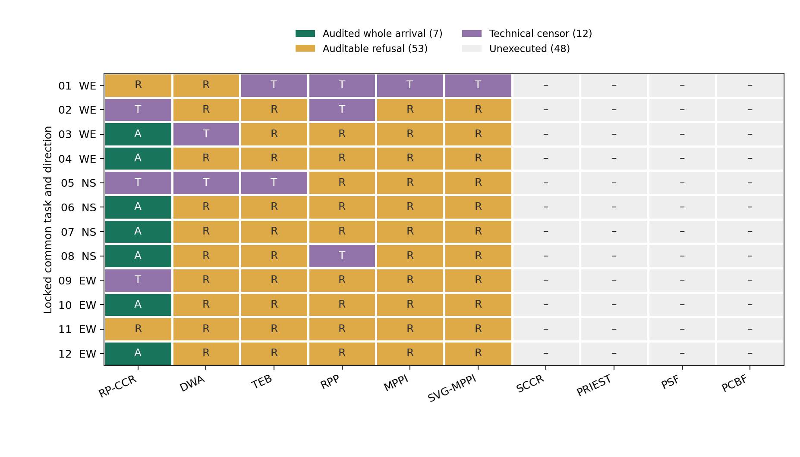

# RP-CCR: Measured-State Recovery for Ackermann Navigation under Partial Observation

**Internal full draft, updated 27 November 2026. Common-comparison snapshot: `runs/v2130_common_results_readout/RESULT.json` (72 closed tasks). Development evidence through V2144. Not submission ready.** This draft supersedes older manuscript progress statements for the explicitly reported snapshot only. Numerical results below are observations; planned confirmation is described separately. The project acronym RP-CCR is retained without inventing an English expansion. Authors, affiliations and acknowledgements remain to be supplied.

## Abstract

Safe execution of a local motion does not establish that a vehicle can subsequently reach its goal. We investigate RP-CCR, an Ackermann navigation system that combines recovery-source proposals, execution checks, retained stopping trajectories and replanning from measured handoff states under partial obstacle observation. The evaluation distinguishes complete audited arrivals, finite functional refusals and technical or evidence failures. In a locked comparison involving twelve tasks per method, RP-CCR completed seven tasks, with two functional refusals and three technical failures. Declared adaptations of DWA, TEB, regulated pure pursuit and MPPI each completed twelve evaluations without an audited whole-task arrival; their refusals frequently occurred at command-domain or stopping checks. SVG-MPPI completed twelve evaluations, with eleven finite functional refusals and one technical failure. These outcomes characterize the evaluated systems under their disclosed interfaces and do not establish superiority over unmodified published methods. A separate twenty-assignment mechanism study produced eight complete arrivals. Successful qualified pairs examined for onward prechecking and temporal selection did not show a trajectory or arrival benefit, and temporal selection was inactive in the successful temporal pair. Earlier exposed fixed-course development achieved twenty-four audited arrivals and three exact repeats. Together, the results establish executable recovery examples and reproducible failure boundaries, while leaving mechanism benefit, independent generalization and online real-time performance unresolved.

**Keywords:** Ackermann navigation; partial observation; recovery planning; predictive safety; reproducible evaluation.

## 1. Introduction

Navigation through constrained environments requires a sequence of feasible decisions. A vehicle may execute a collision-free prefix and stop safely, yet remain unable to find a continuation to its goal. This distinction matters when steering dynamics, limited observations and a moving obstacle change the conditions under which a proposed recovery can be executed. A continuation planned from a predicted endpoint also requires revalidation when the vehicle reaches a measured endpoint with updated observations.

Our research question is whether recovery proposals, checks of subsequent continuation, and replanning from the actual handoff state can improve task completion while retaining explicit execution constraints. RP-CCR implements these elements in a simulation pipeline with causal sensor inputs and a separate evidence evaluator. Proposed motions are not accepted solely because a geometric path exists. Their control requests, predicted physical response, stopping continuation and provenance are checked before execution. A subsequent segment is planned from measured state and control memory rather than an assumed exact arrival at the predicted endpoint.

This paper currently provides three forms of evidence: an explicit account of the implemented recovery system and its assumptions; a comparison of declared controller adaptations under locked common tasks and an execution interface; and a mechanism study that preserves negative and inconclusive outcomes. The present evidence does not yet establish a new general safety theorem, a positive causal effect of the tested mechanisms, or superiority across unseen environments. These are substantive research gaps rather than editorial omissions.

## 2. Related work and comparison scope

The dynamic window approach selects dynamically admissible local motion commands [1]. Timed elastic band methods optimize trajectories and can explore distinct topologies [2]. Regulated pure pursuit is a path-tracking controller [3], whereas information-theoretic MPPI and SVG-MPPI optimize distributions over control sequences [4,5]. PRIEST combines sampling with projection-based optimization [6]. These methods differ in their required inputs, motion representations and role in a navigation stack. A path follower supplied with a shared path is not, by itself, a complete competing recovery planner.

Predictive safety filters already distinguish a nominal control proposal from the decision to apply or modify it [7]. Predictive control barrier functions introduce a recovery mechanism through an auxiliary soft-constrained predictive problem and terminal conditions [8]. Accordingly, adding prediction, a stopping check or a fallback to a controller is insufficient to establish the novelty of RP-CCR. The prospective contribution must be located in a particular executable recovery construction and its interaction with changing causal information and measured handoffs. The current experiments test some aspects of that interaction but have not demonstrated a net mechanism benefit.

Our measured baseline identities include engineering adaptations. We report them as such. Published performance numbers and theoretical guarantees are not transferred to these implementations. PSF and PCBF must also be evaluated with an explicitly fixed nominal controller, system model, uncertainty description and terminal conditions; they cannot be treated as ready-made independent navigation policies.

## 3. Problem formulation and assumptions

Let the vehicle state be \(x_k\), its retained control memory be \(m_k\), and a requested motion command be \(u_k\). The simulator, actuator mapping and controller state determine the subsequent physical state. Online decisions use the public static map, current vehicle information and the registered causal range-observation interface. Actor truth is reserved for sensor simulation and offline evaluation. Actual observations need not be identical across methods after their trajectories diverge, even when sensor seeds and observation rules agree.

The dynamic tasks use a known map, three courses, a single moving actor and a declared motion class. New phase values change actor timing within those courses. They are not independent unseen maps. Accurate simulation state and the declared observation model are assumptions; hardware localization and sensing performance have not been established.

The current original execution contract includes tracking checks of 0.04 m position, 0.035 rad heading and 0.015 steering, an actual clearance floor of 0.15 m, the original conservative prediction reserves, a complete 2,200-native-step stopping continuation, and a 200-step error-stop closure where applicable. Full state, control and mocap replay is evaluated against the original \(10^{-8}\) tolerance, together with contact, self-contact and causal-source checks. These conditions are not interchangeable with thresholds from other historical study versions.

Task completion requires the registered goal condition, its stopping requirements, complete evidence and the applicable independent checks. A safe prefix, small final goal distance, successful process exit or completed archive is not a whole-task arrival.

## 4. Recovery and execution procedure

RP-CCR maintains a current route or recovery proposal, a measured state and controller memory, a causal obstacle estimate, and retained execution evidence. Depending on the registered course and branch, the system considers direct continuation, a refuge followed by onward continuation, or a current-state fallback proposal. Known-course reference proposals are declared prior information; they are not evidence of a universal route generator.

The conceptual procedure is:

1. Form the current state and causal observation record, preserving its native timestamp and provenance.
2. Construct or retrieve an allowed reference proposal. Any control and response evidence required for the current plant is regenerated from the applicable measured state; historical controls or certificates are not attached to a new plant.
3. Evaluate command admissibility, predicted response and the complete retained stopping continuation under the original contract.
4. For the registered onward-check branch, test a finite continuation before admitting the initial recovery prefix. This precheck is a finite search witness, not a guarantee that later planning will succeed.
5. Execute the admitted prefix with current feedback and checks. Preserve the canonical reason when no candidate satisfies the execution contract.
6. At handoff, obtain the actual state and current observation record. Replan or revalidate onward motion from that state. A predicted handoff is not substituted for the measured one.
7. At termination, retain actual state and control capture, perform the required replay and independent evaluation, and classify the outcome.

The temporal branch evaluates the registered waiting candidates when that branch is entered. The `no_time` variant preserves candidate computation but removes nonzero waits from selection eligibility. The `no_onward` variant removes the pre-execution onward precheck while preserving current prefix checks, feedback, stopping evidence and replanning after measured handoff. Other parameters are held fixed. Inactive branches remain part of the outcome record.

### 4.1 Conditional geometric interpretation

Let \(R_U(\tau)\) contain the actual vehicle footprint under a candidate command sequence, including the assumed execution error, and let \(O(\tau)\) contain the obstacle occupancy consistent with causal observations and the assumed motion bound. If both set containments hold throughout an interval and

\[
\operatorname{dist}(R_U(\tau),O(\tau))\geq d_{\min}
\quad\text{for every }\tau\text{ in that interval},
\]

then the actual sets satisfy that separation over the interval. This is an elementary conditional set-inclusion argument, not a novel theorem. The current discrete native-step audits do not independently prove the required continuous-time containments. Between-sample motion, model uncertainty, execution delay and the beginning of the validity interval require explicit treatment before making a continuous-time safety claim. Safe stopping also does not guarantee indefinite safety against an obstacle that continues to move.

## 5. Experimental design

### 5.1 Separate evidence cohorts

We keep the following cohorts distinct: earlier static acceptance; exposed dynamic fixed24 development and its repeats; the current twelve-task common comparison; and the twenty-assignment mechanism study. Repeats do not increase independent sample counts. Development tasks, earlier failed versions and new-phase observations are not pooled into a larger success rate.

The common registry contains ten methods and twelve locked tasks, giving 120 slots. Six methods have completed all twelve evaluations. The snapshot contains72 closed slots: seven audited whole arrivals,53 valid finite refusals and twelve technical/evidence censors. Four methods retain48 unexecuted slots. No task is active in this reporting snapshot. Unexecuted methods are reported as unexecuted, not as zero-success methods. Runtime archive completion is recorded separately from scientific closure.

### 5.2 Actual baseline identities

| Method | Evaluated implementation and disclosed interface | Relevant configuration or limitation |
|---|---|---|
| RP-CCR | Current original-contract recovery system | Course-dependent recovery proposals and finite source search; current-state revalidation |
| DWA | Pinned PythonRobotics reference with Phase Ackermann admissibility filtering | Forward configuration 0.08 m/s; public static information and causal current range points |
| TEB | Pinned original HCP core with vehicle geometry and upstream saturation mapping | Forward configuration 0.08 m/s; original raw curvature may violate the common execution domain |
| RPP | Pinned Nav2 core through the declared ExecutableRPP adaptation | Speed limited to ±0.1 m/s, near-zero deadband, yaw projection, 1.5 s projected-pair collision recheck; lookahead 0.6/0.3/0.9 m |
| MPPI | Pinned Nav2 core through coherent/deadband vehicle adaptation | 1,000 samples, 56 steps of 0.05 s, one iteration, speed ±0.1 m/s; persistent optimizer |
| SVG-MPPI | Declared persistent author-core vehicle interface | Registered 8,000 samples, 100 gradient iterations and 10 SVGD iterations; current route and stopping checks |

Common task fields do not imply identical controller speeds, identical priors, identical search budgets or equal total computational work. The current experiment measures these declared systems under their interfaces. It is not an unmodified-native comparison of the original papers. In particular, forcing a shared stopping or command constraint on a controller can determine its outcome before its native avoidance behavior is observed. This influence must be discussed rather than attributed automatically to the underlying algorithm.

The original common-input contract lacks channels required by full SCCR. A separate equal-camera/depth group has been authorized for all reference methods, with final tasks and versions still unregistered. Actual acquisition of24 rendered-depth features has now been validated through a disclosed camera binding; the complete186-dimensional observation, frozen policies and navigation remain unqualified. PRIEST's saved point-obstacle representation conflicts with its fixed initial state; this is an adapter applicability limitation, not a formal navigation failure. PSF and a declared PCBF variant passed short original-vehicle components; a longer PCBF component terminated on optimizer non-convergence. These components do not occupy the48 remaining formal slots or establish the original papers' theoretical assumptions.

### 5.3 Outcome definitions and statistical scope

We use three closed-outcome categories. An audited whole arrival satisfies the complete goal and evidence conditions. A valid finite functional refusal records a method refusal with complete applicable closure and independent prefix evidence. A technical/evidence failure records an execution, source, capture or audit deficiency that prevents interpretation as a clean algorithm outcome. A primary functional error can coexist with a technical censor; classification is not inferred from the first error string alone.

All registered tasks remain in the denominator. Technical failures are not deleted to improve a success rate. At this stage, results are descriptive for the fixed tasks. The three courses and repeated phase structure limit independence. We do not report a population superiority test or treat exact repeats as additional independent observations.

## 6. Results

### 6.1 Common comparison snapshot

**Table1.** Updated fixed-course snapshot verified against72 canonical result SHA256 records. Every method retains twelve slots; unexecuted methods are not assigned zero-success performance. The obsolete64-task figure is removed from this draft while its historical artifact is preserved.

| Method | Closed / 12 | Audited whole arrival | Valid finite refusal | Technical/evidence failure |
|---|---:|---:|---:|---:|
| RP-CCR | 12 | 7 | 2 | 3 |
| DWA | 12 | 0 | 10 | 2 |
| TEB | 12 | 0 | 10 | 2 |
| RPP | 12 | 0 | 9 | 3 |
| MPPI | 12 | 0 | 11 | 1 |
| SVG-MPPI | 12 | 0 | 11 | 1 |
| SCCR, PRIEST, PSF, PCBF | 0 each | Not evaluated | Not evaluated | Not evaluated |

RP-CCR achieved seven qualified arrivals among its twelve tasks. The course breakdown was two WEST_EAST, three NORTH_SOUTH and two EAST_WEST arrivals. Saved successful WEST_EAST branches used refuge-onward recovery followed by direct continuation. NORTH_SOUTH successes used the declared current-state fallback. These observations identify successful execution branches but do not isolate their causal contribution.

RP-CCR's two clean functional refusals concerned failure of finite search to provide a current whole-goal source and a mismatch with the registered normal-driving discovery condition. Its three technical/evidence failures remain non-successes, including a near-goal task whose evidence byte allowance was exhausted. None of these outcomes proves global physical infeasibility.

The ten valid DWA refusals occurred at the current-cycle complete-stop check. RPP had nine valid refusals; ten records contain a gear-domain first error, but one also has a technical limitation and must not be counted as a clean refusal. TEB includes finite optimizer-query and raw-curvature refusal boundaries. MPPI had eleven valid complete-stop refusals and one technical failure. SVG-MPPI's eleven clean closed refusals were also complete-stop refusals. Consequently, a table of zero arrivals alone would omit the principal scientific information about where each evaluated system stopped.

For SVG common04, 4,055 normal steps and 200 error-stop steps yielded 4,255 actual and replay steps. Maximum replay state/control/mocap error was zero, independent prefix audit passed, minimum actual clearance was 0.2669666896 m, and no secondary error was recorded. Whole-task arrival remained false. This illustrates why prefix safety and task completion are separate endpoints.

### 6.2 Mechanism study

The separate locked study contains twenty assignments: WEST_EAST full/no-onward pairs, EAST_WEST full/no-time pairs and NORTH_SOUTH full-method tasks. All assignments closed, with eight whole arrivals and twelve non-successes. One assignment has unknown native-step counts, which remain unknown.

The phase02 full/no-onward trajectories were identical and both failed to find a measured-handoff continuation. The successful phase04 onward pair also had identical trajectories. The successful phase12 time pair showed identical trajectories and did not enter the temporal selection branch. The observed pairs therefore do not establish an arrival gain from onward prechecking or waiting selection. Inactive branches do not establish that those mechanisms are generally unnecessary. Other pairs with incomplete evidence cannot be promoted to clean causal comparisons.

### 6.3 Earlier evidence, kept separate

Earlier static acceptance produced 23 strict arrivals in 24 tasks, with three same-version repeats and 27 physical audits. It was restricted to the registered known-map and initially unknown static-obstacle conditions. Dynamic fixed24 development subsequently completed all 24 exposed tasks and three exact repeats under its original contract. The development exposure prevents interpreting that 24/24 result as independent generalization.

Historical SCCR cohorts used different contracts. In G4C, SCCR completed 60/100 tasks and the old DWA-C3 adaptation completed 61/100. In Final300, SCCR completed 214/300 and the old Phase21-v11 system completed 165/300; collision and computation tradeoffs remained. Phase21-v11 is not relabelled as current RP-CCR, and these cohorts are not merged with the common comparison.

### 6.4 Efficiency evidence and missing measurements

The earlier64-task reporting snapshot contained saved machine elapsed time for62 tasks; two values were missing. This historical availability count is not extrapolated to the updated72-task snapshot. These values include closure work and differ in trajectory duration, termination stage and evidence reconstruction. They cannot rank online controller efficiency. Complete normal/static/native model work is not fully instrumented; reported q1159 counters cover a subset only.

The terminal SVG `query_wall_s` field stores the last query duration, as established by the saved worker source. It is not cumulative solve time and cannot yield P95. Online control latency quantiles, deadline misses and execution-delay effects remain unestablished. A future fixed-source timing study must distinguish sensing, estimation, proposal generation, certification, transfer, command application, recording, replay and offline audit.

### 6.5 Subsequent capability development, excluded from Table1

These exposed development components do not constitute independent confirmation. PSF executed250 fresh control queries,1250 normal native steps and the complete2200-step stop. Its endpoint displacement was0.9610509758m, while the original goal remained7.0389490476m away. It did not encounter the moving actor. All3450 actual/replay steps matched with zero state/control/mocap error and contact mismatch; the independent501-profile audit passed. This establishes sustained local execution, not whole-route arrival or avoidance competence.

The declared PCBF engineering variant retained strict optimizer status/residual and hard-body checks while using minimal-feasible slack initialization and permitting its intended soft prediction tightening. Its20-query component passed2300 actual/replay steps. The longer component's82nd auxiliary solve returned SLSQP status8 with success=false despite a small residual. Execution stopped after81 applied queries (405 normal steps), followed by200 error-stop steps. All605 actual/replay steps and the independent prefix audit matched. This numerical non-success is retained without retry or reinterpretation as convergence; it is not a collision or proof of global infeasibility.

SCCR's inherited66-dimensional core contains24 rendered-depth patch features, additional to50 appended camera/depth features. The original camera lookup was absent from the current model. A separately disclosed binding to the existing camera acquired three real64x64 frames at native0,5,10; these were not all-ones fallback data. Original24-feature extraction matched independent recomputation, rendering preserved the measured integration state, and2210 actual/replay steps with complete stopping and independent audit passed. This qualifies acquisition of those24 features, not the other inputs or the full learned policy. Factory-internal model, renderer and policy counts remain unknown. A later component assembled the complete observation on three saved measured-state fixtures and evaluated the two frozen107/186-input actors against SB3 deterministic references. Maximum action differences were5.96e-8 and4.17e-7 under the preregistered1e-6 threshold; neither comparison was byte exact. This used six direct forwards and two three-row reference batches, with no new physical steps or training. The saved fixtures belong to one exposed case, and actual live union sensing, risk fusion and the complete inner control mapping remain unqualified. The first pre-inference import-binding failure remains separately recorded; its one entry correction did not change the policies or tolerances.

PRIEST's saved original input placed all50 inflated obstacle constraints in conflict with the fixedt0 state. A predeclared four-disc vehicle enclosure passed512-heading enclosure checks but still left two initial conflicts. No new optimizer or vehicle navigation was launched from this incompatible representation. This is an input applicability limitation, not an executed formal failure.

These findings motivate independent capability positive controls and a new frozen equal-information comparison. They do not retrospectively repair old results or establish fair baseline treatment by themselves.

The subsequent exposed PSF long-route attempt completed 999 numerical queries and 4,995 normal native steps before a byte-grant refusal, followed by the prescribed 200-step error stop. Its 5,195 actual steps and exact own replay were captured; all 1,998 saved prediction profiles passed the first independent prefix audit. Endpoint displacement was 3.835m, while the original goal remained 4.473m away and no actor return had been detected. This is an auditable technical censor with a nontrivial curved driving prefix, not a whole arrival or a dynamic-avoidance result.

A separate PCBF development experiment applied fixed variable units to the same ideal nonlinear program. On four saved inputs and a synthetic open positive, both optimization stages converged with the original success and residual gates; a synthetic occupied negative remained inadmissible under the unchanged exact hard-geometry check. The known saved input that previously returned auxiliary status8 returned status0 after conditioning. The twelve new numerical returns passed a first arithmetic audit without another solve. This is exposed numerical-development evidence; physical validation of the conditioned implementation remains pending. The worker wrote all numerical evidence before a NumPy-boolean final-console serialization error; the outer pipeline remains recorded as failed.

### 6.6 Locked-task outcome disposition

**Figure 1.** Every locked method–task slot in the 27 November snapshot. A denotes an audited whole arrival, R an auditable finite refusal, T a technical censor, and a dash an unexecuted slot. The twelve tasks are repeated phases/directions within the same known field, not independent maps. Development components, source-only failures and current unfinished runs are excluded. An R label establishes evidence closure for the recorded refusal; it does not by itself establish native-method applicability, interface fairness or statistical superiority.

## 7. Discussion

The strongest present result is that RP-CCR can complete a full dynamic recovery chain under its original simulation contract and can reproduce some complete executions exactly. The current common tasks also provide seven successful new-phase examples. The evidence infrastructure allows refusals and technical failures to remain visible rather than treating a successful process or a collision-free prefix as a navigation success.

The comparison has substantial limits. Native baseline behavior is mediated by declared vehicle adapters and a shared execution contract. Some methods stop before observing the moving actor, so their failures cannot establish inferior dynamic-obstacle handling. Candidate priors, speed settings and computational budgets differ. The task population is narrow, and the current ablations do not show the mechanism benefit needed for a strong causal claim. Improving a baseline after observing its formal outcome would create a new development version; it cannot replace the old result.

For a stronger method paper, the next evidence should connect a precisely defined recovery mechanism to an observed outcome difference under a credible matched comparison. Independent confirmation should then test a frozen final system on tasks not used for development, including new geometries where the proposal generator is applicable. A pure simulation contribution also needs a clear treatment of model error and timing assumptions. Hardware performance remains untested and is not inferred from the simulator.

## 8. Conclusion

RP-CCR integrates recovery proposals with measured-state execution and continuation checks. Existing experiments establish complete simulated recovery examples, reproducibility under declared conditions, and identifiable functional and technical boundaries. Current comparisons and ablations do not establish general algorithmic superiority or a positive causal mechanism effect. The draft therefore reports the supported system outcomes and explicit negative evidence while reserving stronger claims for independent, activation-aware and timing-complete evaluation.

## Data and implementation availability — internal drafting note

The canonical project is `https://github.com/frank8763/phase-`. Source and selected runtime evidence are retained with version and SHA256 recovery records. This new manuscript and its reporting readout are local additions after the V2109 source archive; they are not claimed to be included in that earlier commit or Release. A submission supplement must list the exact final code commit, licenses, runtime recovery indices and restoration instructions rather than linking only the repository landing page.

The historical64-row snapshot and mechanism readout remain under `runs/v2111_paper_parallel_readout/`. Current72-row classifications and input hashes are under `runs/v2130_common_results_readout/`. Canonical development results are separately under V2137(PSF), V2135/V2141(PCBF), and V2144(SCCR depth acquisition). This reporting update adds no model, optimizer, physics, replay or new independent physical audit. Its provenance records exact input SHA256 values; late edits are not claimed to be included in earlier sealed Releases.

## References

1. Fox, D., Burgard, W., Thrun, S. The Dynamic Window Approach to Collision Avoidance. IEEE Robotics & Automation Magazine 4(1), 23–33, 1997. https://doi.org/10.1109/100.580977
2. Rösmann, C., Hoffmann, F., Bertram, T. Integrated online trajectory planning and optimization in distinctive topologies. Robotics and Autonomous Systems 88, 142–153, 2017. https://doi.org/10.1016/j.robot.2016.11.007
3. Macenski, S., Singh, S., Martín, F., Ginés, J. Regulated Pure Pursuit for Robot Path Tracking. Autonomous Robots 47, 685–694, 2023. https://doi.org/10.1007/s10514-023-10097-6
4. Williams, G., Drews, P., Goldfain, B., Rehg, J. M., Theodorou, E. A. Information-Theoretic Model Predictive Control: Theory and Applications to Autonomous Driving. IEEE Transactions on Robotics 34(6), 1603–1622, 2018. https://doi.org/10.1109/TRO.2018.2865891
5. Honda, K., et al. Stein Variational Guided Model Predictive Path Integral Control: Proposal and Experiments with Fast Maneuvering Vehicles. ICRA, 7020–7026, 2024. https://doi.org/10.1109/ICRA57147.2024.10611021
6. Rastgar, F., et al. PRIEST: Projection Guided Sampling-Based Optimization for Autonomous Navigation. IEEE Robotics and Automation Letters 9(3), 2630–2637, 2024. https://doi.org/10.1109/LRA.2024.3357311
7. Wabersich, K. P., Zeilinger, M. N. A predictive safety filter for learning-based control of constrained nonlinear dynamical systems. Automatica 129, 109597, 2021. https://doi.org/10.1016/j.automatica.2021.109597
8. Wabersich, K. P., Zeilinger, M. N. Predictive Control Barrier Functions: Enhanced Safety Mechanisms for Learning-Based Control. IEEE Transactions on Automatic Control 68(5), 2638–2651, 2023. https://doi.org/10.1109/TAC.2022.3175628
